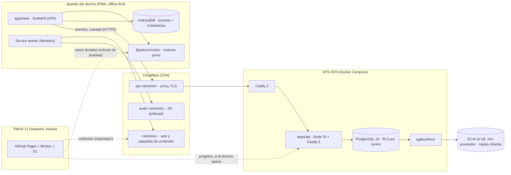
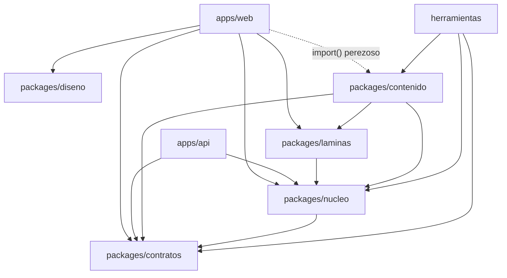
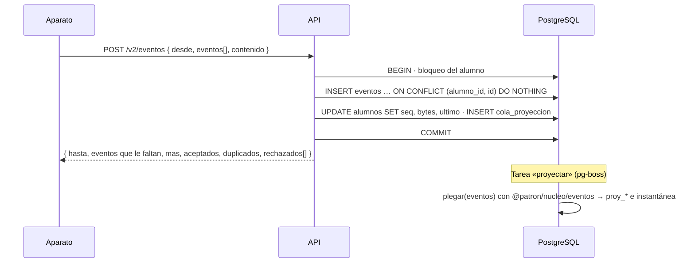
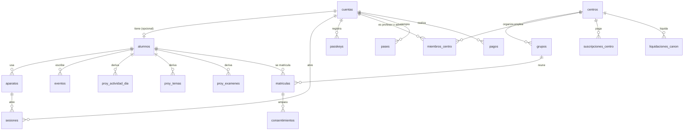
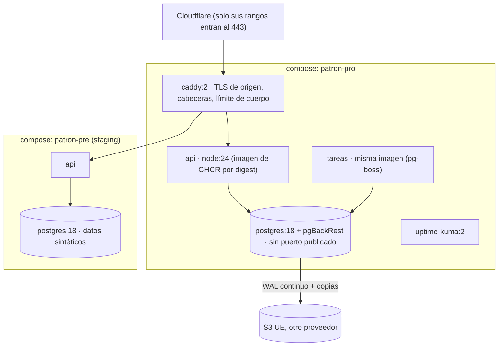
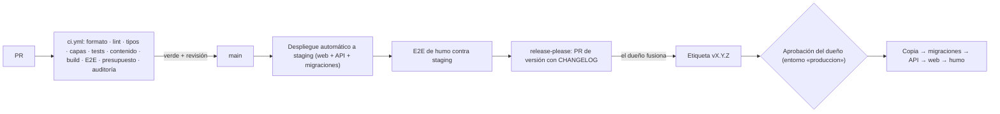

# Arquitectura de «Patrón» 2.0

Diseño del **producto nuevo**: un servicio de preparación de los exámenes náuticos con cuentas, academias y cobro,
construido desde cero. El orden y los plazos están en [`PLAN.md`](PLAN.md); el resumen para el dueño, en
[`RESUMEN.md`](RESUMEN.md); cada decisión, en [`adr/`](adr/). Los ids `E-01`, `S-12`… son hallazgos de la
[auditoría de v1](../auditoria/AUDITORIA.md), que aquí sirven de lista de errores que no repetir.

_17 de noviembre de 2026 (segunda versión: desarrollo nuevo en lugar de migración). Solo diseño: no cambia código._

**Enfoque (decisión del dueño).** Patrón v1 —la app actual en GitHub Pages con su Worker— **ha cumplido como maqueta**:
ha definido el método y lo ha puesto en práctica con el material. Se queda donde está, viva y sin tocar. El producto
nuevo se aloja en otro sitio (otro repositorio, otro dominio, otro servidor), así que **nada de lo que se construya
puede romper v1**. No hay convivencia de código, ni adaptador de vistas antiguas, ni doble escritura, ni congelación
por el examen de marzo.

**Decisiones del dueño que se mantienen:** academias el primer año → PostgreSQL en el VPS con aislamiento entre
centros y roles; alojamiento híbrido (API y base de datos en el VPS de OVH con Docker, web y audio tras una CDN, app
*offline-first*); dominio propio; repositorio propio en GitHub, monorepo.

**Versiones.** Las que se citan son las estables de referencia a noviembre de 2026. Se fijan exactas al crear el
repositorio y las mantiene Renovate; ninguna decisión depende de una versión menor concreta.

## 0. Vista general



Tres propiedades que el diseño garantiza:

1. **El VPS puede caer y la app sigue abriendo y funcionando.** Código, contenido y progreso están en el aparato o en
   la CDN. La API solo hace falta para sincronizar, entrar en la cuenta, el panel del profesor y pagar.
2. **El progreso es un registro de eventos de aprendizaje**; lo demás (estado del alumno, panel del profesor) se
   deriva con el mismo código en el aparato y en el servidor, y se puede reconstruir.
3. **Nada llega a producción sin pasar por CI y por una aprobación**, y nadie —persona, agente o test— tiene a mano una
   credencial que escriba en la base de producción.

### 0.1 Qué se aprovecha de v1 y cómo

| De v1 | Cómo entra en el producto nuevo |
| --- | --- |
| **El contenido** (10.182 preguntas de tres tribunales, explicaciones, clases, conceptos, resoluciones de carta, láminas, pódcast y su audio, reserva y cuarentena) | Es el activo principal. Un **importador repetible** lo lee de v1, lo convierte a los esquemas nuevos y lo valida (§4.2). v1 sigue siendo la fuente del contenido hasta el relevo |
| **Los algoritmos** (náutica, kit de resoluciones, diagnóstico de errores, repaso, «estoy listo», plan, corrección de exámenes) | Unos se **portan tal cual** y se tipan; otros se **reescriben limpios**. En los dos casos v1 es el **oráculo**: se ejecuta sobre todo el banco para generar casos dorados y el código nuevo debe dar lo mismo (§1.3 y §2.3) |
| **Las 2.581 pruebas** | Fuente de casos: las de los módulos portados pasan casi literales a Vitest; las demás se leen como especificación |
| **El método y el diseño** (estilo C, accesibilidad para gente mayor, tres tamaños de letra, actualización que no interrumpe un examen) | Referencia de comportamiento y de aspecto: capturas de v1 y lista de paridad por pantalla |
| **El progreso de los alumnos** | Importación **opcional**, sin prisa: el alumno la pide con su código de v1 o con un fichero de copia (§5.5) |
| **La interfaz, el almacenamiento, el service worker, el Worker y el proceso de publicación** | **No se aprovechan.** Se hacen nuevos |

### 0.2 Qué cambia respecto a la primera versión de este documento

| Tema | Antes (migración) | Ahora (desarrollo nuevo) |
| --- | --- | --- |
| Estrategia | Estrangulamiento con vistas antiguas dentro de la app nueva | Producto nuevo aparte; v1 intacta como maqueta y oráculo |
| Interfaz | Preact (porque `h()` se traducía casi solo) | **SvelteKit**: sin código que traducir, pesa más tener convenciones hechas (§3.1) |
| API | Hono (para portar el Worker) | **Fastify 5**: sin Worker que portar, gana la madurez en Node (§5.1) |
| Sincronización | Mismo contrato de operaciones de v1, aparatos capaces de recomponer el servidor | **Eventos de aprendizaje con contrato nuevo**, pliegue conmutativo, servidor con autoridad e instantáneas (§5.3) |
| Núcleo | Mover y tipar las 54.000 líneas | Portar lo matemático, reescribir el aprendizaje, todo contra casos dorados |
| Pruebas | `node:test` conservado | **Vitest en todo el monorepo** |
| Tipos | `checkJs` de transición | **TypeScript `strict` desde la primera línea** |
| Alumnos de v1 | Mudanza de dominio obligada y doble escritura | Importación opcional del progreso |
| Calendario | Congelación hasta marzo de 2027 | Se empieza ya; nada toca v1 |

## 1. Monorepo

Repositorio nuevo y dedicado (nombre provisional `patron`), **privado** mientras los derechos del contenido sigan sin
aclarar (`docs/PRODUCTO.md` §9). Historial nuevo, sin audio ([ADR 0002](adr/0002-monorepo-pnpm-repositorio-propio.md)).

**Gestor:** pnpm 10 con *workspaces*, `catalog:` para versiones compartidas y `node-linker=isolated`; Node 24 LTS
(`.nvmrc`, `engines`, `packageManager`). Sin Turborepo ni Nx al empezar; se añade caché de tareas si la CI pasa de 10 minutos.

### 1.1 Paquetes

```
patron/
├── apps/
│   ├── web/            @patron/web        PWA: SvelteKit en modo SPA
│   └── api/            @patron/api        Fastify: eventos, cuentas, centros, pagos, avisos, tareas
├── packages/
│   ├── contratos/      @patron/contratos  Esquemas Zod: eventos, API, contenido. Solo depende de zod
│   ├── nucleo/         @patron/nucleo     Motores puros: mates, nautica, carta, ejercicios, analisis, graficos,
│   │                                      examenes, bancos, aprendizaje, eventos
│   ├── laminas/        @patron/laminas    Generadores de SVG de las láminas
│   ├── contenido/      @patron/contenido  Fuentes (JSON, resoluciones en TS) y compilador a paquetes
│   └── diseno/         @patron/diseno     Tokens, tipografías, iconos y componentes base (Svelte)
├── e2e/                @patron/e2e        Playwright: recorridos, accesibilidad, rendimiento
├── herramientas/       @patron/herramientas
│   ├── importar-v1/                       Importador de contenido desde la maqueta
│   ├── oraculo/                           Generador de casos dorados ejecutando v1
│   ├── bancos/                            Tubería de extracción de exámenes oficiales (portada de v1)
│   └── podcast/                           Guiones → audio → R2
├── infra/              Compose, Caddyfile, guiones de despliegue y copias, runbooks
└── docs/               Guía corta, ADR, legal, divergencias respecto a v1
```

### 1.2 Reglas de dependencia



| Regla | Qué impide |
| --- | --- |
| `contratos` no importa ningún paquete propio | Que el contrato dependa de una implementación |
| `nucleo` y `laminas` no usan `document`, `window`, `fetch`, `indexedDB`, `Date.now()` ni `Math.random()` directos: reloj, azar y almacenamiento llegan inyectados | Perder lo que hizo probables los motores de v1 |
| `nucleo` no importa `laminas` ni `contenido` | Las dependencias mutuas que v1 acabó teniendo (E-08) |
| `web` y `api` no se importan entre sí; se hablan por `contratos` | El acoplamiento por ruta relativa de v1 (E-11) |
| `api` no importa `laminas`, `diseno` ni `contenido` | Presentación en el servidor |
| Dentro de `nucleo`: `mates ← nautica ← carta ← ejercicios ← analisis ← graficos`; `bancos`, `examenes` (dominio) `← aprendizaje ← eventos` | Capas completas, no solo el 36 % que cubría la regla de v1 (E-07) |
| Dentro de `web`: solo `src/lib/datos/` toca IndexedDB y solo `src/lib/red/` llama a la API | Estado y efectos repartidos por las pantallas |
| Nada importa de `herramientas/` ni lee el código de v1 en tiempo de ejecución | Que la maqueta se cuele en el producto |

**Vigilancia:** `dependency-cruiser` 17 (falla la CI), `knip` 5 para lo que sobra, y `no-restricted-globals` /
`no-restricted-imports` de ESLint para la pureza del núcleo.

### 1.3 Qué se porta y qué se reescribe

Criterio ([ADR 0018](adr/0018-portar-o-reescribir-con-oraculo.md)): **se porta** lo que es matemática o norma, está
probado al 96–100 % y no depende de cómo se guarda el progreso; **se reescribe** lo que arrastra el modelo de datos de
la maqueta, tiene funciones de complejidad 50–80 o mezcla lógica con interfaz. En ambos casos, contra casos dorados.

| Parte de v1 (líneas aprox.) | Decisión | Cómo |
| --- | --- | --- |
| `math`, `nautical`, `chart` (≈ 2.500) | **Portar tal cual** | Renombrar a `.ts`, tipar, mismas operaciones en el mismo orden: resultados idénticos bit a bit |
| `exercises`, `analysis` —generadores y diagnóstico de errores— (≈ 3.500) | **Portar tal cual** | Igual; dorados por tipo y semilla |
| `exams/kit.js` y pasos (≈ 3.000) | **Portar tal cual** | Es lo que resuelve cada pregunta de carta con la respuesta oficial; conserva su API para que las resoluciones entren sin tocar |
| `exams/solutions` (16.741) | **Portar como contenido** | Conversión mecánica a `.ts` en `contenido/resoluciones/`; dorado: cada pregunta de carta da la respuesta oficial y los mismos pasos |
| `illustrations` (17.101) | **Portar como contenido** | A `@patron/laminas`; dorado: mismo SVG para cada especificación |
| `graphics` (carta en SVG, instrumentos) | **Portar y cubrir** | Solo tenía un 42 % de cobertura: se porta con dorados de SVG y se sube al 80 % |
| Repaso espaciado, «estoy listo», olvido y margen (fórmulas de `course`) | **Portar tal cual** | Son el método; funciones pequeñas y puras |
| Reglas de examen por titulación (`theory/blocks`), reserva y equivalentes (`bancos`) | **Portar tal cual** | Son normas; conservan sus pruebas |
| `course`: `planHoy`, `estadoAlumno`, examen final, ruta, semana, travesía, cuaderno y dosis (≈ 7.500) | **Reescribir** | Sobre el estado nuevo del alumno, en funciones pequeñas; dorados: miles de estados × fechas → misma salida que v1 |
| `theory`: simulacros, sesión de test, corrección | **Reescribir** | La lógica que v1 tenía dentro de las vistas (C-03) nace en el núcleo; dorado: hojas de respuestas → misma nota |
| `store/sync`: operaciones, `plegar` (complejidad 83), fusión de bases | **Reescribir** | Contrato de eventos nuevo y pliegue conmutativo (§5.3); dorado: secuencias de v1 convertidas → mismo progreso |
| `ui/`, `styles/`, `store/` local, `sw.js`, `sync-worker/` | **Nuevo** | v1 sirve de referencia visual y de comportamiento |
| `tools/bancos` (extracción de PDF, 8 etapas, Python) | **Portar tal cual** | Funciona; solo cambia la última etapa (escribe el esquema nuevo) |
| `ai/` (`window.nautica`), voz del «profe», modo profesor por fichero, copia en fichero, QR | **No se lleva** | Lo sustituyen cuentas, panel del profesor y exportación; la voz se reconsidera después del lanzamiento |

Las diferencias deliberadas respecto a v1 (mejoras, correcciones) se apuntan una a una en `docs/divergencias-v1.md`
con su motivo; un dorado que no coincide y no está ahí es un fallo.

## 2. Lenguaje y calidad

### 2.1 Herramientas

| Herramienta | Versión | Uso |
| --- | --- | --- |
| TypeScript | 5.9 (o la 6.x estable al empezar) | **`strict` en todos los paquetes desde la primera línea**, con `noUncheckedIndexedAccess`, `exactOptionalPropertyTypes`, `verbatimModuleSyntax`. Sin JavaScript en `src/` |
| ESLint | 9 (*flat config*) + `typescript-eslint` 8 + `eslint-plugin-svelte` 3 | Reglas con tipos; `complexity` ≤ 15 y `max-lines-per-function` ≤ 80 como **error**; `no-empty` |
| `svelte-check` | 4 | Tipos y accesibilidad en plantillas |
| Prettier | 3 + `prettier-plugin-svelte` | Formato único, ancho 110, `.editorconfig` |
| Vitest | 4 | **Un solo ejecutor en todo el monorepo**: núcleo, contratos, contenido, API (con PostgreSQL efímero) y componentes (`@testing-library/svelte`, modo navegador) |
| `fast-check` | 4 | Pruebas de propiedad (pliegue, proyecciones, aislamiento) |
| Playwright | 1.5x + `@axe-core/playwright` 4.10 | `e2e`: recorridos, accesibilidad, rendimiento |
| Stylelint | 16 | Prohíbe colores y tamaños literales fuera de los tokens |
| `squawk` | 2 | Lint de migraciones SQL |
| gitleaks | 8 | Secretos en cada PR |
| Renovate | — | Dependencias e imágenes, PR agrupadas semanales |

[ADR 0003](adr/0003-typescript-estricto-por-paquetes.md). Al portar pruebas de v1, `node:assert` sigue valiendo dentro
de Vitest: solo cambia la importación de `test`.

### 2.2 Cobertura mínima y convenciones

Cobertura con todos los ficheros contados (umbral que falla la CI):

| Paquete | Líneas | Ramas | Nota |
| --- | ---: | ---: | --- |
| `nucleo` | 95 % | 90 % | `eventos` y `aprendizaje/repaso`: 100 % / 95 % |
| `contratos` | 95 % | 90 % | |
| `laminas` | 90 % | — | Más los dorados de SVG |
| `contenido` (compilador) | 85 % | — | Más las pruebas de contrato de datos, que no cuentan como cobertura |
| `api` | 85 % | 80 % | Más la batería de aislamiento entre centros, obligatoria |
| `web` | 70 % | — | La lógica vive en `nucleo`; los recorridos los cubre `e2e` |
| `diseno` | 80 % | — | Cada componente con su prueba de accesibilidad |
| `herramientas` | 60 % | — | El importador de v1: 85 % |

Convenciones:

- **Todo en español** en dominio, tipos, tablas y rutas (`Pregunta`, `plegar`, `matriculas`, `/v2/centros`). Los
  módulos portados conservan los nombres de sus funciones para que las resoluciones entren sin tocar.
- Ficheros en `kebab-case`; componentes `PascalCase.svelte` con su prueba al lado.
- **Sin estado en variables de módulo**: todo estado cuelga del contenedor que crea `crearApp(...)`.
- **Sin lógica de negocio en componentes**: un componente llama a una función del núcleo y pinta su resultado.
- Un único camino para errores esperados (`esperado(e, 'almacen-lleno')`), que deja rastro contable.
- Conventional Commits (`commitlint` 19): de ahí salen versión y CHANGELOG.
- Cada decisión nueva, un ADR de una página; guía de arquitectura de menos de 300 líneas.

### 2.3 v1 como oráculo: casos dorados

`herramientas/oraculo/` ejecuta la maqueta —fijada a un commit concreto de su repositorio, de solo lectura— y escribe
ficheros de casos (`dorados/*.jsonl`, comprimidos; en el repositorio si pesan poco, en R2 por *hash* si no). Las
pruebas del producto nuevo los leen. v1 **no es dependencia de ejecución ni de CI**: los dorados se regeneran a mano
cuando cambia el commit de referencia.

| Juego de casos | Entrada | Debe coincidir |
| --- | --- | --- |
| Carta | Todas las preguntas de carta de todos los bancos | Respuesta oficial, valor de cada paso y avisos, exactos |
| Ejercicios | Cada tipo × 500 semillas | Enunciado, solución y diagnóstico de 10 respuestas erróneas por caso, exactos |
| Náutica y mates | Rejillas de entradas y casos límite (180°, hemisferio sur, polos) | Bit a bit |
| Corrección | Cada convocatoria × 50 hojas de respuestas generadas | Nota, apto por materia, preguntas anuladas |
| Repaso y preparación | 5.000 historiales al azar | Próximo repaso por pregunta y «estoy listo» (tolerancia 1e-9) |
| Plan de «Hoy» | 2.000 estados × 5 fechas | Misma lista de tareas en el mismo orden |
| Reserva y cuarentena | Cada eje, titulación y foto de reserva | Mismos conjuntos de estudio, examen y final |
| Láminas y carta en SVG | Todas las especificaciones | Mismo SVG tras normalizar espacios |
| Progreso | 2.000 secuencias de operaciones de v1 | El progreso que da v1 ≡ el del pliegue nuevo tras importarlas (§5.5) |

Para lo portado la igualdad es exacta. Para lo reescrito, la prueba adapta el estado nuevo a la forma de v1 solo
dentro del arnés. Los juegos lentos van en un trabajo de CI aparte y solo cuando cambian `nucleo` o `contenido`.

## 3. Cliente

### 3.1 Framework: SvelteKit

**Decisión: Svelte 5 con SvelteKit 2 en modo SPA** (`adapter-static`, sin renderizado en servidor para la app).
([ADR 0004](adr/0004-sveltekit-spa.md))

En la versión anterior ganaba Preact por una sola razón: el auxiliar `h()` de v1 se traducía casi solo y las vistas
antiguas podían convivir con las nuevas. **Al no haber nada que traducir ni con qué convivir, ese criterio desaparece**
y pasa a pesar qué deja menos decisiones propias que mantener a una persona que dirige agentes.

| Criterio (desarrollo nuevo) | SvelteKit (Svelte 5) | Preact + Vite | Solid |
| --- | --- | --- | --- |
| Convenciones hechas: rutas por ficheros con carga perezosa, diseños anidados, límites de error, carga de datos | De serie | Hay que elegir y montar enrutador, estado y carga perezosa | SolidStart, menos maduro |
| CSS con ámbito por componente (v1 acabó con 1.425 clases en un fichero) | De serie | CSS Modules | CSS Modules |
| Accesibilidad | Avisos del compilador en cada plantilla; primitivas sin estilo (`bits-ui` 2) | `eslint-plugin-jsx-a11y`; primitivas de React con capa de compatibilidad | Pocas |
| Peso | *Runtime* pequeño; muy por debajo del presupuesto de 200 KB | ≈ 6 KB de base | ≈ 7 KB |
| Páginas públicas (portada, precios, privacidad, alta de centros) | **Prerenderizadas en la misma app**: se indexan y abren sin JavaScript | Haría falta otra herramienta | Posible |
| Que lo escriban bien los agentes y lo lea cualquier desarrollador | Bien; hay que vigilar que no mezclen sintaxis de Svelte 4 (lo caza `svelte-check`) | Muy bien (modelo de React) | Regular |
| Riesgo de plataforma | Proyecto asentado y con respaldo; modelo estable desde la versión 5 | Muy bajo | Comunidad pequeña |

**Cómo se valida sin frenar:** la primera fase incluye una **rebanada vertical** (una tanda de preguntas completa:
contenido real, núcleo, IndexedDB, sincronización contra la API, service worker, desplegada en *staging*). Si en esa
rebanada los agentes necesitan más de dos rondas de corrección por componente o `svelte-check` no deja el código
limpio, se cambia a Preact + Vite: núcleo, contratos, contenido y API no dependen del framework.

### 3.2 Estructura, rutas y estado

- **Vite 7** bajo SvelteKit. `ssr = false` en la zona de la app (`/app/*`); **prerenderizado** en la zona pública
  (`/`, `/precios`, `/centros`, `/privacidad`, `/aviso-legal`).
- **Rutas por ficheros**, limpias (`/app/hoy`, `/app/per/andalucia/tema/3`, `/profesor/grupos/…`), cada una en su
  trozo. La CDN devuelve el `index.html` de la app para cualquier ruta bajo `/app` y `/profesor`.
- Los *tokens* de un solo uso (enlace mágico, unir aparato) viajan en el **fragmento** (`/entrar#…`), que no llega a
  ningún registro de servidor.
- **Estado:** *runes* de Svelte 5 en módulos `.svelte.ts`. `crearApp({ almacen, reloj, azar, red, contenido })`
  construye el contenedor (sesión, estado plegado del alumno, titulación y tribunal activos, ajustes) y lo ofrece por
  contexto. Las pantallas leen valores derivados que llaman al núcleo.
- **Tres zonas con la misma base:** alumno (`/app`), profesor (`/profesor`) y pública. El panel del profesor no es
  *offline-first*: necesita red y se carga aparte, sin engordar la app del alumno.
- **Errores:** límite de error por ruta con «Volver a Hoy», más `error` y `unhandledrejection` globales a la cola de
  errores (§8.2). Nunca se enseña una traza.
- **Textos** en módulos por pantalla (no incrustados en el marcado), para poder revisarlos y, si un día hace falta,
  traducirlos; sin librería de traducción por ahora.

### 3.3 PWA

`@vite-pwa/sveltekit` 1.x en modo **`injectManifest`** con Workbox 7
([ADR 0005](adr/0005-pwa-workbox-precache-generado.md)). El service worker es código propio en TypeScript y **la lista
de precarga la genera la *build***; nadie la toca a mano.

| Qué | Estrategia |
| --- | --- |
| Carcasa de la app del alumno (todas sus rutas, tipografías, iconos) | Precarga con revisión por *hash* (≈ 1 MB gzip): cualquier pantalla abre sin red |
| Paquetes de contenido del tribunal y titulación elegidos | Descarga en segundo plano tras elegirlos, a una caché `contenido-<versión>` (`CacheFirst`; inmutables por *hash*). El alumno ve «Listo para usar sin conexión» |
| Otros tribunales y titulaciones | Bajo demanda |
| Audio (`audio.<dominio>`) | Nunca en precarga. `CacheFirst` con `workbox-range-requests`, solo lo que el alumno escucha o descarga; tope de 300 MB |
| Panel del profesor y páginas públicas | Sin precarga; red primero |
| API | `NetworkOnly`. La cola sin conexión son los eventos pendientes en IndexedDB, no una cola del service worker |

- **Actualización:** se conserva lo que v1 hace bien: la versión nueva espera, se ofrece con un aviso y **nunca se
  aplica a mitad de un examen**.
- **Interruptor de emergencia** (service worker que se desinstala y `Clear-Site-Data`) preparado y ensayado en *staging*.
- **Push** (recordatorio diario) con VAPID propio del producto nuevo; no se comparte nada con v1.

### 3.4 Almacenamiento local: IndexedDB

Una base `patron` con esquema versionado, tocada solo desde `apps/web/src/lib/datos/` con `idb` 8
([ADR 0006](adr/0006-indexeddb-eventos-e-instantanea.md)).

| Almacén | Clave | Contenido |
| --- | --- | --- |
| `eventos` | `id`; índices `estado` (`pendiente` \| `confirmado`) y `seq` | Una fila por evento. Responder una pregunta es un `put` |
| `instantanea` | `actual` | Estado plegado hasta un `seq` confirmado por el servidor |
| `meta` | nombre | Aparato, contador, cursor, versión del pliegue |
| `local` | nombre | Lo que no viaja: ajustes del aparato, examen a medias, borradores |
| `carta-usuario` | — | La carta escaneada por el alumno; nunca sale del aparato |
| `errores` | autoincremental | Cola de errores, sin datos personales |

- **Lectura en memoria, escritura asíncrona.** Al arrancar: `instantanea` + eventos posteriores → estado. Cada
  respuesta aplica el evento al estado en memoria y encola un `put`; se fuerza el volcado en `visibilitychange` y `pagehide`.
- **Compactación resuelta desde el diseño:** cuando el aparato acumula más de 2.000 eventos confirmados, pide la
  instantánea del servidor (§5.3), la guarda y borra los eventos que cubre. El registro local no crece sin límite.
- **Pestañas:** `BroadcastChannel` para avisar de eventos nuevos y `navigator.locks` para que solo una sincronice.
- **Persistencia:** `navigator.storage.persist()`; `estimate()` en el diagnóstico.
- **Sin `localStorage`** salvo la preferencia de tema, que debe leerse antes de pintar.

Se descartó SQLite en el navegador (WebAssembly sobre OPFS): permitiría consultas locales, pero añade ≈ 400 KB, un
*worker* obligatorio y comportamiento desigual en WebKit, para un volumen (miles de eventos, un banco de 2–4 MB) que
cabe en memoria.

### 3.5 Diseño, temas y accesibilidad

- **El estilo C de la maqueta es la referencia visual**: carta náutica, modo noche de puente, tipografías propias. Se
  reconstruye como sistema: `packages/diseno/src/tokens.ts` es la fuente única (color, tipografía, espacio, radios,
  movimiento) y la *build* genera el CSS para claro, oscuro y automático; los dos bloques oscuros no pueden divergir.
- **CSS con ámbito** en cada componente; Stylelint prohíbe colores y tamaños literales. No existe una hoja global más
  allá de tokens y *reset*.
- **Componentes base** en `diseno` (`Boton`, `Tarjeta`, `Dialogo`, `Pestanas`, `Aviso`, `Campo`, `Opcion`) sobre
  primitivas accesibles, con foco, roles y teclado resueltos una vez. Catálogo navegable para revisarlos en claro,
  oscuro y los tres tamaños de letra.
- **Accesibilidad como puerta de CI:** axe en todos los E2E (0 infracciones WCAG 2.2 AA), objetivos táctiles ≥ 44 px
  medidos en Playwright, `prefers-reduced-motion`, tres tamaños de letra, contraste comprobado sobre los tokens, y
  pasada manual con VoiceOver y TalkBack antes de dar por buena cada pantalla.
- **`<Svg>`**: único componente que inserta marcado; solo acepta el tipo `SvgSeguro` que producen `laminas` y
  `nucleo/graficos`. Con *Trusted Types* en la CSP, cualquier otra inserción falla en el navegador.
- **Paridad con v1:** `docs/paridad.md` lista, pantalla a pantalla, qué hace la maqueta y qué hace el producto nuevo
  (igual, mejor, aplazado, descartado), con capturas de v1 a 360 y 990 px en claro y oscuro como referencia.

## 4. Contenido

[ADR 0007](adr/0007-contenido-git-esquema-zod-paquetes.md). El contenido vive **en git, revisado por PR**, con esquema
formal, y se compila a paquetes que el cliente carga bajo demanda. Ninguna base de datos ni CMS.

### 4.1 Fuentes y esquema

```
packages/contenido/
├── fuentes/
│   ├── ejes/<eje>/eje.json                              ficha del tribunal (incluye la reserva)
│   ├── ejes/<eje>/<tit>/convocatorias/<conv>.json       preguntas de una convocatoria — GENERADO por la tubería
│   ├── ejes/<eje>/<tit>/explicaciones/<conv>.json       explicaciones — a mano
│   ├── ejes/<eje>/<tit>/{practica,resueltos,conceptos}.json
│   ├── ejes/<eje>/img/
│   ├── curso/<tit>/leccion-<id>.json, curso/<tit>/ruta.json
│   ├── comun/, conceptos/, mapas/, normativa.json
│   ├── podcast/episodios.json, podcast/<tit>/*.md        índice y guiones (el audio, en R2)
│   └── carta/carta-105.json
├── resoluciones/<eje>-<tit>/*.ts                         resoluciones programadas de carta
├── src/compilar.ts
└── dist/                                                 NO versionado
```

- **Un fichero por convocatoria** (en v1 era un fichero de 2–4 MB por banco): los cambios se revisan en un PR legible
  y la reserva, que es por convocatoria, se corresponde con ficheros.
- **Esquema:** Zod 4 en `@patron/contratos/contenido`: `Pregunta` (los ≈ 25 campos de `docs/BANCOS.md` de v1, con
  nombres normalizados), `Convocatoria`, `FichaEje`, `Explicacion`, `Leccion`, `Tarjeta`, `Ruta`, `Concepto`,
  `EspecLamina`, `Episodio`. De ahí salen los tipos (`z.infer`) y los JSON Schema para el editor (`z.toJSONSchema()`).
- **Generado frente a escrito a mano:** lo que sale de la tubería de bancos lleva su huella y un test falla si se
  edita a mano.
- **Estados editoriales** por pieza: `borrador` → `verificado` → `publicado`, con `fuente` y fecha de verificación
  obligatorias para publicar. El compilador solo empaqueta `publicado`.
- **Identificadores estables:** **se conservan los ids de v1** (`and-2022-c2-t05`…): de ellos dependen la reserva, la
  cuarentena y la importación del progreso. Un id publicado no se reutiliza ni se renombra; la CI lo compara con la
  última versión publicada.

### 4.2 Importación desde v1

`pnpm importar-v1 --desde <ruta al repositorio de v1> --commit <hash>` ([ADR 0007](adr/0007-contenido-git-esquema-zod-paquetes.md)):

1. Lee `data/`, `src/exams/solutions/`, `src/illustrations/` y `podcast/` del commit indicado.
2. Convierte a los esquemas nuevos (parte el banco por convocatoria, normaliza campos, convierte resoluciones y
   láminas a `.ts` de forma mecánica) y **valida todo con Zod**: lo que no valida se lista y no entra.
3. Sube el audio a R2 por *hash* y escribe `episodios.json`.
4. Escribe un informe (`importacion.md`): recuentos por tribunal y titulación frente a v1, piezas rechazadas, huellas.
5. Es **repetible e idempotente**: volver a ejecutarlo con un commit más nuevo de v1 trae solo las diferencias.

**Quién manda sobre el contenido:** hasta el **relevo**, v1 (ahí sigue trabajando el dueño y ahí estudian sus
alumnos); en el producto nuevo no se edita contenido a mano, solo se reimporta. En el relevo —que se fija al lanzar
el producto para particulares— se hace la última importación y el contenido pasa a mantenerse solo en el repositorio nuevo.

Criterio de aceptación de la importación: 10.182 preguntas (o las que tenga v1 ese día) con 0 rechazadas; cada
pregunta de carta se resuelve con el kit portado y da la respuesta oficial; reserva y cuarentena sin citas nuevas.

### 4.3 Compilación a paquetes

`pnpm --filter @patron/contenido compilar` escribe, con nombre por *hash*:

| Paquete | Contenido | Cuándo se carga |
| --- | --- | --- |
| `indice.<hash>.json` | Tribunales, titulaciones, versión y *hash* de cada paquete | Arranque (unos KB) |
| `<eje>/<tit>/indice.<hash>.json` | Por pregunta: id, tema, convocatoria, concepto, marcas (≈ 60 bytes) | Al elegir banco. Es lo que necesitan el plan y «Hoy»: decenas de KB (v1 analizaba 2,2 MB) |
| `<eje>/<tit>/tema-<nn>.<hash>.json` | Preguntas del estudio de ese tema | Al estudiarlo; en segundo plano tras elegir banco |
| `<eje>/<tit>/expl-<nn>.<hash>.json` | Explicaciones del tema | Al corregir |
| `<eje>/<tit>/conv-<clave>.<hash>.json` | **Una convocatoria que es o ha sido reserva**, entera y aparte | Solo según la reserva del alumno (§4.4) |
| `curso/<tit>/…` | Ruta y clases | Ruta al arrancar; clase al abrirla |
| Trozos JS de resoluciones y láminas | Código | `import()` por banco o por lámina |

Cada banco lleva **versión semántica** (`mayor`: cambia la reserva o se retiran preguntas; `menor`: convocatoria
nueva; `parche`: correcciones). Los eventos de examen guardan la versión del banco con que se hicieron.

### 4.4 Cuarentena y reserva por tribunal

Son principios del proyecto y se mantienen íntegros (`docs/CUARENTENA.md` y `docs/BANCOS.md` de v1):

- **Regla:** ningún contenido cita una pregunta reservada para el examen final, ni por id ni por enunciado casi
  literal. La herramienta de cuarentena de v1 se porta y es puerta de CI, sobre las fuentes **y** sobre los paquetes compilados.
- **Separación física:** las convocatorias que son o han sido reserva se empaquetan aparte (`conv-*`). El estudio del
  alumno = paquetes de tema ∪ los `conv-*` que no están en su reserva. Una reservada no está ni en el aparato antes del examen final.
- **Reserva por alumno:** la primera vez que un alumno abre un banco se le fija la foto de la reserva vigente (un
  evento `reserva_fijada`, que gana siempre el primero). Su examen final sale de esa foto aunque la ficha cambie después.
- **Bancos independientes:** un paquete nunca mezcla tribunales; una explicación solo cita el criterio de su banco.
- **Deuda del audio:** los episodios ya grabados que leen una reservada se importan con su lista de deuda y su
  trinquete (no puede crecer); la app avisa antes de escucharlos, como en v1.

### 4.5 Audio

Los 62 MP3 (304 MB) nunca entran en git: viven en R2, servidos en `audio.<dominio>` con nombre por *hash*. En git,
`episodios.json` (con *hash* y duración), los guiones y la herramienta para generarlos y subirlos. Un test comprueba
que cada episodio del índice existe en R2.

### 4.6 Cuándo hará falta un editor para academias

No en esta arquitectura. Lo que una academia necesita primero **no es editar el curso**, sino configurar su grupo:
fecha de convocatoria, plan, temas destacados y listas de preguntas elegidas del banco. Eso son **datos de servidor**
(`config_grupo`, §6) con un formulario en el panel del profesor.

Un editor de contenido de verdad (preguntas o clases propias de un centro) se construye **solo si** se cumple una de
estas: tres o más centros lo piden y pagarían por ello; entra en el equipo alguien que edita contenido y no usa git;
o las correcciones propuestas por profesores superan las ~20 al mes. Entonces el contenido de centro viviría en
Postgres con su `centro_id` y el mismo esquema Zod, sin mezclarse con el contenido común.

## 5. API

### 5.1 Stack y contratos

**Node 24 LTS + Fastify 5** ([ADR 0008](adr/0008-api-node-fastify-contratos-zod.md)). La versión anterior elegía Hono
para portar el Worker de v1 casi sin tocarlo; sin Worker que portar, se elige el servidor más asentado en Node, con
validación por esquema, registros `pino`, límites de tasa, cabeceras y WebSocket (para el aula futura) como piezas
oficiales.

- **Contratos:** `@patron/contratos/api` define con Zod 4 petición y respuesta de cada ruta. La API los usa con
  `fastify-type-provider-zod` (valida la entrada **y la salida**); el cliente usa un `fetch` tipado derivado de los
  mismos esquemas. Se publica un OpenAPI 3.1 generado (`@fastify/swagger`) como documentación.
- **Prefijo `/v2`** en todas las rutas (por el producto; el Worker de la maqueta usa `/v1`, así nunca se confunden en
  registros ni en conversaciones). Los cambios incompatibles del contrato de eventos van por el campo `v` del evento.
- **Acceso a datos:** `pg` 8 + **Kysely** 0.28 con tipos generados de la base real (`kysely-codegen`). Sin ORM.
  Consultas siempre parametrizadas.
- **Estructura:** `rutas/` (HTTP) → `casos/` (lógica) → `db/` (consultas). Solo `db/contexto.ts` importa `pg`, porque
  es quien fija el contexto de seguridad por filas (§6.2).
- **Tareas programadas** (proyecciones, instantáneas, recordatorio diario, retención, liquidación del canon): un
  segundo proceso de la misma imagen con `pg-boss` 10 sobre el mismo Postgres. Sin Redis.

### 5.2 Autenticación e identidad

[ADR 0011](adr/0011-identidad-cuenta-opcional-enlace-magico-passkeys.md).

| Concepto | Qué es |
| --- | --- |
| **Alumno** | El sujeto del progreso (un registro de eventos). Existe sin cuenta |
| **Aparato** | Un navegador o instalación unido a un alumno. Tiene nombre y se puede revocar |
| **Sesión** | Credencial de un aparato: *token* opaco de 256 bits; en el servidor, solo su SHA-256. Revocable. Caduca a los 180 días sin uso |
| **Cuenta** | Correo verificado. Opcional para el alumno; obligatoria para profesores, administradores de centro y para pagar |
| **Código para unir** | Enlace de **un solo uso** y 10 minutos para añadir un aparato. No es una credencial permanente, como lo era el código de v1 |

- **Sin cuenta (por defecto):** al primer evento que subir, el aparato pide `POST /v2/aparatos` y recibe su sesión.
  Nada que recordar.
- **Unir otro aparato:** «Mis dispositivos → Añadir» pide `POST /v2/vinculos` → código de 12 símbolos, también como QR
  con `https://<dominio>/unir#<código>`. El aparato nuevo lo canjea por su propia sesión.
- **Cuenta con enlace mágico:** `POST /v2/cuentas/enlace { correo }` → enlace de 15 minutos y un solo uso. Respuesta
  idéntica exista o no la cuenta. Al entrar, la cuenta se asocia al alumno del aparato; si ya tenía otro, los dos
  registros de eventos se unen (el pliegue es conmutativo: unir es sumar eventos).
- **Passkeys después** (WebAuthn, `@simplewebauthn/server` 13): se ofrecen a quien ya tiene cuenta; el enlace mágico
  queda como recuperación. Sin contraseñas en ningún momento.
- **Alumno de academia:** entra con el **código de centro** del grupo, sin cuenta ni contraseña (`PRODUCTO.md` §6):
  `POST /v2/matriculas { codigo }` crea su matrícula y le enseña la pantalla de consentimiento (§6.4).
- **Sesiones:** cookie `__Host-sesion` (`HttpOnly`, `Secure`, `SameSite=Lax`) de `api.<dominio>`, mismo sitio que la
  web. Defensa CSRF: `SameSite`, comprobación de `Origin` y solo `application/json`.
- **Roles:** `alumno`, `profesor` y `admin_centro` (por centro) y `admin_servicio` (el dueño, con passkey
  obligatoria). El rol efectivo lo fija el servidor a partir de la sesión.

Se valoró una librería de autenticación completa: encaja mal con «alumno sin cuenta con varios aparatos» y con el
modelo de centros con seguridad por filas, y lo que hay que escribir son pocas rutas bien acotadas. Se revisa en la
rebanada vertical; las partes criptográficas (WebAuthn) sí van con librería.

### 5.3 Sincronización: eventos de aprendizaje y proyecciones

[ADR 0010](adr/0010-eventos-de-aprendizaje-y-proyecciones.md). Con desarrollo nuevo se revisaron las alternativas:

| Opción | Veredicto |
| --- | --- |
| **Registro de eventos + pliegue determinista** (la idea de v1) | **Se mantiene la idea, se rehace el contrato.** El progreso de un alumno *es* una lista de hechos («respondió X a las 10:02»): un solo escritor por alumno, solo se añade, y de los hechos sale todo |
| Motor de sincronización Postgres ↔ SQLite local (PowerSync, ElectricSQL, Zero) | Añade un servicio más que operar y una dependencia central para un problema más simple que el que resuelven (varios escritores sobre las mismas filas) |
| CRDT genérico (Yjs, Automerge) | Documentos opacos en el servidor: impediría las consultas del panel del profesor |
| Estado con «gana el último» | Pierde intentos al usar dos aparatos; es lo que v1 tuvo que abandonar |

Lo que **cambia** respecto a v1:

- **Contrato nuevo y tipado** (`@patron/contratos/eventos`, unión discriminada con versión): `respuesta`,
  `intento_ejercicio`, `actividad`, `leccion_vista`, `examen_hecho`, `ajuste` (solo los compartidos), `reserva_fijada`,
  `insignia`, `correccion_tema`, `fallo_cuaderno`, `convocatoria_alumno`, `importado_v1`. Sin claves metidas en
  `settings` para no redesplegar (E-12).
- **Evento:** `{ id (UUIDv7), tipo, v, t (ms), aparato, n (contador del aparato), …datos }`. El servidor asigna `seq`
  por alumno al recibirlo y lo valida con el mismo esquema que el cliente.
- **Pliegue conmutativo.** El estado del alumno se diseña para que el orden de llegada no importe: sumas (veces,
  minutos), máximos (rango), uniones (insignias, exámenes), «gana el más reciente por (t, aparato, n)» (ajustes,
  clases) y «gana el primero» (reserva). La única parte que depende del orden —el repaso espaciado de cada pregunta—
  guarda sus últimas 20 respuestas y se recalcula al insertar una tardía. Así `aplicar(instantánea, eventos nuevos)`
  da siempre lo mismo que plegar todo, y unir dos alumnos es sumar sus eventos.
- **El servidor tiene autoridad sobre lo sincronizado.** Con copias y recuperación a un punto en el tiempo (§8), deja
  de hacer falta que cada aparato guarde el historial entero para recomponer el servidor, como en v1. El aparato solo
  es fuente de verdad de lo que aún no ha subido.
- **Instantáneas:** una tarea guarda por alumno el estado plegado hasta un `seq` y la versión del pliegue. Sirven a un
  aparato nuevo (baja instantánea + cola, no todo el historial) y a la compactación local (§3.4).



- **Proyecciones** (`proy_*`): las calcula el servidor **con el mismo pliegue que el cliente**, no con SQL que lo
  imite. Son desechables: una orden las reconstruye desde `eventos`. Prueba de propiedad: `proyección ≡ plegar(eventos)`.
- **Topes:** 256 KB por petición, 500 eventos por lote, 200.000 eventos y 20 MB por alumno, y alerta si la base crece
  más de un 20 % en una semana.
- **Cuándo sincroniza** (como v1, que acertó): al abrir, al volver la red o el primer plano, cada pocos minutos con
  la app visible y unos segundos después de cada escritura. Nunca bloquea la interfaz.

### 5.4 Límites de tasa y registros

- **Límites** con `@fastify/rate-limit` en memoria (un solo proceso; sin Redis). Clave: sesión o, sin ella, IP tomada
  de `CF-Connecting-IP` (solo se confía en ella si la conexión viene de Cloudflare).

| Ruta | Límite |
| --- | --- |
| Cualquiera, por IP | 120/min |
| `/v2/eventos`, por alumno | 60/min |
| `/v2/cuentas/enlace` | 3/h por correo y 10/h por IP |
| `/v2/vinculos/canjear`, `/v2/matriculas` (códigos) | 10 fallos/h por IP; el código se invalida al 5.º fallo |
| `/v2/aparatos` (altas) | 20/día por IP |
| `/v2/importar-v1` | 3/día por alumno |
| `/v2/errores` | 20/h por aparato |

  Además, una regla de límite de Cloudflare delante de `/v2/cuentas/*` como segunda barrera.
- **Registros estructurados sin datos personales** (`pino`, JSON a la salida estándar): método, ruta *plantilla*
  (`/v2/centros/:id`, nunca la URL real), estado, duración, id de petición, id interno de alumno o cuenta **solo en
  errores**. Se redactan `authorization`, `cookie`, `set-cookie` y cualquier campo `correo` o `codigo`; no se registran
  cuerpos. La IP no se guarda: para abuso, un HMAC con una sal que rota cada día. Retención: 30 días.
- **CORS:** solo `https://<dominio>` (y el de *staging* en *staging*); `localhost` solo en desarrollo.

### 5.5 Importación opcional del progreso de v1

[ADR 0013](adr/0013-importacion-opcional-del-progreso-de-v1.md). Sin prisa y sin dependencia: v1 sigue funcionando
para quien no quiera moverse. En el producto nuevo, «Ajustes → Traer mi progreso de Patrón (versión anterior)»:

| Vía | Cómo funciona | Qué exige de v1 |
| --- | --- | --- |
| **Por código** | El alumno escribe su código de v1. El **servidor** nuevo llama al Worker de v1 por su API pública (`POST /v1/sync` con `ops: []` y cursor 0, paginando) y recibe sus operaciones. Es una lectura: no escribe progreso en v1 | Nada: ni cambios ni despliegues |
| **Por fichero** | El alumno pulsa en v1 «Guardar una copia» (ya existe) y sube el fichero | Nada |

- **Conversión** en `@patron/nucleo/eventos/desde-v1`: cada respuesta de v1 (`r`) pasa a un evento `respuesta` con su
  fecha original; ejercicios, minutos, clases, insignias y exámenes, a su tipo; las «bases» de v1 y lo que no tiene
  equivalente fino, a un evento `importado_v1` con el resumen. Los ids se derivan del id de v1, así que **importar dos
  veces no duplica** y se puede repetir más adelante para traer lo estudiado después.
- **Lo que no viaja:** ajustes del aparato, examen a medias, bloc y la carta escaneada (se vuelve a importar).
- **Garantía:** el juego de dorados «Progreso» (§2.3) comprueba que lo que v1 daba por plegado coincide con lo que da
  el producto nuevo tras importar.
- **Privacidad:** el código de v1 se usa en esa petición y no se guarda; la importación queda apuntada en
  `importaciones_v1` (cuándo, cuántos eventos, huella), sin el código.
- Los ids de pregunta son los mismos en los dos productos (§4.1): por eso el progreso encaja.

## 6. Datos: PostgreSQL

**PostgreSQL 18** en Docker en el VPS ([ADR 0009](adr/0009-postgresql-rls-por-centro.md)). Identificadores `uuid`
generados con `uuidv7()` (ordenables por tiempo; nativo en 18). Fechas en `timestamptz`. Correos en `citext`.

### 6.1 Modelo



| Tabla | Columnas principales | Notas |
| --- | --- | --- |
| `alumnos` | `id`, `cuenta_id?` (único), `creado`, `ultimo`, `seq`, `bytes`, `borrado_en?` | Sujeto del progreso. Seudónimo: sin nombre ni correo |
| `cuentas` | `id`, `correo` (citext, único), `verificado_en`, `creado`, `borrado_en?` | Lo mínimo: ni nombre ni teléfono |
| `passkeys` | `id`, `cuenta_id`, `credencial_id` (único), `clave_publica`, `contador`, `transportes`, `creada`, `usada` | |
| `enlaces_magicos` | `token_hash` (PK), `correo`, `proposito`, `caduca`, `usado_en?` | Un solo uso; se purgan a las 24 h |
| `aparatos` | `id`, `alumno_id`, `dev` (id del aparato en los eventos), `nombre?`, `creado`, `visto`, `revocado_en?` | |
| `sesiones` | `id`, `token_hash` (único), `aparato_id`, `cuenta_id?`, `creada`, `usada`, `caduca`, `revocada_en?` | Sin IP ni agente de usuario en claro |
| `vinculos` | `token_hash` (PK), `alumno_id`, `caduca`, `usado_en?`, `fallos` | El «código» de 10 minutos |
| `eventos` | `alumno_id`, `seq`, `id` (UUIDv7 del evento), `tipo`, `v`, `t`, `aparato_id`, `datos` (jsonb), `recibido` | PK `(alumno_id, seq)`; única `(alumno_id, id)`. Solo inserción |
| `instantaneas` | `alumno_id` (PK), `seq`, `base` (jsonb), `creada` | Base plegada para aparatos nuevos |
| `proy_actividad_dia` | `alumno_id`, `dia`, `minutos`, `respuestas`, `aciertos` | PK `(alumno_id, dia)` |
| `proy_temas` | `alumno_id`, `eje`, `tit`, `tema`, `vistas`, `dominadas`, `preparacion` (0–1), `actualizado` | La «preparación por tema» del panel |
| `proy_examenes` | `alumno_id`, `test_id`, `eje`, `tit`, `tipo`, `hecho`, `nota`, `apto`, `por_materia` (jsonb), `version_banco` | |
| `proy_resumen` | `alumno_id`, `eje`, `tit`, `listo` (0–1), `riesgo`, `ultimo_dia`, `racha`, `examen_previsto?` | Una fila por alumno y titulación: lo que lista el profesor |
| `cola_proyeccion` | `alumno_id` (PK), `desde` | |
| `centros` | `id`, `nombre`, `nif?`, `estado` (`prueba` \| `activo` \| `pausado` \| `baja`), `encargo_aceptado_en`, `encargo_version` | |
| `miembros_centro` | `centro_id`, `cuenta_id`, `rol` (`profesor` \| `admin_centro`), `alta`, `baja?` | |
| `grupos` | `id`, `centro_id`, `nombre`, `eje`, `tit`, `convocatoria?` (fecha), `archivado_en?` | |
| `profesores_grupo` | `grupo_id`, `cuenta_id`, `centro_id` | Qué profesor lleva qué grupo |
| `codigos_centro` | `hash` (PK), `centro_id`, `grupo_id`, `caduca?`, `usos`, `usos_max?`, `revocado_en?` | El código que el profesor reparte en clase |
| `config_grupo` | `grupo_id` (PK), `centro_id`, `config` (jsonb, esquema de `config-profe`), `actualizada` | Sustituye al fichero del modo profesor |
| `matriculas` | `id`, `centro_id`, `grupo_id`, `alumno_id`, `alias` (el nombre que el alumno quiere que vea su profesor), `estado` (`activa` \| `baja`), `alta`, `baja?` | Única `(grupo_id, alumno_id)` |
| `consentimientos` | `id`, `alumno_id`, `matricula_id?`, `centro_id?`, `tipo`, `texto_version`, `otorgado_en`, `revocado_en?` | Solo inserción y marca de revocación; nunca se borra una fila salvo al borrar al alumno |
| `accesos_profesor` | `id`, `centro_id`, `cuenta_id`, `alumno_id`, `que`, `cuando` | Auditoría (V2-R12). Solo inserción |
| `productos` | `id` (`pase-per-3m`…), `tit`, `dias`, `precio_centimos`, `activo` | Catálogo de `PRODUCTO.md` §5 |
| `pases` | `id`, `cuenta_id`, `producto_id`, `desde`, `hasta`, `origen` (`compra` \| `cupon` \| `ampliacion`), `pago_id?` | El acceso por centro no crea pase: sale de la matrícula activa en un centro al corriente |
| `cupones` | `codigo_hash`, `tipo`, `descuento_centimos`, `caduca`, `usado_por?`, `usado_en?` | «¡Aprobé!» |
| `pagos` | `id`, `proveedor`, `id_externo` (único), `cuenta_id?`, `centro_id?`, `importe_centimos`, `moneda`, `estado`, `creado` | Ni tarjetas ni datos de facturación: viven en Stripe |
| `eventos_pago` | `id_externo` (PK), `tipo`, `cuerpo` (jsonb), `recibido`, `procesado_en?` | Idempotencia de *webhooks* |
| `suscripciones_centro` | `centro_id`, `tramo`, `estado`, `id_externo`, `periodo_desde`, `periodo_hasta`, `meses_pausa` (int[]) | |
| `liquidaciones_canon` | `id`, `centro_id`, `trimestre`, `alumnos_activos`, `tramo`, `importe_centimos`, `detalle` (jsonb con recuentos, sin alumnos), `pago_id?` | |
| `avisos_push` | `id`, `alumno_id`, `aparato_id`, `endpoint` (único), `p256dh`, `auth`, `zona`, `hora`, `renovado`, `dia?`, `seguidos` | Recordatorio diario |
| `solicitudes_rgpd` | `id`, `alumno_id?`, `cuenta_id?`, `tipo` (`exportar` \| `borrar`), `pedida`, `ejecutar_en`, `resuelta?`, `cancelada?` | |
| `importaciones_v1` | `id`, `alumno_id`, `via` (`codigo` \| `fichero`), `hecha`, `eventos`, `huella` | Sin el código de v1 (§5.5) |
| `auditoria` | `id`, `actor`, `accion`, `objeto`, `cuando`, `detalle` | Acciones de administración del servicio |

### 6.2 Aislamiento entre centros: seguridad por filas

**RLS de PostgreSQL**, con el código de la aplicación como primera barrera y la base como segunda. Es justo lo que
pedía VERSION-2 («una academia nunca ve datos de otra aunque falle el código») y ahora es barato porque Postgres está
al lado de la API.

- **Roles de base de datos:**

| Rol | Puede | Lo usa |
| --- | --- | --- |
| `patron_propietario` | DDL. Dueño de las tablas | Solo el contenedor de migraciones, en el despliegue |
| `patron_api` | `SELECT/INSERT/UPDATE` según tabla; `DELETE` solo en tablas efímeras. **Sin `BYPASSRLS`**, sin `TRUNCATE`, sin DDL | La API y las tareas |
| `patron_lectura` | `SELECT` con `default_transaction_read_only = on` y sin acceso a `eventos.datos` ni a `cuentas.correo` | Consultas humanas de diagnóstico |
| `patron_copias` | Replicación y lectura | pgBackRest |

- **Contexto por transacción.** Toda consulta pasa por `conContexto(ctx, fn)`, que abre transacción y ejecuta
  `SELECT set_config('app.cuenta_id', $1, true), set_config('app.alumno_id', $2, true), set_config('app.centro_id', $3, true), set_config('app.rol', $4, true)`.
  Con `true` el valor muere con la transacción: no se filtra entre peticiones del *pool*.
- **Políticas.** Todas las tablas con `centro_id` o `alumno_id` tienen `ENABLE` y `FORCE ROW LEVEL SECURITY`. Ejemplos:

```sql
-- Lo de un centro solo lo ve ese centro.
CREATE POLICY grupos_del_centro ON grupos
  USING (centro_id = app.centro_id() AND app.rol() IN ('profesor', 'admin_centro'))
  WITH CHECK (centro_id = app.centro_id() AND app.rol() = 'admin_centro');

-- Los eventos solo los ve su alumno. Ningún rol de centro lo lee nunca.
CREATE POLICY eventos_propios ON eventos
  USING (alumno_id = app.alumno_id());

-- El resumen de un alumno lo ve él y, con consentimiento vigente, el profesor de su grupo.
CREATE POLICY resumen_visible ON proy_resumen FOR SELECT USING (
  alumno_id = app.alumno_id()
  OR EXISTS (
    SELECT 1 FROM matriculas m
    JOIN consentimientos c ON c.matricula_id = m.id
    WHERE m.alumno_id = proy_resumen.alumno_id
      AND m.centro_id = app.centro_id() AND m.estado = 'activa'
      AND c.tipo = 'compartir_progreso' AND c.revocado_en IS NULL
      AND (app.rol() = 'admin_centro'
           OR (app.rol() = 'profesor' AND m.grupo_id IN
               (SELECT grupo_id FROM profesores_grupo WHERE cuenta_id = app.cuenta_id())))
  )
);
```

- **Que no se olvide una tabla:** una prueba recorre el catálogo y falla si existe una tabla con `centro_id` o
  `alumno_id` sin RLS forzada y sin política. Otra batería («aislamiento») crea dos centros y comprueba, tabla a
  tabla y ruta a ruta, que A no lee ni escribe nada de B, ni un profesor nada de un alumno sin consentimiento.
- **Alternativas descartadas:** un esquema o una base por centro (migraciones y copias multiplicadas, y el alumno es
  transversal: puede tener progreso propio y estar en un centro); filtrar solo en el código (un `WHERE` olvidado es una
  brecha entre centros, y el código lo escriben en su mayoría agentes).

### 6.3 Migraciones e índices

- **Migraciones: `dbmate` 2**, SQL puro en `apps/api/migraciones/NNNN_titulo.sql`, **solo hacia delante**
  ([ADR 0014](adr/0014-migraciones-sql-y-produccion-intocable.md)). Políticas, roles y funciones son SQL revisable en
  el PR, no magia de un ORM. Patrón *expandir y contraer*: nunca se borra una columna en el mismo despliegue en que
  deja de usarse. `squawk` bloquea en CI `DROP TABLE/COLUMN`, `TRUNCATE`, `DELETE`/`UPDATE` sin `WHERE`, cambios de tipo
  que reescriben tabla e índices sin `CONCURRENTLY`; saltárselo exige una etiqueta en el PR y aprobación del dueño.
  `schema.sql` se regenera y se versiona; un test comprueba que coincide con aplicar las migraciones.
- **Índices clave:**

| Índice | Para |
| --- | --- |
| `eventos (alumno_id, seq)` PK y única `(alumno_id, id)` | Sincronizar y deduplicar |
| `eventos (recibido)` BRIN | Retención y diagnóstico por fechas, barato |
| `sesiones (token_hash)` única; `sesiones (aparato_id) WHERE revocada_en IS NULL` | Cada petición autenticada |
| `alumnos (ultimo) WHERE borrado_en IS NULL` | Tarea de retención |
| `matriculas (grupo_id) WHERE estado = 'activa'`; `matriculas (alumno_id, centro_id)` | Lista del grupo; políticas RLS |
| `consentimientos (matricula_id) WHERE revocado_en IS NULL` | Políticas RLS |
| `proy_actividad_dia (alumno_id, dia)` PK; `proy_resumen (alumno_id, eje, tit)` PK | Panel del profesor |
| `profesores_grupo (cuenta_id, grupo_id)` | Políticas RLS |
| `eventos_pago (id_externo)` PK; `pagos (id_externo)` única | Idempotencia |
| `avisos_push (hora, zona)` | Tarea horaria de avisos |
| `accesos_profesor (centro_id, cuando)`; `(alumno_id, cuando)` | Auditoría y «quién ha visto mis datos» |

- **Sin particionar** `eventos` de entrada: 2.000 alumnos × 20.000 eventos × ~150 bytes ≈ 6 GB en el peor
  caso, manejable. Se revisa al llegar a 50 millones de filas.

### 6.4 Qué ve el profesor y con qué consentimiento

Principio de `PRODUCTO.md` §6: **siempre con el consentimiento del alumno**, revocable, y el centro conserva su
relación con él.

| Situación | Qué ve el profesor |
| --- | --- |
| Alumno matriculado **sin** consentimiento | Su alias y «no comparte su progreso». Cuenta como alumno activo para el canon (un dato booleano que se calcula en el servidor y llega al centro solo como recuento) |
| Alumno **con** consentimiento `compartir_progreso` | De la titulación del grupo: días y minutos de estudio, preparación por tema (`proy_temas`), simulacros y exámenes con nota por materia, indicador de riesgo, racha, fecha prevista de examen |
| Nunca, con o sin consentimiento | Eventos en bruto, respuestas una a una con su hora, el cuaderno y las notas del alumno, su correo, sus aparatos, su código, su actividad en otra titulación u otro centro, lo anterior a la matrícula salvo que el alumno marque «incluir mi progreso previo» |

- **Cómo se pide:** al usar el código de centro, una pantalla en lenguaje llano con el nombre del centro, la lista
  exacta de lo que verá su profesor y dos botones del mismo tamaño («Compartir» / «No compartir»). No compartir no
  quita el acceso al contenido. Se guarda `texto_version`.
- **Cómo se retira:** en «Ajustes → Mi centro», un interruptor. Efecto inmediato: la política RLS deja de devolver
  filas en la siguiente consulta; no depende de que el código del panel lo respete.
- **Auditoría:** cada vez que un profesor abre la ficha de un alumno se apunta en `accesos_profesor`; el alumno puede
  ver «quién ha consultado mi progreso» en la app.
- **Fin de la relación:** al dar de baja la matrícula o 90 días después de la convocatoria del grupo, el profesor deja
  de ver al alumno. El progreso sigue siendo del alumno.
- **Agregados del grupo:** solo con alumnos que comparten, y solo si son al menos 5 (para que un agregado no delate a uno).

## 7. Seguridad y RGPD

### 7.1 Cabeceras

En la CDN, fichero `_headers` generado por la *build* de `web`:

```
Content-Security-Policy: default-src 'none'; script-src 'self' 'sha256-<hash del script de tema>';
  style-src 'self'; style-src-attr 'unsafe-inline'; img-src 'self' data: blob:; font-src 'self';
  media-src 'self' https://audio.<dominio>; connect-src 'self' https://api.<dominio>;
  manifest-src 'self'; worker-src 'self'; frame-ancestors 'none'; base-uri 'none'; form-action 'none';
  require-trusted-types-for 'script'; trusted-types patron-svg
Strict-Transport-Security: max-age=63072000; includeSubDomains; preload
X-Content-Type-Options: nosniff
Referrer-Policy: no-referrer
Permissions-Policy: camera=(self), microphone=(), geolocation=(), payment=()
Cross-Origin-Opener-Policy: same-origin
```

- `style-src-attr 'unsafe-inline'` es una concesión temporal: las láminas y resoluciones portadas de v1
  generan SVG con atributos `style`. Se retira cuando las láminas usen clases.
- Se despliega primero como `Content-Security-Policy-Report-Only` con informes a `/v2/csp`, y se hace obligatoria
  cuando lleve dos semanas sin informes legítimos. HSTS con `preload` solo cuando el dominio esté asentado.
- `camera=(self)` porque el alumno escanea su carta.
- La API responde con `Cache-Control: no-store`, `nosniff` y `Content-Security-Policy: default-src 'none'`.

### 7.2 Secretos

| Secreto | Dónde vive |
| --- | --- |
| Contraseñas de los roles de Postgres, clave HMAC de los códigos de centro, VAPID privada, clave de Stripe y de su *webhook*, credenciales de correo, clave de cifrado de las copias | En el VPS, como ficheros `root:root 600` montados como *secrets* de Compose. Copia cifrada en el repositorio con **SOPS 3 + age** (`infra/secretos/produccion.enc.yaml`); la clave `age` la tienen el VPS y el gestor de contraseñas del dueño |
| *Token* de Cloudflare (solo desplegar la web y subir a R2), acceso de despliegue al VPS | *Secrets* de entorno de GitHub (`staging`, `produccion`), este último con aprobación |
| Ninguna credencial de la base de producción | **Ni en GitHub ni en ningún portátil** |

`gitleaks` en cada PR y en el historial al crear el repositorio. `.env*` ignorado en la raíz (S-08). Las claves de
prueba siguen separadas de las reales (S-09). Rotación anual, o inmediata ante sospecha, con runbook.

### 7.3 Exportación y borrado

- **Exportar** (`GET /v2/yo/exportacion`, y botón en Ajustes): JSON con los eventos, el estado plegado, la
  cuenta, los aparatos, las matrículas, los consentimientos, los pases y los accesos de profesores. Para quien no
  tiene cuenta funciona con la sesión del aparato. Además, el aparato ya tiene todo su progreso en local.
- **Borrar** (`DELETE /v2/yo`): se registra en `solicitudes_rgpd` con `ejecutar_en` = +7 días (margen para un toque
  equivocado: ya hubo un borrado accidental), se cierra la sincronización y se ocultan los datos al profesor al
  instante. A los 7 días una tarea borra en cascada alumno, eventos, proyecciones, aparatos, sesiones, avisos y
  matrículas, y anonimiza `pagos` (se conservan por obligación fiscal sin vínculo a la persona). Un aparato que aún
  guarde datos no puede resubirlos: su sesión ya no existe y el servidor no admite altas con historial (a diferencia
  de v1, donde un aparato podía recrear al alumno); la app le ofrece borrar también lo local. El borrado llega a las
  copias por caducidad (35 días), y así lo dice la política.
- **El borrado es una función de la base** (`borrar_alumno(id)`, `SECURITY DEFINER`) que exige una solicitud vencida;
  `patron_api` no tiene `DELETE` sobre `alumnos` ni `eventos`. Un `DELETE` sin condición no puede volver a ocurrir.

### 7.4 Retención

| Dato | Plazo |
| --- | --- |
| Alumno sin cuenta, sin actividad | 24 meses → borrado (no hay forma de avisarle; lo dice la política y un aviso en la app al volver tras 18 meses) |
| Cuenta sin actividad | Aviso por correo a los 23 meses; borrado a los 24 |
| Visibilidad del profesor | Hasta la baja o 90 días tras la convocatoria del grupo |
| `accesos_profesor`, `auditoria` | 12 meses |
| Registros de la API | 30 días |
| Suscripciones de push sin renovar | 120 días (como hoy) |
| Enlaces mágicos y vínculos usados o caducados | 24 horas |
| Copias de seguridad | 35 días |
| Pagos y liquidaciones | 6 años (obligación mercantil); sin datos de tarjeta |
| Chat del aula (cuando exista) | Efímero; no se guarda |

Las ejecuta una tarea diaria (`tareas retencion`) que **solo llama a funciones de la base** con condición de fecha y
tope de filas por pasada, y que deja el recuento en `auditoria`.

### 7.5 Registro de tratamientos y encargo con los centros

- **Registro de actividades de tratamiento** en `docs/legal/registro-tratamientos.md` (versionado): sincronización del
  progreso, cuentas, avisos, seguimiento por el profesor, cobro, errores y soporte. Para cada una: finalidad, base
  jurídica, categorías de datos, destinatarios, plazo y medidas.
- **Quién es quién:** para el alumno particular, el titular del servicio es el **responsable**. Para el seguimiento de
  los alumnos de un centro, **el centro es responsable y el servicio es su encargado** (art. 28 RGPD): se firma un
  **contrato de encargo** que el administrador del centro acepta al darlo de alta (`centros.encargo_aceptado_en`,
  `encargo_version`), con anexo de subencargados (OVH: alojamiento; Cloudflare: CDN; proveedor de correo; almacén de
  copias) y de medidas de seguridad. Stripe actúa como responsable independiente del pago.
- **Los datos son seudónimos, no anónimos** (la maqueta decía «nada que lo identifique»): se tratan como
  personales desde el primer día.
- **Política de privacidad y aviso legal** publicados en `<dominio>/privacidad` y enlazados desde la bienvenida y
  Ajustes, antes de la mudanza de dominio. Son texto en el repositorio (`docs/legal/`), revisado por un profesional antes de cobrar.
- **Menores:** el servicio no se dirige a menores de 14 años (edad de consentimiento digital en España; comprobar si
  cambia con la reforma en trámite). Los centros con alumnos de 14–17 lo gestionan como responsables.
- **Todo en la UE:** VPS y copias en la UE; R2 con jurisdicción UE; correo con proveedor europeo.

## 8. Infraestructura

### 8.1 En el VPS

Docker Compose, un proyecto por entorno (`patron-pro`, `patron-pre`), cada uno con su red, su volumen y sus secretos
([ADR 0012](adr/0012-alojamiento-hibrido-cloudflare-vps.md), [0015](adr/0015-copias-pgbackrest-restauracion-probada.md)).



- **Proxy inverso: Caddy 2** (un fichero de 30 líneas frente a las etiquetas de Traefik; no hay descubrimiento
  dinámico que aprovechar). TLS de origen con certificado de Cloudflare Origin CA y modo «Full (strict)», más
  *Authenticated Origin Pulls* para que solo Cloudflare pueda hablar con el origen. Límite de cuerpo de 512 KB.
- **API:** imagen multietapa (`node:24-bookworm-slim`, usuario sin privilegios, sistema de ficheros de solo lectura,
  `HEALTHCHECK` contra `/v2/salud`). Dos réplicas no hacen falta; el despliegue arranca la nueva, comprueba salud y
  cambia (corte < 5 s, que la app tolera por diseño).
- **PostgreSQL:** sin puerto publicado, solo en la red interna. `shared_buffers` ≈ 25 % de la memoria asignada,
  `max_connections` 50 (*pool* de 10 en la API), `log_min_duration_statement = 500ms` sin parámetros.
- **Copias: pgBackRest 2.5x** a un almacén S3 **en la UE y de otro proveedor** que el VPS, cifradas en origen
  (`aes-256-cbc`). Completa semanal, diferencial diaria y **archivo continuo de WAL** (`archive_timeout = 60 s`:
  pérdida máxima ≈ 1 minuto; recuperación a un punto en el tiempo de los últimos 35 días). Además, un `pg_dump` lógico
  semanal al mismo almacén, como formato portable.
- **Restauración probada, no supuesta:** una tarea semanal restaura la última copia en un contenedor desechable,
  ejecuta comprobaciones (recuentos, `max(recibido)` reciente, `pg_amcheck`) y avisa a un vigilante externo
  (*dead man's switch*); si no avisa, llega una alerta. Una vez por trimestre el dueño hace el simulacro completo con
  el runbook (objetivo: servicio restaurado en menos de 2 horas en un VPS nuevo).
- **Objetivos:** pérdida de datos ≤ 5 min; recuperación ≤ 4 h. La app sigue funcionando en local mientras tanto.

### 8.2 Monitorización mínima para una persona

[ADR 0019](adr/0019-observabilidad-minima.md). Sin Prometheus ni Grafana al empezar.

| Qué | Con qué | Alerta |
| --- | --- | --- |
| ¿Responde `api.<dominio>/v2/salud` y la web? | Un monitor **externo** gratuito cada 5 min (el VPS no puede avisar de su propia caída) + Uptime Kuma en el VPS para lo interno (Postgres, disco, caducidad de certificados) | Correo y Telegram o `ntfy` |
| ¿Se hizo la copia y la restauración de prueba? | Latido a un vigilante externo desde cada tarea | Si falta un latido |
| Errores 5xx, latencia, crecimiento | La API expone contadores; una tarea cada 5 min compara con umbrales (5xx > 1 % en 15 min, p95 > 1 s, disco > 80 %, base +20 % semanal) | Igual |
| Registros | JSON de Docker con rotación (`max-size 20m`, `max-file 10`), consultables con `docker compose logs` y Dozzle tras la VPN | — |
| Errores del cliente | `POST /v2/errores`: mensaje, traza recortada, ruta plantilla y versión; sin datos del alumno, agrupados por huella en `errores_cliente`. Panel mínimo para el dueño | Si aparece una huella nueva en > 5 aparatos |
| Uso | Recuentos diarios agregados desde las proyecciones (alumnos activos, simulacros). **Sin analítica de terceros ni *cookies*** | — |

Si un día hace falta más: Sentry o GlitchTip para errores, y `postgres_exporter` + Grafana. No antes.

### 8.3 Actualizaciones, cortafuegos y SSH

- **Sistema:** Debian 12 o 13 con `unattended-upgrades` para seguridad y reinicio automático en ventana (martes 04:00).
  Imágenes Docker por *digest*; Renovate propone las subidas y se despliegan como cualquier cambio. Parches menores de
  Postgres en el mes; versión mayor una vez al año, ensayada antes en *staging* con `pg_upgrade`.
- **Cortafuegos en dos capas:** el cortafuegos de red de OVH y `nftables` en la máquina. Entrante: **443 solo desde los
  rangos de Cloudflare** (un guion los actualiza y avisa si cambian), 80 cerrado, 22 cerrado a Internet. Ojo conocido:
  Docker publica puertos saltándose `ufw`; por eso los puertos se publican solo en `127.0.0.1` salvo el 443 de Caddy y
  hay reglas en la cadena `DOCKER-USER`.
- **SSH:** solo por VPN (Tailscale o WireGuard), solo claves, `PermitRootLogin no`, `PasswordAuthentication no`,
  usuario de administración con `sudo` y un usuario `despliegue` cuya clave solo puede ejecutar
  `/srv/patron/desplegar.sh <entorno> <digest>` (orden forzada en `authorized_keys`). `fail2ban` por si la VPN se abre.
- **Si el VPS aloja otras cosas del dueño:** Patrón va en su propio usuario, redes y volúmenes; se recomienda no
  compartir el Postgres con nada más.

### 8.4 Qué hace la CDN

**Cloudflare** (plan gratuito), porque el dueño ya tiene cuenta allí (la usa la maqueta), sirve estáticos sin coste, R2 no
cobra el tráfico de salida —que es justo lo que cuesta el audio— y permite poner cabeceras, que GitHub Pages no deja.
Alternativa europea si un día se quiere salir: Bunny.net (≈ 1–2 €/mes), sin cambios de diseño.

| Nombre | Qué sirve | Cómo |
| --- | --- | --- |
| `<dominio>` | La web (HTML, JS, CSS, paquetes de contenido, tipografías) | Workers Static Assets (el sucesor de Pages), desplegado con `wrangler` desde CI. `index.html` y `sw.js` con `no-cache`; lo demás `immutable` un año |
| `audio.<dominio>` | Los MP3 | R2 con dominio propio, caché larga, peticiones por rango |
| `api.<dominio>` | La API | Proxy hacia el VPS: oculta la IP, absorbe ataques, TLS. **Sin caché** |
| `pre.<dominio>`, `api-pre.<dominio>` | *Staging* | Lo mismo, con Cloudflare Access (solo el dueño) delante. Un solo nivel de subdominio para que valga el certificado gratuito |

La CDN ve IP de los visitantes: figura como subencargado. No se activa analítica ni inyección de scripts de Cloudflare
(rompería la CSP y la promesa de no rastrear).

### 8.5 Coste mensual aproximado

| Concepto | €/mes |
| --- | ---: |
| VPS de OVH | Ya pagado (referencia: 6–13 según tamaño). Recomendado ≥ 2 vCPU, 4 GB, 80 GB |
| Dominio (`.es` o `.com`, ≈ 10–15 €/año) | ≈ 1 |
| Cloudflare: DNS, CDN, estáticos, R2 (< 10 GB), Access | 0 |
| GitHub Pro (repositorio privado con ramas protegidas y aprobación de despliegues) | ≈ 4 |
| Almacén S3 para copias (< 20 GB) | < 1 |
| Correo transaccional (cientos de mensajes al mes) | 0–2 |
| Monitor externo, vigilante de tareas, VPN | 0 |
| **Total fijo además del VPS** | **≈ 6–8** |
| Stripe | Sin cuota; ≈ 1,5 % + 0,25 € por cobro con tarjeta europea (verificar tarifa vigente) |

Precios orientativos a noviembre de 2026; se comprueban en las páginas oficiales antes de contratar.

## 9. CI/CD con GitHub Actions

[ADR 0016](adr/0016-ci-cd-github-actions-entornos.md).



**`ci.yml` en cada PR** (objetivo: respuesta en menos de 10 minutos; lo rápido falla primero):

| Trabajo | Qué ejecuta |
| --- | --- |
| `rapido` (≈ 2 min) | `prettier --check`, ESLint, Stylelint, `tsc -b`, `dependency-cruiser`, `knip`, `commitlint`, `gitleaks` |
| `tests` | Vitest de `nucleo`, `laminas`, `contratos`, `diseno` y `web`, con cobertura y umbrales. Los casos dorados lentos, en un trabajo aparte cuando cambian `nucleo` o `contenido` |
| `contenido` | Validación de esquema, pruebas de contrato de datos, cuarentena, ids estables. Solo si cambian `contenido/` o `nucleo/` |
| `api` | Vitest contra un **PostgreSQL 18 de servicio, efímero**; migraciones desde cero; batería de aislamiento; `squawk` |
| `build` | `vite build`, compilación de contenido, imagen de la API; `size-limit` |
| `e2e` | Playwright (Chromium y WebKit móvil) contra el *build* servido en local con la API y un Postgres efímeros; axe; Lighthouse CI |
| `auditoria` | `pnpm audit --prod` (falla con altas o críticas), `osv-scanner`, Trivy sobre la imagen |

- **Rama `main` protegida:** sin *push* directo, CI obligatoria, una revisión (del dueño; los agentes proponen, no
  fusionan), historial lineal, borrado automático de ramas al fusionar (M-10).
- **Entornos:** `staging` (automático desde `main`) y `produccion` (**revisor obligatorio: el dueño**; solo desde
  etiquetas `v*`). Cada uno con sus secretos.
- **Despliegue de la web:** `wrangler deploy` de `apps/web/build` con un *token* de Cloudflare limitado a ese proyecto.
  Volver atrás = redesplegar la versión anterior (un clic).
- **Despliegue de la API:** la imagen se construye una vez, se sube a **GHCR** y se despliega **por *digest***, la
  misma en *staging* y en producción. El trabajo entra al VPS por la VPN con la clave de orden forzada y ejecuta
  `desplegar.sh`: (1) copia diferencial y verificación, (2) `dbmate up` con `patron_propietario`, (3) arranque de la
  imagen nueva y comprobación de salud, (4) humo. Si falla (3) o (4), vuelve al *digest* anterior; las migraciones son
  compatibles hacia atrás por el patrón de expandir y contraer.
- **Versionado y CHANGELOG generados:** `release-please` 4 con Conventional Commits mantiene un PR de versión con el
  CHANGELOG; al fusionarlo crea la etiqueta. Un único número de versión del producto; el contenido lleva además su
  versión por banco. El CHANGELOG a mano (M-03) pasa a ser las notas para alumnos, que se redactan en ese mismo PR.

### Que nunca se toque la base de producción desde local ni desde pruebas

Ya hubo un borrado accidental (S-22). No se confía en la disciplina: **se quita la posibilidad**
([ADR 0014](adr/0014-migraciones-sql-y-produccion-intocable.md)).

1. **No hay camino de red.** Postgres no publica puerto; no hay túnel documentado. Desde un portátil o desde un
   ejecutor de CI no se puede abrir una conexión a la base de producción.
2. **No hay credencial fuera del VPS.** Las contraseñas de producción no están en GitHub, ni en `.env` locales, ni en
   el gestor de un agente. Lo único que GitHub puede hacer en producción es pedir «despliega este *digest*».
3. **Las pruebas no pueden equivocarse de base.** El arnés de pruebas se niega a arrancar si el servidor no es
   `localhost` o un contenedor efímero o si el nombre de la base no termina en `_test`. La API en modo producción no
   incluye ninguna orden de limpieza ni de datos de prueba.
4. **El rol de la aplicación no puede destruir.** `patron_api` no tiene `TRUNCATE`, ni DDL, ni `DELETE` sobre
   `alumnos` y `eventos`. Borrar un alumno es una función que exige una solicitud registrada y vencida.
5. **El esquema solo cambia por migración revisada**, ejecutada por el despliegue tras una copia verificada; `squawk`
   bloquea lo destructivo.
6. **El acceso humano es de solo lectura por defecto:** `patron-psql` entra como `patron_lectura`. Escribir a mano
   exige `patron-psql --escritura "motivo"`, que hace copia antes, abre una transacción que hay que confirmar y lo
   apunta en `auditoria`.
7. **Y si aun así pasa:** recuperación a un punto en el tiempo de 35 días, ensayada.
8. ***Staging* es otra base, con otros secretos y datos sintéticos.** Nunca se copia producción a *staging*.

**Y v1 no se toca.** El producto nuevo no tiene credenciales de la maqueta (ni de su repositorio, ni de su Worker, ni
de D1). Lo único que hace contra ella es leer: el importador de contenido lee un clon del repositorio y la importación
de progreso usa la API pública con el código que aporta el propio alumno.

## 10. Pagos

[ADR 0017](adr/0017-pagos-stripe.md). **Stripe**, a alto nivel:

- **Particulares:** Stripe Checkout en modo pago único (los pases son por tiempo y **sin renovación automática**,
  `PRODUCTO.md` §5), con tarjeta, Bizum y carteras. La app nunca ve datos de tarjeta. El pase se concede **solo** al
  recibir el *webhook* `checkout.session.completed` firmado, de forma idempotente (`eventos_pago`), nunca por lo que
  diga el cliente. Requiere cuenta (correo), que es también adonde llega el recibo.
- **Derechos de acceso:** una función del servidor, `derechos(alumno)`, calcula qué titulaciones tiene abiertas a
  partir de pases vigentes y matrículas en centros al corriente, y se la entrega firmada al cliente con caducidad
  (7 días, renovada al sincronizar) para que funcione sin conexión. El nivel gratuito no necesita nada.
- **Canon de centros:** no es una suscripción de precio fijo sino **una liquidación trimestral por alumnos activos**
  con meses de pausa. Una tarea calcula `liquidaciones_canon` desde las proyecciones (activo = actividad en los
  últimos 30 días), el administrador del centro la ve y la puede revisar unos días, y se emite una factura de Stripe
  Invoicing que el centro paga por tarjeta o adeudo SEPA. Impago → `centros.estado = 'pausado'` tras el plazo de
  gracia; los alumnos conservan su progreso y pasan al nivel gratuito.
- **IVA y facturas:** con Stripe el vendedor es el dueño, así que el IVA y la factura legal son cosa suya (Stripe Tax
  ayuda a calcularlo). Con clientes casi todos en España es asumible, y la comisión es un tercio de la de un
  comerciante de registro (≈ 1,5 % + 0,25 € frente a ≈ 5 % + 0,50 €, que en un pase de 9,90 € es mucho). **Queda para
  el dueño y su asesor** confirmar la facturación (incluida la obligación de sistemas de facturación verificables) o,
  si prefiere no llevarla, pasar a la modalidad de comerciante de registro de Stripe o a Paddle: el diseño lo aísla
  tras una interfaz `ProveedorPago` y la tabla `eventos_pago`.
- **Antes de cobrar** (puertas de `PRODUCTO.md` §10 que siguen vigentes): derechos de preguntas y carta aclarados,
  política publicada, exportación y borrado funcionando.

## 11. Rendimiento

Presupuestos que **fallan la CI** si se superan. Condición de medida: móvil modesto (CPU ×4) y 4G lenta (1,6 Mbps,
150 ms), primera visita sin caché.

| Presupuesto | Límite | v1, como referencia |
| --- | ---: | ---: |
| JS de arranque (carcasa + «Hoy»), gzip | 200 KB | 1.420 KB |
| JS de cualquier otra ruta, gzip | 90 KB | — |
| CSS de arranque, gzip | 30 KB | 60 KB |
| Peticiones hasta «pantalla lista» | 15 | 403 |
| Datos para pintar «Hoy», gzip | 150 KB | ≈ 1,2 MB (4,5 MB sin comprimir) |
| «Pantalla lista» en la condición de medida | 3,5 s | 28 s en local con HTTP/1.1 |
| LCP / CLS / INP (Lighthouse móvil) | 2,5 s / 0,05 / 200 ms | — |
| Precarga inicial (carcasa + banco elegido), gzip | 3 MB | 7,5 MB |
| Tiempo de escritura de una respuesta en el almacén | 5 ms p95 con 20.000 eventos | Crece con el registro |
| `POST /v2/eventos` en el servidor | p95 < 150 ms | — |

**Cómo se mide en CI:** `size-limit` 11 sobre el *build* (trabajo `build`); Lighthouse CI 0.15 con aserciones contra
el *build* servido con compresión (trabajo `e2e`); el guion de arranque de la auditoría
(`metricas/config/arranque.mjs`) convertido en prueba de Playwright con tres condiciones; una prueba de rendimiento
del almacén (20.000 eventos) y `autocannon` contra la API en el trabajo `api`. Cada PR
publica un comentario con la diferencia respecto a `main`.

## 12. Registro de decisiones

| ADR | Decisión | Respecto a la versión anterior |
| --- | --- | --- |
| [0001](adr/0001-producto-nuevo-v1-como-maqueta.md) | Producto nuevo; v1 queda como maqueta, fuente de contenido y oráculo | **Sustituye** al estrangulamiento |
| [0002](adr/0002-monorepo-pnpm-repositorio-propio.md) | Repositorio propio, monorepo con pnpm | Ajustada |
| [0003](adr/0003-typescript-estricto-por-paquetes.md) | TypeScript estricto desde el inicio y Vitest en todo el monorepo | **Cambia** |
| [0004](adr/0004-sveltekit-spa.md) | SvelteKit en modo SPA | **Cambia** (antes Preact) |
| [0005](adr/0005-pwa-workbox-precache-generado.md) | PWA con Workbox y precarga generada | Ajustada |
| [0006](adr/0006-indexeddb-eventos-e-instantanea.md) | IndexedDB con eventos e instantánea del servidor | **Cambia** |
| [0007](adr/0007-contenido-git-esquema-zod-paquetes.md) | Contenido en git con esquema Zod, importado de v1 y compilado a paquetes | Ampliada |
| [0008](adr/0008-api-node-fastify-contratos-zod.md) | API con Node + Fastify y contratos Zod | **Cambia** (antes Hono) |
| [0009](adr/0009-postgresql-rls-por-centro.md) | PostgreSQL en el VPS con seguridad por filas | Igual |
| [0010](adr/0010-eventos-de-aprendizaje-y-proyecciones.md) | Eventos de aprendizaje, pliegue conmutativo, servidor con autoridad y proyecciones | **Cambia** |
| [0011](adr/0011-identidad-cuenta-opcional-enlace-magico-passkeys.md) | Cuenta opcional, enlace mágico, passkeys y sesiones revocables | Ajustada |
| [0012](adr/0012-alojamiento-hibrido-cloudflare-vps.md) | Cloudflare para estáticos y audio, VPS para la API | Igual |
| [0013](adr/0013-importacion-opcional-del-progreso-de-v1.md) | Importación opcional del progreso de v1 | **Sustituye** a la mudanza de dominio |
| [0014](adr/0014-migraciones-sql-y-produccion-intocable.md) | Migraciones SQL revisadas y producción intocable desde fuera | Igual |
| [0015](adr/0015-copias-pgbackrest-restauracion-probada.md) | Copias con pgBackRest y restauración probada | Igual |
| [0016](adr/0016-ci-cd-github-actions-entornos.md) | CI/CD con GitHub Actions, entornos y aprobación | Igual |
| [0017](adr/0017-pagos-stripe.md) | Pagos con Stripe | Igual |
| [0018](adr/0018-portar-o-reescribir-con-oraculo.md) | Qué se porta y qué se reescribe; casos dorados generados con v1 | **Sustituye** a la doble escritura |
| [0019](adr/0019-observabilidad-minima.md) | Observabilidad mínima para una persona | Igual |
| [0020](adr/0020-rgpd-roles-consentimiento-retencion.md) | RGPD: papeles, consentimiento, retención y borrado | Ajustada |
| [0021](adr/0021-alcance-del-lanzamiento.md) | Orden de lanzamiento: particulares, academias, cobro; qué entra en cada uno | **Nueva** |

## 13. Fuera de este diseño

- **El aula virtual en tiempo real** (carta compartida, test en clase): cabe en esta arquitectura (WebSocket en el
  mismo proceso de la API, estado efímero) y sigue condicionada al permiso de la carta. Se diseña cuando el panel del
  profesor esté en uso.
- **PNB, Capitán y más tribunales:** son contenido; los ejes y paquetes ya los admiten sin tocar la app.
- **App nativa** y **voz del «profe»:** fuera por ahora.
- **El futuro de v1:** no forma parte del producto nuevo. Mientras siga abierta conserva sus carencias (sin política
  de privacidad ni borrado de datos, origen compartido). Cuándo se cierra o se deja como demostración es decisión del
  dueño; lo razonable es fijar una fecha tras el lanzamiento para particulares y un periodo para importar el progreso.
