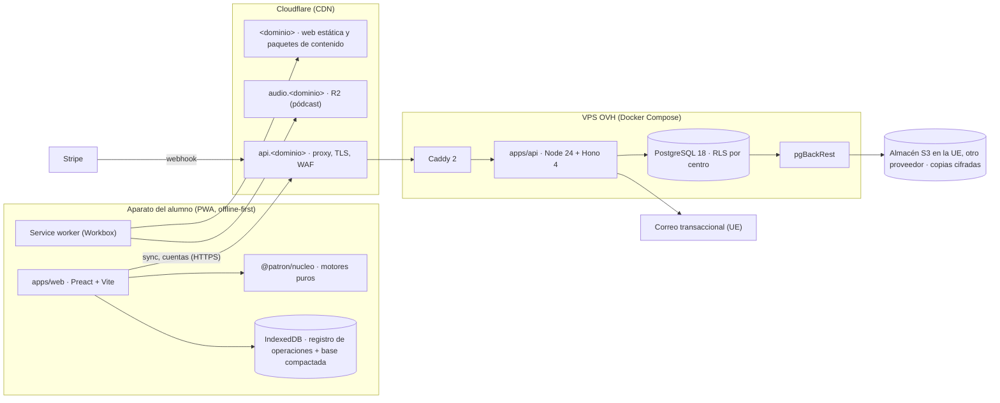
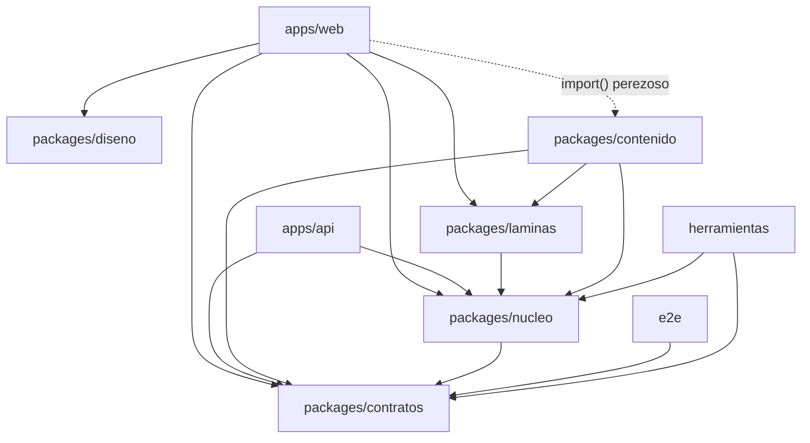
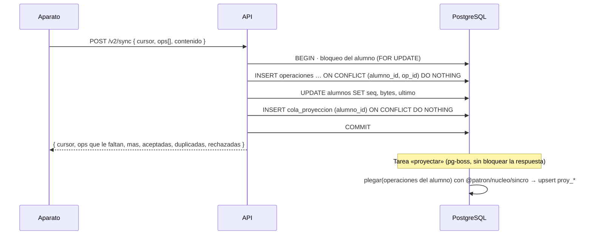
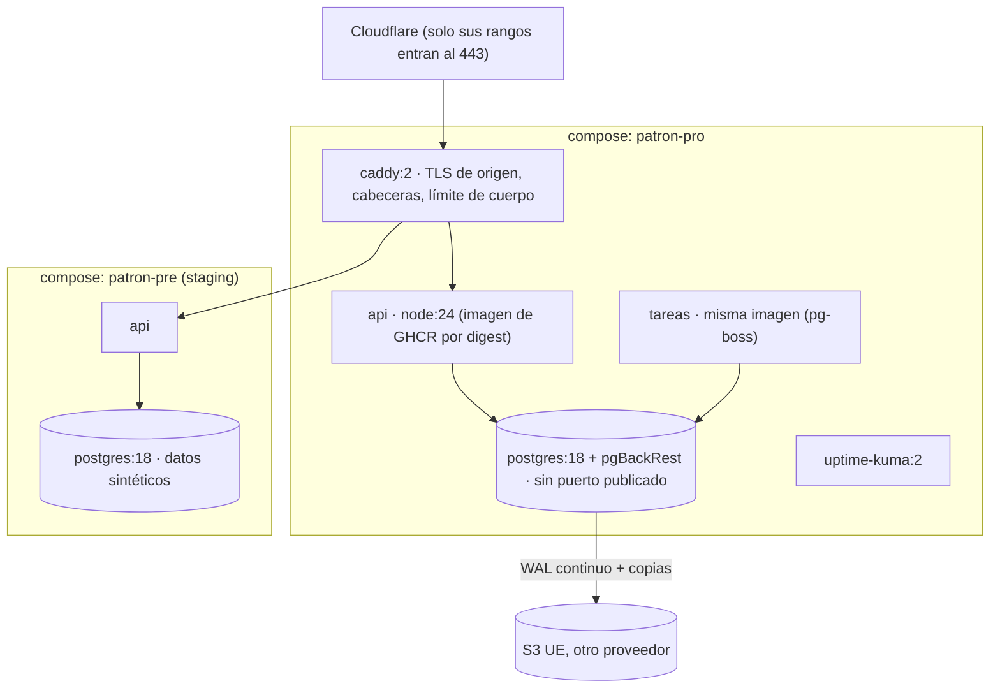
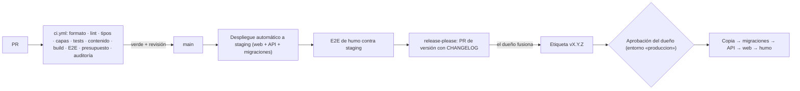

# Arquitectura objetivo de «Patrón» 2.0

Diseño de destino para pasar de prototipo a servicio con cuentas, academias y cobro. Parte de la auditoría
([`../auditoria/AUDITORIA.md`](../auditoria/AUDITORIA.md); los ids `E-01`, `S-12`… son sus hallazgos) y sustituye la
arquitectura objetivo de `docs/VERSION-2.md` §3. El orden y los plazos están en [`PLAN-MIGRACION.md`](PLAN-MIGRACION.md);
el resumen para el dueño, en [`RESUMEN.md`](RESUMEN.md); cada decisión, en [`adr/`](adr/).

_17 de noviembre de 2026. Solo diseño: este documento no cambia código._

**Decisiones de partida (del dueño, no se reabren):** academias el primer año → PostgreSQL en el VPS con aislamiento
entre centros y roles; alojamiento híbrido (API y base de datos en el VPS de OVH con Docker, web y audio tras una CDN,
app *offline-first*); dominio propio con mudanza sin pérdida de progreso; repositorio propio, monorepo, historial nuevo
sin audio. **De la auditoría:** conservar y tipar el núcleo, reescribir la carcasa por estrangulamiento con E2E de
caracterización, y antes de nada CI y audio fuera de git.

**Versiones.** Las que se citan son las estables de referencia a noviembre de 2026. Se fijan exactas en F0
(`package.json` con versión exacta, imágenes Docker por *digest*) y las mantiene Renovate; ninguna decisión depende de
una versión menor concreta.

## 0. Vista general



Tres propiedades que el diseño garantiza:

1. **El VPS puede caer y la app sigue abriendo y funcionando.** Todo lo que el alumno necesita para estudiar (código,
   contenido, progreso) está en el aparato o en la CDN. La API solo hace falta para sincronizar, entrar en la cuenta,
   la vista de profesor y pagar.
2. **El registro de operaciones es la fuente de verdad** en el aparato y en el servidor. Lo demás (progreso plegado,
   proyecciones para el profesor) se deriva y se puede reconstruir.
3. **Nada llega a producción sin pasar por CI y por una aprobación**, y nadie —persona, agente o test— tiene a mano una
   credencial que escriba en la base de producción.

## 1. Monorepo

Repositorio nuevo y dedicado (nombre provisional `patron`), **privado** mientras los derechos del contenido sigan sin
aclarar (`docs/PRODUCTO.md` §9). Historial nuevo: se importa el árbol de `nautica/` y `sync-worker/` sin `podcast/audio/`;
el repositorio antiguo queda archivado como referencia histórica. Detalle en [ADR 0002](adr/0002-monorepo-pnpm-repositorio-propio.md).

**Gestor:** pnpm 10 con *workspaces* y `catalog:` para versiones compartidas; Node 24 LTS (`.nvmrc`, `engines`,
`packageManager` fijado con Corepack). Sin Turborepo ni Nx al empezar: `pnpm -r --filter` y referencias de proyecto de
TypeScript bastan a este tamaño; se añade caché de tareas solo si la CI pasa de 10 minutos.

```
patron/
├── apps/
│   ├── web/                  @patron/web          PWA: Vite + Preact. Carcasa nueva y, mientras dure, ui/ antigua
│   ├── api/                  @patron/api          Node + Hono. Sync, cuentas, centros, pagos, avisos
│   └── worker-legado/        @patron/worker-legado  El Worker actual, congelado, hasta su apagado
├── packages/
│   ├── contratos/            @patron/contratos    Esquemas Zod: operaciones, API, contenido. Solo depende de zod
│   ├── nucleo/               @patron/nucleo       Motores puros (math, nautical, chart, exercises, analysis, graphics,
│   │                                              course, exams, bancos, theory, conceptos, teacher, bloc, sincro)
│   ├── laminas/              @patron/laminas      Generadores de SVG (hoy src/illustrations/)
│   ├── contenido/            @patron/contenido    Fuentes (JSON, resoluciones en TS) y compilador a paquetes
│   └── diseno/               @patron/diseno       Tokens, tipografías, iconos y componentes base (Preact)
├── e2e/                      @patron/e2e          Playwright: caracterización, accesibilidad, rendimiento
├── herramientas/             @patron/herramientas Tubería de bancos, cuarentena, pódcast, importación del legado
├── infra/                    Compose, Caddyfile, guiones de despliegue y copias, runbooks
└── docs/                     Guía corta, ADR, legal (política, registro de tratamientos)
```

**Responsabilidades y dependencias permitidas** (flecha = «puede importar»):



| Regla | Qué impide |
| --- | --- |
| `contratos` no importa ningún paquete propio | Que el contrato dependa de una implementación |
| `nucleo` y `laminas` no usan `document`, `window`, `fetch`, `localStorage`, `indexedDB`, `Date.now()` ni `Math.random()` directos (fecha, azar y almacenamiento llegan inyectados) | Perder lo que hoy hace probables los motores |
| `nucleo` no importa `laminas` ni `contenido` | Las dependencias mutuas de E-08 (`course ↔ illustrations`) |
| `web` no importa `api`, ni al revés; se hablan por `contratos` | El acoplamiento por ruta relativa de E-11 |
| `api` no importa `laminas`, `diseno` ni `contenido` | Meter presentación en el servidor |
| Dentro de `nucleo`: `math ← nautical ← chart ← exercises ← analysis ← graphics`; `bancos`, `theory`, `exams` (dominio) `← course` (aprendizaje) `← sincro` | La regla de capas completa que pedía E-07 |
| Dentro de `web`: solo `src/datos/` toca IndexedDB; `src/legado/` no puede ser importado por código nuevo salvo por el adaptador `VistaAntigua` | Que lo nuevo dependa de lo que se va a borrar |

**Vigilancia:** `dependency-cruiser` 17 con las reglas anteriores en `.dependency-cruiser.cjs` (falla la CI); `knip` 5
para exportaciones, ficheros y dependencias sin uso (E-10, P-07); `no-restricted-globals` y
`no-restricted-imports` de ESLint para la regla de pureza del núcleo. Además, pnpm con `node-linker=isolated` hace que
un paquete no pueda importar lo que no declara.

## 2. Lenguaje y calidad

| Herramienta | Versión | Uso |
| --- | --- | --- |
| TypeScript | 5.9 (o la 6.x estable al empezar F0) | `strict` por paquete, en el orden de abajo |
| ESLint | 9 (*flat config*) + `typescript-eslint` 8 | Reglas recomendadas con tipos, `complexity` ≤ 15 en código nuevo, `max-lines-per-function` ≤ 80, `eslint-plugin-jsx-a11y` en `web` |
| Prettier | 3 | Formato único; ancho 110. `.editorconfig` |
| `node:test` + `c8` 10 | Node 24 | `nucleo`, `laminas`, `contenido`, `contratos`, `herramientas`: los 2.581 casos actuales **no se reescriben**. Node 24 ejecuta `.ts` sin compilar (borrado de tipos) |
| Vitest | 4 | `web` (componentes con `@testing-library/preact`) y `api` (con PostgreSQL efímero) |
| Playwright | 1.5x + `@axe-core/playwright` 4.10 | `e2e`: recorridos, accesibilidad, rendimiento |
| Stylelint | 16 | Prohíbe colores literales fuera de los tokens |
| `squawk` | 2 | Lint de las migraciones SQL |
| gitleaks | 8 | Secretos en cada PR |
| Renovate | — | Dependencias e imágenes, PR agrupadas semanales |

**Orden de `strict`** ([ADR 0003](adr/0003-typescript-estricto-por-paquetes.md)):

1. **Transición inmediata (F0):** `checkJs` sin `strict` sobre el código actual, como puerta de CI. Objetivo 472 → 0
   errores, empezando por los 13 `TS2554` y los 95 `TS236x`, que son fallos probables (T-02).
2. `contratos` y `api`: nacen en TypeScript `strict` con `noUncheckedIndexedAccess`, `exactOptionalPropertyTypes`,
   `verbatimModuleSyntax` y `erasableSyntaxOnly`.
3. `nucleo`, directorio a directorio, por errores actuales de menos a más: `math`, `bancos`, `analysis`, `chart`,
   `graphics`, `bloc` (0) → `theory` (8) → `store/sync` (13) → `exams` (17) → `course` (103). Cada directorio se
   renombra a `.ts` y pasa a `strict` en un PR propio con sus tests intactos.
4. `laminas` (184 errores): el último del núcleo; son generadores de texto con poco riesgo.
5. `web` nuevo: `strict` desde el primer componente. **`src/legado/` (la `ui/` actual) no se convierte nunca**: se queda
   en JavaScript con `checkJs` no estricto hasta que se borra pantalla a pantalla.

**Cobertura mínima** (con `--all`, para que no engañe como P-04; umbral que falla la CI):

| Paquete | Líneas | Ramas | Nota |
| --- | ---: | ---: | --- |
| `nucleo` | 95 % | 90 % | Hoy 96–100 % salvo `graphics` (42 %): `graphics` entra con umbral propio del 60 % y sube |
| `nucleo/sincro` | 100 % | 95 % | Es la pieza que no puede fallar |
| `contratos` | 95 % | 90 % | |
| `laminas` | 90 % | — | Hoy 99 % |
| `contenido` (compilador) | 85 % | — | Más las pruebas de contrato de datos, que no cuentan como cobertura |
| `api` | 85 % | 80 % | Más la batería de aislamiento entre centros, obligatoria |
| `web` (código nuevo) | 70 % | — | La lógica vive en `nucleo`; los recorridos los cubre `e2e` |
| `web/src/legado` | sin umbral | | Lo protege `e2e`; no se invierte en probar lo que se borra |

**Convenciones** (resuelven C-10):

- Dominio, tipos, tablas y rutas en **español** (`Pregunta`, `plegar`, `matriculas`, `/v2/centros`); se mantienen los
  nombres ingleses antiguos del núcleo y no se renombra por renombrar.
- Ficheros en `kebab-case`; componentes en `PascalCase.tsx` con su `Componente.module.css` y `Componente.test.tsx` al lado.
- Sin estado en variables de módulo (C-04): todo estado cuelga del contenedor que crea `crearApp(...)`.
- Un único camino para errores esperados: `esperado(e, 'almacen-lleno')` deja rastro contable; los `catch` vacíos los
  prohíbe ESLint (`no-empty`, C-05).
- Commits con Conventional Commits (lo comprueba `commitlint` 19); de ahí salen versión y CHANGELOG (§9).
- Decisiones nuevas: un ADR de una página; `docs/ARCHITECTURE.md` se sustituye por una guía de menos de 300 líneas (M-06).

## 3. Cliente

### 3.1 Framework: Preact, confirmado con la prueba de «Hoy»

**Recomendación: Preact 10 con TSX y `@preact/signals` 2.** ([ADR 0004](adr/0004-preact-signals-vite.md))

| Criterio | Preact | Svelte 5 | Solid 1.9 |
| --- | --- | --- | --- |
| Reutilizar la `ui/` actual | `h('div.clase', attrs, hijos)` es casi `h()` de Preact: traducción en buena parte mecánica, y los dos pueden convivir en el mismo árbol | Hay que reescribir cada vista como plantilla | JSX parecido, pero semántica distinta (los componentes se ejecutan una vez): la traducción mecánica engaña |
| Peso del *runtime* | ≈ 4,5 KB gzip + 1,5 KB de signals | ≈ 3–8 KB, pero crece por componente | ≈ 7 KB |
| SVG generado como texto (láminas, carta) | `dangerouslySetInnerHTML` envuelto en un único componente `<Svg>` | `{@html}` | `innerHTML` |
| Que cualquier desarrollador o agente lo reconozca (M-05) | Es el modelo de React: el más documentado y el que mejor escriben los agentes | Bueno, menos material | Minoritario |
| CSS con ámbito | CSS Modules de Vite | De serie (su punto fuerte) | CSS Modules |
| Riesgo de plataforma | Bajo y estable (API de React) | Compilador propio; cambió de modelo en la v5 | Comunidad pequeña |

Solid se descarta. Entre Preact y Svelte decide la prueba, pero se parte con Preact porque el criterio que más pesa en
este proyecto es **cuánto código y cuánto conocimiento se reaprovecha** con una sola persona y agentes.

**La prueba de «Hoy»** (3–4 días, al empezar F7a; se hace en una rama que no se fusiona):

1. Se escribe primero el E2E de caracterización de «Hoy» contra la app actual (ya existirá desde F1): estados de primer
   día, día normal, sesión hecha, semana antes del examen, sin conexión; a 360 y 990 px, claro y oscuro.
2. Se saca de `views/hoy.js` la lógica a una función pura `modeloHoy(estado, reloj)` en `nucleo` con sus tests (esto
   se conserva gane quien gane).
3. Se implementa la pantalla dos veces sobre ese modelo: Preact + signals y Svelte 5, con los mismos tokens.
4. Se mide:

| Medida | Cómo | Criterio |
| --- | --- | --- |
| Igualdad funcional | El mismo E2E pasa sin tocarlo; axe con 0 infracciones | Obligatorio para las dos |
| JS de arranque + «Hoy», gzip | `size-limit` sobre el *build* | ≤ 200 KB; gana quien pese menos, pero una diferencia < 15 KB no decide |
| «Pantalla lista» con CPU ×4 y red 4G lenta | Guion de `metricas/config/arranque.mjs` | ≤ 3,5 s; diferencia < 10 % no decide |
| Código antiguo reutilizado | Líneas de `hoy.js` y sus auxiliares que pasan sin reescribir o con cambio mecánico | Cuanto más, mejor |
| Convivencia | ¿Puede la vista nueva alojar un trozo de la antigua (y al revés) sin *iframes*? | Obligatorio |
| Tiempo de un agente (Sonnet) en producirla con revisión | Horas de reloj y rondas de corrección | Informativo |

**Regla de decisión:** se elige Preact salvo que Svelte gane por más del 25 % en peso **y** en tiempo de arranque sin
perder en convivencia. El resultado se anota como revisión del ADR 0004.

### 3.2 Vite, rutas y estado

- **Vite entra antes que el framework:** en la fase F2 empaqueta la app actual tal cual (misma `ui/`), y con eso ya
  se pasa de 403 peticiones a unas 15 y la precarga se genera sola. Preact llega después, sobre esa base.
- **Vite 7** con `@preact/preset-vite`. Salida con nombres por *hash*; `build.target` = `es2022` (los navegadores que
  ya exige la app). Sin SSR ni prerenderizado: el HTML inicial lleva la cabecera, como hoy (primera pintura ≈ 100 ms).
- **Rutas por *hash*, como hoy** (`#/<tit>/…`): no rompe enlaces ni accesos directos, no necesita reglas en la CDN y,
  sobre todo, el fragmento nunca llega a los registros del servidor (importa para los enlaces de vinculación).
  Enrutador: `wouter-preact` 3 con `useHashLocation`. **Cada ruta es un `lazy(() => import(...))`**: arranque = carcasa
  + «Hoy»; el resto baja al navegar y ya está en la precarga del service worker tras la instalación.
- **Estrangulamiento dentro de una sola app.** La tabla de rutas dice, por ruta, si la sirve un componente nuevo o
  `<VistaAntigua vista={…}>`, que monta la función de vista actual en un contenedor y la desmonta con un
  `AbortController` (arregla de paso C-07). Un interruptor por ruta (`?nueva=hoy` y un ajuste oculto) permite probar
  la nueva en producción antes de hacerla la de todos, y volver atrás sin desplegar.
- **Estado:** signals. `crearApp({ almacen, reloj, azar, red, contenido })` construye el contenedor (sesión, progreso
  plegado, titulación y eje activos, ajustes) y lo ofrece por contexto. Las vistas leen señales derivadas
  (`computed`) que llaman a los motores de `nucleo`; no hay lógica de negocio en componentes (C-03). Sin Redux ni
  librería de estado adicional.
- **Errores:** `ErrorBoundary` por ruta con «Volver a Hoy», más `error` y `unhandledrejection` globales que apuntan en
  la cola de errores (§6.5). Nunca se enseña una traza al alumno (C-06).

### 3.3 PWA

`vite-plugin-pwa` 1.x en modo **`injectManifest`** con Workbox 7 ([ADR 0005](adr/0005-pwa-workbox-precache-generado.md)).
El service worker es código propio en TypeScript; **la lista de precarga la inyecta la *build*** y `sw-lista.js`
desaparece del repositorio (M-02, S-06).

| Qué | Estrategia |
| --- | --- |
| Carcasa (HTML, JS y CSS de todas las rutas, tipografías, iconos) | Precarga con revisión por *hash*. Tras empaquetar son ≈ 1,5 MB gzip: se precarga entera para que cualquier pantalla abra sin red |
| Paquetes de contenido del eje y titulación elegidos | Se descargan en segundo plano tras elegirlos, a una caché `contenido-<versión>` (`CacheFirst`; son inmutables por *hash*). El alumno ve «Listo para usar sin conexión» |
| Otros ejes y titulaciones | Bajo demanda al elegirlos (R-02) |
| Audio (`audio.<dominio>`) | Nunca en precarga. `CacheFirst` con `workbox-range-requests`, solo los episodios que el alumno descarga o escucha; tope de 300 MB con caducidad LRU |
| API | Nunca por caché: `NetworkOnly`. La cola sin conexión es el registro de operaciones, no `workbox-background-sync` |

- **Actualización:** se conserva el comportamiento actual, que es bueno: la versión nueva espera (`registerType:
  'prompt'`), se ofrece con un aviso y **nunca se aplica a mitad de un examen** (el contenedor expone `ocupado`).
- **Interruptor de emergencia:** `infra/emergencia/sw.js` (se desregistra y borra cachés) y la cabecera
  `Clear-Site-Data` listos para desplegar con una orden, documentados en el runbook y probados en *staging*.
- **Push:** el alta de avisos pasa a la API nueva; las claves VAPID de producción no cambian de valor pero sí de sitio.

### 3.4 Almacenamiento local: IndexedDB

Una sola base `patron` con esquema versionado y un único módulo que la toca (`apps/web/src/datos/`), con `idb` 8
([ADR 0006](adr/0006-indexeddb-registro-compactado.md)). Resuelve D-01, D-02 y D-08.

| Almacén | Clave | Contenido |
| --- | --- | --- |
| `ops` | `i` (id de operación); índices `estado` (`pendiente` \| `confirmada`) y `t` | **Una fila por operación.** Escribir una respuesta es un `put`, no reescribir 2 MB |
| `base` | `actual` | Lo compactado: operaciones `b` (bases) que resumen todo lo confirmado más antiguo |
| `meta` | nombre | `dev`, contador, cursor, época, identidad (alumno, sesión del aparato), versión de contrato |
| `local` | nombre | Ajustes del aparato y examen a medias (lo que hoy es `local` del registro) |
| `kv` | nombre | Las otras 12 claves de hoy (errores, tiempos, bloc, calculadora, avisos…), con inventario y versión por clave |
| `carta-usuario` | — | La carta escaneada (ya está en IndexedDB; no sale del aparato) |
| `errores` | autoincremental | Cola de errores del cliente, sin datos personales |

- **Lectura síncrona, escritura asíncrona.** Al arrancar se cargan `base` + `ops` y se pliega a memoria (20.000
  operaciones ≈ 60 ms hoy; con base compactada, menos). Los motores siguen leyendo de memoria como ahora; cada
  escritura aplica la operación al estado plegado y encola un `put`. Se fuerza el volcado en `visibilitychange` y `pagehide`.
- **Pestañas:** `BroadcastChannel` para avisar de operaciones nuevas y `navigator.locks` para que solo una sincronice
  (sustituye al evento `storage`).
- **Compactación** (lo que `docs/SYNC.md` dejó como «solución futura»): cuando hay más de 3.000 operaciones
  confirmadas con más de 90 días, se pliegan a una base (operaciones `b`, el mecanismo que ya existe y está probado
  para migrar y unir aparatos) y se borran de `ops` en la misma transacción. Invariante con test de propiedad:
  `plegar(base + cola) ≡ plegar(todo)`. La recomposición si el servidor pierde un alumno sigue funcionando: se resube
  la base y la cola (con la regla ya documentada de «puede quedarse corto, nunca largo»); con copias y recuperación a
  un punto en el tiempo en el servidor (§8), ese camino pasa a ser el último recurso, no el plan.
- **Persistencia:** `navigator.storage.persist()` como hoy; `estimate()` en el diagnóstico.
- **Migración desde `localStorage`** (mismo origen): al primer arranque de la carcasa nueva, si existe
  `nautica.sync.v1` y `ops` está vacío, se importa, se comprueba que el progreso plegado es idéntico al de
  `nautica.progress.v1`, y solo entonces se marca migrado. `localStorage` se conserva 60 días como copia y luego se limpia.
- La URL del servidor deja de poder cambiarse desde el almacenamiento en producción (S-04).

### 3.5 Diseño, temas y accesibilidad

- **Los tokens actuales se conservan tal cual** (`--bg`, `--surface`, `--text`, `--accent`, `--boton`, `--aviso-*`,
  `--lc-*`). Pasan a una fuente única, `packages/diseno/src/tokens.ts`, de la que la *build* genera `tokens.css` con
  los tres bloques de hoy: `:root` (claro), `@media (prefers-color-scheme: dark)` con `:root:not([data-theme="light"])`
  (automático) y `:root[data-theme="dark"]` (forzado). Los dos bloques oscuros dejan de poder divergir, que es lo que
  hoy vigila `tests/tema.test.js`.
- **CSS por componente** con CSS Modules; Stylelint prohíbe colores literales y tamaños de letra fuera de la escala
  (hoy hay 370 colores literales, E-05). `app.css` y `laminas.css` siguen cargándose mientras exista `legado/` y
  adelgazan con cada pantalla migrada; al final se borran.
- **Sin parpadeo de tema:** el script en línea de `index.html` se mantiene, con su *hash* en la CSP (§7.1).
- **Accesibilidad como puerta, no como intención:** axe en todos los E2E (0 infracciones WCAG 2.2 AA),
  `eslint-plugin-jsx-a11y`, comprobación real de objetivos táctiles ≥ 44 px (caja medida en Playwright, no texto del
  CSS como hoy, P-03), `prefers-reduced-motion`, los tres tamaños de letra, y una pasada manual con VoiceOver y
  TalkBack por pantalla migrada (lo que la auditoría echó en falta, R-05). Componentes base (`Boton`, `Tarjeta`,
  `Dialogo`, `Pestanas`, `Aviso`) en `diseno` con el foco y los roles resueltos una vez.
- **`<Svg>`**: único punto que inserta marcado; solo acepta el tipo `SvgSeguro` que producen `laminas` y `graphics`
  (S-03). Con *Trusted Types* en la CSP, cualquier otro `innerHTML` falla en el navegador.

## 4. Contenido

[ADR 0007](adr/0007-contenido-git-esquema-zod-paquetes.md). El contenido **sigue en git, revisado por PR**; ninguna
base de datos ni CMS. Lo que cambia es que tiene esquema, se compila y se carga por trozos.

### 4.1 Fuentes y esquema

```
packages/contenido/
├── fuentes/
│   ├── ejes/<eje>/eje.json                       ficha del eje (incluye la reserva)
│   ├── ejes/<eje>/<tit>/preguntas.json           GENERADO por la tubería de bancos (cabecera «no editar»)
│   ├── ejes/<eje>/<tit>/{explicaciones,practica,resueltos,conceptos}.json   editados a mano
│   ├── ejes/<eje>/img/
│   ├── curso/<tit>.json, curso/ruta-<tit>.json   clases, tarjetas, chuletas
│   ├── comun/, conceptos/, mapas/, normativa.json
│   ├── podcast/episodios.json, podcast/<tit>/*.md   índice y guiones (el audio, en R2)
│   └── carta/chart-105.json
├── resoluciones/<eje>-<tit>/*.ts                 resoluciones programadas de carta (hoy src/exams/solutions/)
├── src/compilar.ts                               compilador a paquetes
└── dist/                                         NO versionado
```

- **Esquema:** Zod 4 en `@patron/contratos/contenido`: `Pregunta` (los ≈ 25 campos de `docs/BANCOS.md`), `Banco`,
  `FichaEje`, `Explicacion`, `Leccion`, `Tarjeta`, `Ruta`, `Concepto`, `EspecLamina`, `Episodio`. De ahí salen los tipos
  de TypeScript (`z.infer`) y, con `z.toJSONSchema()`, los JSON Schema que el editor usa para validar al escribir.
  Es la fuente única que pedía D-03; `docs/BANCOS.md` pasa a enlazar el esquema en vez de describirlo.
- **Fuente frente a generado (M-09):** lo que sale de la tubería lleva `meta.generado` y un test falla si se edita a
  mano (su huella debe coincidir con la que escribe la tubería). `temas-revisados.json` y las correcciones manuales
  son fuente.
- **Estados editoriales** por pieza: `borrador` → `verificado` → `publicado`, con `fuente` y `verificada` (fecha)
  obligatorias para publicar. El compilador solo empaqueta `publicado`.
- **Resoluciones y láminas siguen siendo código** (tienen pruebas contra la geometría, E-04), pero dejan de viajar en
  el arranque: cada `<eje>-<tit>` es un trozo que Vite carga con `import()` cuando se abre una pregunta de carta de ese banco.
- **Identificadores estables (D-06):** un id publicado no se reutiliza ni se renombra. Una pregunta corregida conserva
  el id; una retirada pasa a `retiradas` y su progreso se ignora; las repetidas siguen resolviéndose con
  `equivalentes`. La CI compara los ids con los de la última versión publicada (`ids-publicados.txt`) y falla si
  desaparece alguno sin estar en `retiradas`.

### 4.2 Compilación a paquetes

`pnpm --filter @patron/contenido compilar` valida todo contra el esquema y escribe, con nombre por *hash*:

| Paquete | Contenido | Cuándo se carga |
| --- | --- | --- |
| `indice.<hash>.json` | Ejes, titulaciones, versión y *hash* de cada paquete | Arranque (unos KB) |
| `<eje>/<tit>/indice.<hash>.json` | Por pregunta: id, tema, convocatoria, concepto, marcas (≈ 60 bytes) | Al elegir banco. Es lo que necesitan el plan y «Hoy» (R-03): decenas de KB en vez de 2,2 MB |
| `<eje>/<tit>/tema-<nn>.<hash>.json` | Preguntas del estudio de ese tema | Al estudiar el tema; en segundo plano tras elegir banco |
| `<eje>/<tit>/expl-<nn>.<hash>.json` | Explicaciones del tema | Al corregir |
| `<eje>/<tit>/conv-<clave>.<hash>.json` | **Una convocatoria que es o ha sido reservada**, entera y aparte | Solo según la reserva del alumno (§4.3) |
| `curso/<tit>.<hash>.json`, `curso/<tit>/leccion-*.json` | Ruta y clases | Ruta al arrancar; clase al abrirla |
| Trozos JS de resoluciones y láminas | Código | `import()` por banco o por lámina |

Cada banco lleva **versión semántica** (`mayor`: cambia la reserva o se retiran preguntas; `menor`: convocatoria nueva;
`parche`: correcciones). El cliente manda la versión de contenido en cada sincronización y las operaciones de examen
(`x`) la guardan, de modo que el progreso queda ligado a la versión del banco con que se generó (D-05).

Sin firma de paquetes: contenido y app salen del mismo origen por HTTPS (la auditoría ya lo descartó, §12).

### 4.3 Cuarentena y reserva por tribunal

Se mantiene íntegra (`docs/CUARENTENA.md`, `docs/BANCOS.md` «reserva») y se refuerza con el empaquetado:

- **La regla no cambia:** ningún contenido cita una pregunta reservada, ni por id ni por enunciado casi literal.
  `herramientas/cuarentena.mjs` y su test siguen siendo puerta de CI, ahora sobre `fuentes/` **y** sobre `dist/`
  (ningún paquete que no sea `conv-*` puede contener una reservada). La deuda del audio conserva su trinquete (`MAX_DEUDA`).
- **Separación física nueva:** las convocatorias que son o han sido reserva se empaquetan aparte (`conv-*`). El
  estudio del alumno = paquetes de tema ∪ los `conv-*` que **no** están en su foto de la reserva. Así una reservada no
  está ni siquiera en el aparato antes del examen final, y la **reserva por alumno** (`reserva_<eje>_<tit>`, que gana
  la primera escritura) sigue mandando aunque la ficha del eje cambie después.
- **Bancos independientes por tribunal:** un paquete nunca mezcla ejes; una explicación solo cita el criterio de su banco.
- **Cuando cambia la reserva** (entra una convocatoria): es un cambio `mayor` del banco; la CI señala las citas
  nuevas, como hoy, y el compilador regenera los `conv-*`.

### 4.4 Audio

Fuera de git ([ADR 0012](adr/0012-alojamiento-hibrido-cloudflare-vps.md)): los 62 MP3 (304 MB) viven en un *bucket*
R2 servido en `audio.<dominio>`, con nombre por *hash* de contenido. En git quedan `episodios.json` (con el *hash* y la
duración), los guiones y `herramientas/podcast` para generarlos y subirlos (`pnpm podcast subir`, con credencial de solo
escritura al *bucket*). Un test comprueba que cada episodio del índice existe en R2.

### 4.5 Cuándo hará falta un editor para academias

No en esta arquitectura. Lo que una academia necesita primero **no es editar el contenido del curso**, sino configurar
el suyo: fecha de convocatoria, plan del grupo, temas destacados y listas de preguntas elegidas del banco. Eso es lo
que hoy hace el fichero del «modo profesor» (D-09) y pasa a ser **datos de servidor** (`config_grupo`, §6) con un
formulario en el panel del profesor, validado con el mismo esquema que `config-profe.js`.

Un editor de contenido de verdad (preguntas o clases propias de un centro) se construye **solo si** se cumple una de
estas: tres o más centros lo piden y pagarían por ello; entra en el equipo alguien que edita contenido y no usa git; o
el volumen de correcciones propuestas por profesores supera lo que se puede pasar a PR a mano (más de ~20 al mes). En
ese caso el contenido de centro viviría en Postgres con su `centro_id` y el mismo esquema Zod, sin mezclarse nunca con
el contenido común de git.

## 5. API

### 5.1 Stack y contratos

**Node 24 LTS + Hono 4** sobre `@hono/node-server` ([ADR 0008](adr/0008-api-node-hono-contratos-zod.md)). Hono usa
`Request`/`Response` estándar, igual que el Worker actual: `manejar(req, env)` y sus 40 pruebas se portan casi sin
tocar, cambiando solo el adaptador de D1 por PostgreSQL. Eso hace barata y segura la fase de doble escritura.

- **Contratos:** `@patron/contratos/api` define con Zod 4 cada petición y respuesta. La API valida con
  `@hono/zod-validator`; el cliente usa un `fetch` tipado generado de los mismos esquemas (`crearCliente(baseUrl)`).
  `web` no importa nada de `api`. Se publica un OpenAPI 3.1 generado (`hono-openapi`) solo como documentación.
- **Versionado:** `/v1/*` = el contrato actual, intacto, para la app antigua. `/v2/*` = lo nuevo. Las operaciones
  llevan versión de contrato (`@patron/contratos/operaciones`, unión discriminada por `k`); se acaba el rodeo de meter
  tipos nuevos en `settings` (E-12): `corr` y `fallo` pasan a ser tipos propios en la versión 2, y el pliegue acepta
  las dos formas para siempre.
- **Acceso a datos:** `pg` 8 + **Kysely** 0.28 con tipos generados de la base real (`kysely-codegen`). Sin ORM.
  Consultas siempre parametrizadas (se conserva S-17).
- **Estructura:** `rutas/` (HTTP) → `casos/` (lógica) → `db/` (consultas). Solo `db/contexto.ts` importa `pg` (lo vigila
  `dependency-cruiser`), porque es quien fija el contexto de seguridad por filas (§6.2).
- **Tareas programadas** (recordatorio diario, retención, liquidación del canon, proyecciones atrasadas): un segundo
  proceso de la misma imagen (`node dist/tareas.js`) con `pg-boss` 10 sobre el mismo Postgres. Sin Redis.

### 5.2 Autenticación e identidad

[ADR 0011](adr/0011-identidad-cuenta-opcional-enlace-magico-passkeys.md).

| Concepto | Qué es |
| --- | --- |
| **Alumno** | El sujeto del progreso (un registro de operaciones). Existe sin cuenta, como hoy |
| **Aparato** | Un navegador o instalación unido a un alumno. Tiene nombre («iPhone de …» lo pone el alumno) y se puede revocar |
| **Sesión** | Credencial de un aparato: *token* opaco de 256 bits; en el servidor solo su SHA-256. Revocable. Caduca a los 180 días sin uso y se renueva sola |
| **Cuenta** | Correo verificado. Opcional para el alumno; obligatoria para profesores, administradores de centro y para pagar |
| **Código de alumno** | Deja de ser la credencial permanente: pasa a ser **un enlace de un solo uso** para unir un aparato |

- **Sin cuenta (por defecto):** al primer dato que subir, el aparato pide `POST /v2/aparatos` y recibe su sesión. No
  hay nada que recordar ni que apuntar.
- **Unir otro aparato:** «Mis dispositivos → Añadir aparato» pide `POST /v2/vinculos` → un código de 12 símbolos (mismo
  alfabeto que hoy) válido **10 minutos y una sola vez**, mostrado como texto y como QR con `https://<dominio>/#/vincular/<código>`.
  El aparato nuevo lo canjea (`POST /v2/vinculos/canjear`) por su propia sesión. Resuelve S-05 y S-10.
- **Cuenta con enlace mágico:** `POST /v2/cuentas/enlace { correo }` → correo con enlace de 15 minutos y un solo uso
  (el *token* va en el fragmento; la página lo canjea por `POST`). Respuesta idéntica exista o no la cuenta. Al
  entrar, la cuenta se asocia al alumno del aparato; si la cuenta ya tenía otro alumno, se unen los dos registros con
  la fusión de bases que ya existe (nadie pierde progreso, V2-R1).
- **Passkeys después** (WebAuthn con `@simplewebauthn/server` 13): se ofrecen al usuario con cuenta como forma de
  entrar sin correo. El enlace mágico queda como recuperación. No hay contraseñas en ningún momento.
- **Alumno de academia:** entra con el **código de centro** del grupo (sin cuenta ni contraseña, como promete
  `PRODUCTO.md` §6): `POST /v2/matriculas { codigo }` crea la matrícula del alumno de ese aparato y le enseña la
  pantalla de consentimiento (§6.4).
- **Sesiones:** cookie `__Host-sesion` (`HttpOnly`, `Secure`, `SameSite=Lax`) puesta por `api.<dominio>`; al ser el
  mismo sitio que `<dominio>`, viaja con `credentials: 'include'`. El JavaScript de la página no puede leerla.
  Defensa CSRF: `SameSite`, comprobación de `Origin` y solo `application/json`. «Mis dispositivos» lista sesiones con
  último uso y permite cerrarlas una a una o todas.
- **Roles:** `alumno`, `profesor`, `admin_centro` (por centro, en `miembros_centro`) y `admin_servicio` (el dueño, con
  passkey obligatoria). El rol efectivo de cada petición lo fija el servidor a partir de la sesión, nunca el cliente.
- **Compatibilidad:** `/v1/sync` sigue aceptando `Authorization: Bearer <código>` para la app antigua hasta 12 meses
  después de apagar el Worker. El *hash* del código lleva versión de *pepper* (`pepper_v`), con lo que el *pepper* se
  puede rotar (S-11).

### 5.3 Sincronización: registro como fuente de verdad, proyecciones al lado

[ADR 0010](adr/0010-registro-operaciones-y-proyecciones.md). El modelo de `docs/SYNC.md` se conserva: operaciones con
id único, `seq` creciente por alumno, pliegue determinista en el cliente, reenvíos idempotentes.



- **El servidor sigue sin fusionar para el cliente:** lo que el aparato recibe son operaciones, y pliega él.
- **Proyecciones** (D-04): tablas `proy_*` que el servidor calcula **plegando con el mismo código que el cliente**
  (`@patron/nucleo/sincro`), no con SQL que imite el pliegue. Al llegar operaciones se encola el alumno y una tarea
  lo repliega (decenas de milisegundos) y actualiza sus filas. Son desechables: `tareas proyecciones:reconstruir`
  las rehace desde `operaciones`. Un test de propiedad comprueba `proyección ≡ plegar(operaciones)`.
- **Instantáneas para aparatos nuevos:** `GET /v2/sync/base` devuelve una base ya plegada hasta `seq = N` más el
  cursor; un aparato nuevo baja eso y la cola en vez de 20.000 operaciones.
- **Topes** (S-14): 256 KB por petición, 500 operaciones por lote, 100.000 operaciones y **20 MB por alumno**
  (`alumnos.bytes`), y alerta si la base crece más de un 20 % en una semana.

### 5.4 Límites de tasa y registros

- **Límites** en la aplicación (`hono-rate-limiter` en memoria; un solo proceso no necesita Redis), no con escrituras
  en la base (S-15). Clave: sesión o, sin ella, IP tomada de `CF-Connecting-IP` (solo se confía en ella si la conexión
  viene de Cloudflare).

| Ruta | Límite |
| --- | --- |
| Cualquiera, por IP | 120/min |
| `/v2/sync`, por alumno | 60/min |
| `/v2/cuentas/enlace` | 3/h por correo y 10/h por IP |
| `/v2/vinculos/canjear`, `/v2/matriculas` (códigos) | 10 fallos/h por IP; el código se invalida al 5.º fallo |
| `/v2/aparatos` (altas) | 20/día por IP |
| `/v2/errores` | 20/h por aparato |

  Además, una regla de límite de Cloudflare (la del plan gratuito) delante de `/v2/cuentas/*` como segunda barrera.
- **Registros estructurados sin datos personales** (`pino` 9, JSON a la salida estándar): método, ruta *plantilla*
  (`/v2/centros/:id`, nunca la URL real), estado, duración, id de petición, id interno de alumno o cuenta **solo en
  errores**. Se redactan `authorization`, `cookie`, `set-cookie` y cualquier campo `correo` o `codigo`; no se registran
  cuerpos. La IP no se guarda: para los límites se usa en memoria y para abuso se guarda un HMAC con una sal que rota
  cada día. Retención de registros: 30 días. Mejora S-18 (hoy no hay registros) sin perder su intención.
- **CORS:** solo `https://<dominio>` (y el de *staging* en *staging*). `localhost` solo en desarrollo (S-16). Durante
  la mudanza, también `https://antoniofcano.github.io` en `/v1/*`.

## 6. Datos: PostgreSQL

**PostgreSQL 18** en Docker en el VPS ([ADR 0009](adr/0009-postgresql-rls-por-centro.md)). Identificadores `uuid`
generados con `uuidv7()` (ordenables por tiempo; nativo en 18). Fechas en `timestamptz`. Correos en `citext`.

### 6.1 Modelo


| Tabla | Columnas principales | Notas |
| --- | --- | --- |
| `alumnos` | `id`, `cuenta_id?` (único), `creado`, `ultimo`, `seq`, `bytes`, `borrado_en?` | Sujeto del progreso. Seudónimo: sin nombre ni correo |
| `credenciales_codigo` | `alumno_id`, `hash`, `pepper_v`, `creado`, `revocada_en?` | El código heredado, solo para `/v1` |
| `cuentas` | `id`, `correo` (citext, único), `verificado_en`, `creado`, `borrado_en?` | Lo mínimo: ni nombre ni teléfono |
| `passkeys` | `id`, `cuenta_id`, `credencial_id` (único), `clave_publica`, `contador`, `transportes`, `creada`, `usada` | |
| `enlaces_magicos` | `token_hash` (PK), `correo`, `proposito`, `caduca`, `usado_en?` | Un solo uso; se purgan a las 24 h |
| `aparatos` | `id`, `alumno_id`, `dev` (id del aparato en las operaciones), `nombre?`, `creado`, `visto`, `revocado_en?` | |
| `sesiones` | `id`, `token_hash` (único), `aparato_id`, `cuenta_id?`, `creada`, `usada`, `caduca`, `revocada_en?` | Sin IP ni agente de usuario en claro |
| `vinculos` | `token_hash` (PK), `alumno_id`, `caduca`, `usado_en?`, `fallos` | El «código» de 10 minutos |
| `operaciones` | `alumno_id`, `seq`, `op_id`, `tipo`, `instante`, `v`, `cuerpo` (jsonb), `recibido` | PK `(alumno_id, seq)`; única `(alumno_id, op_id)`. Solo inserción |
| `instantaneas` | `alumno_id` (PK), `seq`, `base` (jsonb), `creada` | Base plegada para aparatos nuevos |
| `proy_actividad_dia` | `alumno_id`, `dia`, `minutos`, `respuestas`, `aciertos` | PK `(alumno_id, dia)` |
| `proy_temas` | `alumno_id`, `eje`, `tit`, `tema`, `vistas`, `dominadas`, `preparacion` (0–1), `actualizado` | La «preparación por tema» del panel |
| `proy_examenes` | `alumno_id`, `test_id`, `eje`, `tit`, `tipo`, `hecho`, `nota`, `apto`, `por_materia` (jsonb), `version_banco` | |
| `proy_resumen` | `alumno_id`, `eje`, `tit`, `listo` (0–1), `riesgo`, `ultimo_dia`, `racha`, `examen_previsto?` | Una fila por alumno y titulación: lo que lista el profesor |
| `cola_proyeccion` | `alumno_id` (PK), `desde` | |
| `centros` | `id`, `nombre`, `nif?`, `estado` (`prueba` \| `activo` \| `pausado` \| `baja`), `encargo_aceptado_en`, `encargo_version` | |
| `miembros_centro` | `centro_id`, `cuenta_id`, `rol` (`profesor` \| `admin_centro`), `alta`, `baja?` | |
| `grupos` | `id`, `centro_id`, `nombre`, `eje`, `tit`, `convocatoria?` (fecha), `archivado_en?` | |
| `profesores_grupo` | `grupo_id`, `cuenta_id`, `centro_id` | Qué profesor lleva qué grupo |
| `codigos_centro` | `hash` (PK), `centro_id`, `grupo_id`, `caduca?`, `usos`, `usos_max?`, `revocado_en?` | El código que el profesor reparte en clase |
| `config_grupo` | `grupo_id` (PK), `centro_id`, `config` (jsonb, esquema de `config-profe`), `actualizada` | Sustituye al fichero del modo profesor |
| `matriculas` | `id`, `centro_id`, `grupo_id`, `alumno_id`, `alias` (el nombre que el alumno quiere que vea su profesor), `estado` (`activa` \| `baja`), `alta`, `baja?` | Única `(grupo_id, alumno_id)` |
| `consentimientos` | `id`, `alumno_id`, `matricula_id?`, `centro_id?`, `tipo`, `texto_version`, `otorgado_en`, `revocado_en?` | Solo inserción y marca de revocación; nunca se borra una fila salvo al borrar al alumno |
| `accesos_profesor` | `id`, `centro_id`, `cuenta_id`, `alumno_id`, `que`, `cuando` | Auditoría (V2-R12). Solo inserción |
| `productos` | `id` (`pase-per-3m`…), `tit`, `dias`, `precio_centimos`, `activo` | Catálogo de `PRODUCTO.md` §5 |
| `pases` | `id`, `cuenta_id`, `producto_id`, `desde`, `hasta`, `origen` (`compra` \| `cupon` \| `ampliacion`), `pago_id?` | El acceso por centro no crea pase: sale de la matrícula activa en un centro al corriente |
| `cupones` | `codigo_hash`, `tipo`, `descuento_centimos`, `caduca`, `usado_por?`, `usado_en?` | «¡Aprobé!» |
| `pagos` | `id`, `proveedor`, `id_externo` (único), `cuenta_id?`, `centro_id?`, `importe_centimos`, `moneda`, `estado`, `creado` | Ni tarjetas ni datos de facturación: viven en Stripe |
| `eventos_pago` | `id_externo` (PK), `tipo`, `cuerpo` (jsonb), `recibido`, `procesado_en?` | Idempotencia de *webhooks* |
| `suscripciones_centro` | `centro_id`, `tramo`, `estado`, `id_externo`, `periodo_desde`, `periodo_hasta`, `meses_pausa` (int[]) | |
| `liquidaciones_canon` | `id`, `centro_id`, `trimestre`, `alumnos_activos`, `tramo`, `importe_centimos`, `detalle` (jsonb con recuentos, sin alumnos), `pago_id?` | |
| `avisos_push` | `id`, `alumno_id`, `aparato_id`, `endpoint` (único), `p256dh`, `auth`, `zona`, `hora`, `renovado`, `dia?`, `seguidos` | Migra de D1 |
| `solicitudes_rgpd` | `id`, `alumno_id?`, `cuenta_id?`, `tipo` (`exportar` \| `borrar`), `pedida`, `ejecutar_en`, `resuelta?`, `cancelada?` | |
| `lapidas` | `hash` (PK), `borrado_en` | Credenciales de alumnos borrados, para que un aparato antiguo no los recree (§7.3) |
| `auditoria` | `id`, `actor`, `accion`, `objeto`, `cuando`, `detalle` | Acciones de administración del servicio |

### 6.2 Aislamiento entre centros: seguridad por filas

**RLS de PostgreSQL**, con el código de la aplicación como primera barrera y la base como segunda. Es justo lo que
pedía VERSION-2 («una academia nunca ve datos de otra aunque falle el código») y ahora es barato porque Postgres está
al lado de la API.

- **Roles de base de datos:**

| Rol | Puede | Lo usa |
| --- | --- | --- |
| `patron_propietario` | DDL. Dueño de las tablas | Solo el contenedor de migraciones, en el despliegue |
| `patron_api` | `SELECT/INSERT/UPDATE` según tabla; `DELETE` solo en tablas efímeras. **Sin `BYPASSRLS`**, sin `TRUNCATE`, sin DDL | La API y las tareas |
| `patron_lectura` | `SELECT` con `default_transaction_read_only = on` y sin acceso a `operaciones.cuerpo` ni a `cuentas.correo` | Consultas humanas de diagnóstico |
| `patron_copias` | Replicación y lectura | pgBackRest |

- **Contexto por transacción.** Toda consulta pasa por `conContexto(ctx, fn)`, que abre transacción y ejecuta
  `SELECT set_config('app.cuenta_id', $1, true), set_config('app.alumno_id', $2, true), set_config('app.centro_id', $3, true), set_config('app.rol', $4, true)`.
  Con `true` el valor muere con la transacción: no se filtra entre peticiones del *pool*.
- **Políticas.** Todas las tablas con `centro_id` o `alumno_id` tienen `ENABLE` y `FORCE ROW LEVEL SECURITY`. Ejemplos:

```sql
-- Lo de un centro solo lo ve ese centro.
CREATE POLICY grupos_del_centro ON grupos
  USING (centro_id = app.centro_id() AND app.rol() IN ('profesor', 'admin_centro'))
  WITH CHECK (centro_id = app.centro_id() AND app.rol() = 'admin_centro');

-- El registro de operaciones solo lo ve su alumno. Ningún rol de centro lo lee nunca.
CREATE POLICY operaciones_propias ON operaciones
  USING (alumno_id = app.alumno_id());

-- El resumen de un alumno lo ve él y, con consentimiento vigente, el profesor de su grupo.
CREATE POLICY resumen_visible ON proy_resumen FOR SELECT USING (
  alumno_id = app.alumno_id()
  OR EXISTS (
    SELECT 1 FROM matriculas m
    JOIN consentimientos c ON c.matricula_id = m.id
    WHERE m.alumno_id = proy_resumen.alumno_id
      AND m.centro_id = app.centro_id() AND m.estado = 'activa'
      AND c.tipo = 'compartir_progreso' AND c.revocado_en IS NULL
      AND (app.rol() = 'admin_centro'
           OR (app.rol() = 'profesor' AND m.grupo_id IN
               (SELECT grupo_id FROM profesores_grupo WHERE cuenta_id = app.cuenta_id())))
  )
);
```

- **Que no se olvide una tabla:** una prueba recorre el catálogo y falla si existe una tabla con `centro_id` o
  `alumno_id` sin RLS forzada y sin política. Otra batería («aislamiento») crea dos centros y comprueba, tabla a
  tabla y ruta a ruta, que A no lee ni escribe nada de B, ni un profesor nada de un alumno sin consentimiento.
- **Alternativas descartadas:** un esquema o una base por centro (migraciones y copias multiplicadas, y el alumno es
  transversal: puede tener progreso propio y estar en un centro); filtrar solo en el código (un `WHERE` olvidado es una
  brecha entre centros, y el código lo escriben en su mayoría agentes).

### 6.3 Migraciones e índices

- **Migraciones: `dbmate` 2**, SQL puro en `apps/api/migraciones/NNNN_titulo.sql`, **solo hacia delante**
  ([ADR 0014](adr/0014-migraciones-sql-y-produccion-intocable.md)). Políticas, roles y funciones son SQL revisable en
  el PR, no magia de un ORM. Patrón *expandir y contraer*: nunca se borra una columna en el mismo despliegue en que
  deja de usarse. `squawk` bloquea en CI `DROP TABLE/COLUMN`, `TRUNCATE`, `DELETE`/`UPDATE` sin `WHERE`, cambios de tipo
  que reescriben tabla e índices sin `CONCURRENTLY`; saltárselo exige una etiqueta en el PR y aprobación del dueño.
  `schema.sql` se regenera y se versiona; un test comprueba que coincide con aplicar las migraciones (como hace hoy el Worker).
- **Índices clave:**

| Índice | Para |
| --- | --- |
| `operaciones (alumno_id, seq)` PK y única `(alumno_id, op_id)` | Sincronizar y deduplicar |
| `operaciones (recibido)` BRIN | Retención y diagnóstico por fechas, barato |
| `sesiones (token_hash)` única; `sesiones (aparato_id) WHERE revocada_en IS NULL` | Cada petición autenticada |
| `alumnos (ultimo) WHERE borrado_en IS NULL` | Tarea de retención |
| `matriculas (grupo_id) WHERE estado = 'activa'`; `matriculas (alumno_id, centro_id)` | Lista del grupo; políticas RLS |
| `consentimientos (matricula_id) WHERE revocado_en IS NULL` | Políticas RLS |
| `proy_actividad_dia (alumno_id, dia)` PK; `proy_resumen (alumno_id, eje, tit)` PK | Panel del profesor |
| `profesores_grupo (cuenta_id, grupo_id)` | Políticas RLS |
| `eventos_pago (id_externo)` PK; `pagos (id_externo)` única | Idempotencia |
| `avisos_push (hora, zona)` | Tarea horaria de avisos |
| `accesos_profesor (centro_id, cuando)`; `(alumno_id, cuando)` | Auditoría y «quién ha visto mis datos» |

- **Sin particionar** `operaciones` de entrada: 2.000 alumnos × 20.000 operaciones × ~150 bytes ≈ 6 GB en el peor
  caso, manejable. Se revisa al llegar a 50 millones de filas.

### 6.4 Qué ve el profesor y con qué consentimiento

Principio de `PRODUCTO.md` §6: **siempre con el consentimiento del alumno**, revocable, y el centro conserva su
relación con él.

| Situación | Qué ve el profesor |
| --- | --- |
| Alumno matriculado **sin** consentimiento | Su alias y «no comparte su progreso». Cuenta como alumno activo para el canon (un dato booleano que se calcula en el servidor y llega al centro solo como recuento) |
| Alumno **con** consentimiento `compartir_progreso` | De la titulación del grupo: días y minutos de estudio, preparación por tema (`proy_temas`), simulacros y exámenes con nota por materia, indicador de riesgo, racha, fecha prevista de examen |
| Nunca, con o sin consentimiento | Operaciones en bruto, respuestas una a una con su hora, el cuaderno y las notas del alumno, su correo, sus aparatos, su código, su actividad en otra titulación u otro centro, lo anterior a la matrícula salvo que el alumno marque «incluir mi progreso previo» |

- **Cómo se pide:** al usar el código de centro, una pantalla en lenguaje llano con el nombre del centro, la lista
  exacta de lo que verá su profesor y dos botones del mismo tamaño («Compartir» / «No compartir»). No compartir no
  quita el acceso al contenido. Se guarda `texto_version`.
- **Cómo se retira:** en «Ajustes → Mi centro», un interruptor. Efecto inmediato: la política RLS deja de devolver
  filas en la siguiente consulta; no depende de que el código del panel lo respete.
- **Auditoría:** cada vez que un profesor abre la ficha de un alumno se apunta en `accesos_profesor`; el alumno puede
  ver «quién ha consultado mi progreso» en la app.
- **Fin de la relación:** al dar de baja la matrícula o 90 días después de la convocatoria del grupo, el profesor deja
  de ver al alumno. El progreso sigue siendo del alumno.
- **Agregados del grupo:** solo con alumnos que comparten, y solo si son al menos 5 (para que un agregado no delate a uno).

## 7. Seguridad y RGPD

### 7.1 Cabeceras

En la CDN, fichero `_headers` generado por la *build* de `web`:

```
Content-Security-Policy: default-src 'none'; script-src 'self' 'sha256-<hash del script de tema>';
  style-src 'self'; style-src-attr 'unsafe-inline'; img-src 'self' data: blob:; font-src 'self';
  media-src 'self' https://audio.<dominio>; connect-src 'self' https://api.<dominio>;
  manifest-src 'self'; worker-src 'self'; frame-ancestors 'none'; base-uri 'none'; form-action 'none';
  require-trusted-types-for 'script'; trusted-types patron-svg
Strict-Transport-Security: max-age=63072000; includeSubDomains; preload
X-Content-Type-Options: nosniff
Referrer-Policy: no-referrer
Permissions-Policy: camera=(self), microphone=(), geolocation=(), payment=()
Cross-Origin-Opener-Policy: same-origin
```

- `style-src-attr 'unsafe-inline'` es una concesión temporal: los SVG generados llevan atributos `style` y hay 148
  estilos puestos desde JS. Se retira cuando las láminas usen clases.
- Se despliega primero como `Content-Security-Policy-Report-Only` con informes a `/v2/csp`, y se hace obligatoria
  cuando lleve dos semanas sin informes legítimos. HSTS con `preload` solo cuando el dominio esté asentado.
- `camera=(self)` porque el alumno escanea su carta.
- La API responde con `Cache-Control: no-store`, `nosniff` y `Content-Security-Policy: default-src 'none'`.

### 7.2 Secretos

| Secreto | Dónde vive |
| --- | --- |
| Contraseñas de los roles de Postgres, *pepper* v1 y v2, VAPID privada, clave de Stripe y de su *webhook*, credenciales de correo, clave de cifrado de las copias | En el VPS, como ficheros `root:root 600` montados como *secrets* de Compose. Copia cifrada en el repositorio con **SOPS 3 + age** (`infra/secretos/produccion.enc.yaml`); la clave `age` la tienen el VPS y el gestor de contraseñas del dueño |
| *Token* de Cloudflare (solo desplegar la web y subir a R2), acceso de despliegue al VPS | *Secrets* de entorno de GitHub (`staging`, `produccion`), este último con aprobación |
| Ninguna credencial de la base de producción | **Ni en GitHub ni en ningún portátil** |

`gitleaks` en cada PR y en el historial al crear el repositorio. `.env*` ignorado en la raíz (S-08). Las claves de
prueba siguen separadas de las reales (S-09). Rotación anual, o inmediata ante sospecha, con runbook.

### 7.3 Exportación y borrado

- **Exportar** (`GET /v2/yo/exportacion`, y botón en Ajustes): JSON con las operaciones, el progreso plegado, la
  cuenta, los aparatos, las matrículas, los consentimientos, los pases y los accesos de profesores. Para quien no
  tiene cuenta funciona con la sesión del aparato. Además, el aparato ya tiene todo su progreso en local.
- **Borrar** (`DELETE /v2/yo`): se registra en `solicitudes_rgpd` con `ejecutar_en` = +7 días (margen para un toque
  equivocado: ya hubo un borrado accidental), se cierra la sincronización y se ocultan los datos al profesor al
  instante. A los 7 días una tarea borra en cascada alumno, operaciones, proyecciones, aparatos, sesiones, avisos y
  matrículas, y anonimiza `pagos` (se conservan por obligación fiscal sin vínculo a la persona). Se deja una **lápida**
  con el *hash* de sus credenciales para que un aparato antiguo que aún guarde el registro reciba `410 alumno-borrado`
  y **no lo recree** (el mecanismo de recomposición de `docs/SYNC.md` lo resubiría si no). El borrado llega a las
  copias por caducidad (35 días), y así lo dice la política.
- **El borrado es una función de la base** (`borrar_alumno(id)`, `SECURITY DEFINER`) que exige una solicitud vencida;
  `patron_api` no tiene `DELETE` sobre `alumnos` ni `operaciones`. Un `DELETE` sin condición no puede volver a ocurrir.

### 7.4 Retención

| Dato | Plazo |
| --- | --- |
| Alumno sin cuenta, sin actividad | 24 meses → borrado (no hay forma de avisarle; lo dice la política y un aviso en la app al volver tras 18 meses) |
| Cuenta sin actividad | Aviso por correo a los 23 meses; borrado a los 24 |
| Visibilidad del profesor | Hasta la baja o 90 días tras la convocatoria del grupo |
| `accesos_profesor`, `auditoria` | 12 meses |
| Registros de la API | 30 días |
| Suscripciones de push sin renovar | 120 días (como hoy) |
| Enlaces mágicos y vínculos usados o caducados | 24 horas |
| Copias de seguridad | 35 días |
| Pagos y liquidaciones | 6 años (obligación mercantil); sin datos de tarjeta |
| Chat del aula (cuando exista) | Efímero; no se guarda |

Las ejecuta una tarea diaria (`tareas retencion`) que **solo llama a funciones de la base** con condición de fecha y
tope de filas por pasada, y que deja el recuento en `auditoria`.

### 7.5 Registro de tratamientos y encargo con los centros

- **Registro de actividades de tratamiento** en `docs/legal/registro-tratamientos.md` (versionado): sincronización del
  progreso, cuentas, avisos, seguimiento por el profesor, cobro, errores y soporte. Para cada una: finalidad, base
  jurídica, categorías de datos, destinatarios, plazo y medidas.
- **Quién es quién:** para el alumno particular, el titular del servicio es el **responsable**. Para el seguimiento de
  los alumnos de un centro, **el centro es responsable y el servicio es su encargado** (art. 28 RGPD): se firma un
  **contrato de encargo** que el administrador del centro acepta al darlo de alta (`centros.encargo_aceptado_en`,
  `encargo_version`), con anexo de subencargados (OVH: alojamiento; Cloudflare: CDN; proveedor de correo; almacén de
  copias) y de medidas de seguridad. Stripe actúa como responsable independiente del pago.
- **Los datos son seudónimos, no anónimos** (S-13): se corrige la afirmación de `docs/SYNC.md` y se tratan como
  personales desde el primer día.
- **Política de privacidad y aviso legal** publicados en `<dominio>/privacidad` y enlazados desde la bienvenida y
  Ajustes, antes de la mudanza de dominio. Son texto en el repositorio (`docs/legal/`), revisado por un profesional antes de cobrar.
- **Menores:** el servicio no se dirige a menores de 14 años (edad de consentimiento digital en España; comprobar si
  cambia con la reforma en trámite). Los centros con alumnos de 14–17 lo gestionan como responsables.
- **Todo en la UE:** VPS y copias en la UE; R2 con jurisdicción UE; correo con proveedor europeo.

## 8. Infraestructura

### 8.1 En el VPS

Docker Compose, un proyecto por entorno (`patron-pro`, `patron-pre`), cada uno con su red, su volumen y sus secretos
([ADR 0012](adr/0012-alojamiento-hibrido-cloudflare-vps.md), [0015](adr/0015-copias-pgbackrest-restauracion-probada.md)).



- **Proxy inverso: Caddy 2** (un fichero de 30 líneas frente a las etiquetas de Traefik; no hay descubrimiento
  dinámico que aprovechar). TLS de origen con certificado de Cloudflare Origin CA y modo «Full (strict)», más
  *Authenticated Origin Pulls* para que solo Cloudflare pueda hablar con el origen. Límite de cuerpo de 512 KB.
- **API:** imagen multietapa (`node:24-bookworm-slim`, usuario sin privilegios, sistema de ficheros de solo lectura,
  `HEALTHCHECK` contra `/v2/salud`). Dos réplicas no hacen falta; el despliegue arranca la nueva, comprueba salud y
  cambia (corte < 5 s, que la app tolera por diseño).
- **PostgreSQL:** sin puerto publicado, solo en la red interna. `shared_buffers` ≈ 25 % de la memoria asignada,
  `max_connections` 50 (*pool* de 10 en la API), `log_min_duration_statement = 500ms` sin parámetros.
- **Copias: pgBackRest 2.5x** a un almacén S3 **en la UE y de otro proveedor** que el VPS, cifradas en origen
  (`aes-256-cbc`). Completa semanal, diferencial diaria y **archivo continuo de WAL** (`archive_timeout = 60 s`:
  pérdida máxima ≈ 1 minuto; recuperación a un punto en el tiempo de los últimos 35 días). Además, un `pg_dump` lógico
  semanal al mismo almacén, como formato portable.
- **Restauración probada, no supuesta:** una tarea semanal restaura la última copia en un contenedor desechable,
  ejecuta comprobaciones (recuentos, `max(recibido)` reciente, `pg_amcheck`) y avisa a un vigilante externo
  (*dead man's switch*); si no avisa, llega una alerta. Una vez por trimestre el dueño hace el simulacro completo con
  el runbook (objetivo: servicio restaurado en menos de 2 horas en un VPS nuevo).
- **Objetivos:** pérdida de datos ≤ 5 min; recuperación ≤ 4 h. La app sigue funcionando en local mientras tanto.

### 8.2 Monitorización mínima para una persona

[ADR 0019](adr/0019-observabilidad-minima.md). Sin Prometheus ni Grafana al empezar.

| Qué | Con qué | Alerta |
| --- | --- | --- |
| ¿Responde `api.<dominio>/v2/salud` y la web? | Un monitor **externo** gratuito cada 5 min (el VPS no puede avisar de su propia caída) + Uptime Kuma en el VPS para lo interno (Postgres, disco, caducidad de certificados) | Correo y Telegram o `ntfy` |
| ¿Se hizo la copia y la restauración de prueba? | Latido a un vigilante externo desde cada tarea | Si falta un latido |
| Errores 5xx, latencia, crecimiento | La API expone contadores; una tarea cada 5 min compara con umbrales (5xx > 1 % en 15 min, p95 > 1 s, disco > 80 %, base +20 % semanal) | Igual |
| Registros | JSON de Docker con rotación (`max-size 20m`, `max-file 10`), consultables con `docker compose logs` y Dozzle tras la VPN | — |
| Errores del cliente | `POST /v2/errores`: mensaje, traza recortada, ruta plantilla y versión; sin datos del alumno, agrupados por huella en `errores_cliente`. Panel mínimo para el dueño | Si aparece una huella nueva en > 5 aparatos |
| Uso | Recuentos diarios agregados desde las proyecciones (alumnos activos, simulacros). **Sin analítica de terceros ni *cookies*** | — |

Si un día hace falta más: Sentry o GlitchTip para errores, y `postgres_exporter` + Grafana. No antes.

### 8.3 Actualizaciones, cortafuegos y SSH

- **Sistema:** Debian 12 o 13 con `unattended-upgrades` para seguridad y reinicio automático en ventana (martes 04:00).
  Imágenes Docker por *digest*; Renovate propone las subidas y se despliegan como cualquier cambio. Parches menores de
  Postgres en el mes; versión mayor una vez al año, ensayada antes en *staging* con `pg_upgrade`.
- **Cortafuegos en dos capas:** el cortafuegos de red de OVH y `nftables` en la máquina. Entrante: **443 solo desde los
  rangos de Cloudflare** (un guion los actualiza y avisa si cambian), 80 cerrado, 22 cerrado a Internet. Ojo conocido:
  Docker publica puertos saltándose `ufw`; por eso los puertos se publican solo en `127.0.0.1` salvo el 443 de Caddy y
  hay reglas en la cadena `DOCKER-USER`.
- **SSH:** solo por VPN (Tailscale o WireGuard), solo claves, `PermitRootLogin no`, `PasswordAuthentication no`,
  usuario de administración con `sudo` y un usuario `despliegue` cuya clave solo puede ejecutar
  `/srv/patron/desplegar.sh <entorno> <digest>` (orden forzada en `authorized_keys`). `fail2ban` por si la VPN se abre.
- **Si el VPS aloja otras cosas del dueño:** Patrón va en su propio usuario, redes y volúmenes; se recomienda no
  compartir el Postgres con nada más.

### 8.4 Qué hace la CDN

**Cloudflare** (plan gratuito), porque el dueño ya tiene cuenta allí (el Worker), sirve estáticos sin coste, R2 no
cobra el tráfico de salida —que es justo lo que cuesta el audio— y permite poner cabeceras, que GitHub Pages no deja.
Alternativa europea si un día se quiere salir: Bunny.net (≈ 1–2 €/mes), sin cambios de diseño.

| Nombre | Qué sirve | Cómo |
| --- | --- | --- |
| `<dominio>` | La web (HTML, JS, CSS, paquetes de contenido, tipografías) | Workers Static Assets (el sucesor de Pages), desplegado con `wrangler` desde CI. `index.html` y `sw.js` con `no-cache`; lo demás `immutable` un año |
| `audio.<dominio>` | Los MP3 | R2 con dominio propio, caché larga, peticiones por rango |
| `api.<dominio>` | La API | Proxy hacia el VPS: oculta la IP, absorbe ataques, TLS. **Sin caché** |
| `pre.<dominio>`, `api-pre.<dominio>` | *Staging* | Lo mismo, con Cloudflare Access (solo el dueño) delante. Un solo nivel de subdominio para que valga el certificado gratuito |

La CDN ve IP de los visitantes: figura como subencargado. No se activa analítica ni inyección de scripts de Cloudflare
(rompería la CSP y la promesa de no rastrear).

### 8.5 Coste mensual aproximado

| Concepto | €/mes |
| --- | ---: |
| VPS de OVH | Ya pagado (referencia: 6–13 según tamaño). Recomendado ≥ 2 vCPU, 4 GB, 80 GB |
| Dominio (`.es` o `.com`, ≈ 10–15 €/año) | ≈ 1 |
| Cloudflare: DNS, CDN, estáticos, R2 (< 10 GB), Access | 0 |
| GitHub Pro (repositorio privado con ramas protegidas y aprobación de despliegues) | ≈ 4 |
| Almacén S3 para copias (< 20 GB) | < 1 |
| Correo transaccional (cientos de mensajes al mes) | 0–2 |
| Monitor externo, vigilante de tareas, VPN | 0 |
| **Total fijo además del VPS** | **≈ 6–8** |
| Stripe | Sin cuota; ≈ 1,5 % + 0,25 € por cobro con tarjeta europea (verificar tarifa vigente) |

Precios orientativos a noviembre de 2026; se comprueban en las páginas oficiales antes de contratar.

## 9. CI/CD con GitHub Actions

[ADR 0016](adr/0016-ci-cd-github-actions-entornos.md).



**`ci.yml` en cada PR** (objetivo: respuesta en menos de 10 minutos; lo rápido falla primero):

| Trabajo | Qué ejecuta |
| --- | --- |
| `rapido` (≈ 2 min) | `prettier --check`, ESLint, Stylelint, `tsc -b`, `dependency-cruiser`, `knip`, `commitlint`, `gitleaks` |
| `tests` | `node --test` de `nucleo`, `laminas`, `contratos` con `c8 --all` y umbrales; Vitest de `web` |
| `contenido` | Validación de esquema, pruebas de contrato de datos (las 62 de hoy), cuarentena, ids estables. Solo si cambian `contenido/` o `nucleo/` |
| `api` | Vitest contra un **PostgreSQL 18 de servicio, efímero**; migraciones desde cero; batería de aislamiento; `squawk` |
| `build` | `vite build`, compilación de contenido, imagen de la API; `size-limit` |
| `e2e` | Playwright (Chromium y WebKit móvil) contra el *build* servido en local con la API y un Postgres efímeros; axe; Lighthouse CI |
| `auditoria` | `pnpm audit --prod` (falla con altas o críticas), `osv-scanner`, Trivy sobre la imagen |

- **Rama `main` protegida:** sin *push* directo, CI obligatoria, una revisión (del dueño; los agentes proponen, no
  fusionan), historial lineal, borrado automático de ramas al fusionar (M-10).
- **Entornos:** `staging` (automático desde `main`) y `produccion` (**revisor obligatorio: el dueño**; solo desde
  etiquetas `v*`). Cada uno con sus secretos.
- **Despliegue de la web:** `wrangler deploy` de `apps/web/dist` con un *token* de Cloudflare limitado a ese proyecto.
  Volver atrás = redesplegar la versión anterior (un clic).
- **Despliegue de la API:** la imagen se construye una vez, se sube a **GHCR** y se despliega **por *digest***, la
  misma en *staging* y en producción. El trabajo entra al VPS por la VPN con la clave de orden forzada y ejecuta
  `desplegar.sh`: (1) copia diferencial y verificación, (2) `dbmate up` con `patron_propietario`, (3) arranque de la
  imagen nueva y comprobación de salud, (4) humo. Si falla (3) o (4), vuelve al *digest* anterior; las migraciones son
  compatibles hacia atrás por el patrón de expandir y contraer.
- **Versionado y CHANGELOG generados:** `release-please` 4 con Conventional Commits mantiene un PR de versión con el
  CHANGELOG; al fusionarlo crea la etiqueta. Un único número de versión del producto; el contenido lleva además su
  versión por banco. El CHANGELOG a mano (M-03) pasa a ser las notas para alumnos, que se redactan en ese mismo PR.

### Que nunca se toque la base de producción desde local ni desde pruebas

Ya hubo un borrado accidental (S-22). No se confía en la disciplina: **se quita la posibilidad**
([ADR 0014](adr/0014-migraciones-sql-y-produccion-intocable.md)).

1. **No hay camino de red.** Postgres no publica puerto; no hay túnel documentado. Desde un portátil o desde un
   ejecutor de CI no se puede abrir una conexión a la base de producción.
2. **No hay credencial fuera del VPS.** Las contraseñas de producción no están en GitHub, ni en `.env` locales, ni en
   el gestor de un agente. Lo único que GitHub puede hacer en producción es pedir «despliega este *digest*».
3. **Las pruebas no pueden equivocarse de base.** El arnés de pruebas se niega a arrancar si el servidor no es
   `localhost` o un contenedor efímero o si el nombre de la base no termina en `_test`. La API en modo producción no
   incluye ninguna orden de limpieza ni de datos de prueba.
4. **El rol de la aplicación no puede destruir.** `patron_api` no tiene `TRUNCATE`, ni DDL, ni `DELETE` sobre
   `alumnos` y `operaciones`. Borrar un alumno es una función que exige una solicitud registrada y vencida.
5. **El esquema solo cambia por migración revisada**, ejecutada por el despliegue tras una copia verificada; `squawk`
   bloquea lo destructivo.
6. **El acceso humano es de solo lectura por defecto:** `patron-psql` entra como `patron_lectura`. Escribir a mano
   exige `patron-psql --escritura "motivo"`, que hace copia antes, abre una transacción que hay que confirmar y lo
   apunta en `auditoria`.
7. **Y si aun así pasa:** recuperación a un punto en el tiempo de 35 días, ensayada.
8. ***Staging* es otra base, con otros secretos y datos sintéticos.** Nunca se copia producción a *staging*.

El Worker y D1 actuales quedan bajo la misma norma desde F0: sin `wrangler d1 execute` contra producción salvo
exportaciones de solo lectura, y con una exportación semanal automática mientras sigan vivos.

## 10. Pagos

[ADR 0017](adr/0017-pagos-stripe.md). **Stripe**, a alto nivel:

- **Particulares:** Stripe Checkout en modo pago único (los pases son por tiempo y **sin renovación automática**,
  `PRODUCTO.md` §5), con tarjeta, Bizum y carteras. La app nunca ve datos de tarjeta. El pase se concede **solo** al
  recibir el *webhook* `checkout.session.completed` firmado, de forma idempotente (`eventos_pago`), nunca por lo que
  diga el cliente. Requiere cuenta (correo), que es también adonde llega el recibo.
- **Derechos de acceso:** una función del servidor, `derechos(alumno)`, calcula qué titulaciones tiene abiertas a
  partir de pases vigentes y matrículas en centros al corriente, y se la entrega firmada al cliente con caducidad
  (7 días, renovada al sincronizar) para que funcione sin conexión. El nivel gratuito no necesita nada.
- **Canon de centros:** no es una suscripción de precio fijo sino **una liquidación trimestral por alumnos activos**
  con meses de pausa. Una tarea calcula `liquidaciones_canon` desde las proyecciones (activo = actividad en los
  últimos 30 días), el administrador del centro la ve y la puede revisar unos días, y se emite una factura de Stripe
  Invoicing que el centro paga por tarjeta o adeudo SEPA. Impago → `centros.estado = 'pausado'` tras el plazo de
  gracia; los alumnos conservan su progreso y pasan al nivel gratuito.
- **IVA y facturas:** con Stripe el vendedor es el dueño, así que el IVA y la factura legal son cosa suya (Stripe Tax
  ayuda a calcularlo). Con clientes casi todos en España es asumible, y la comisión es un tercio de la de un
  comerciante de registro (≈ 1,5 % + 0,25 € frente a ≈ 5 % + 0,50 €, que en un pase de 9,90 € es mucho). **Queda para
  el dueño y su asesor** confirmar la facturación (incluida la obligación de sistemas de facturación verificables) o,
  si prefiere no llevarla, pasar a la modalidad de comerciante de registro de Stripe o a Paddle: el diseño lo aísla
  tras una interfaz `ProveedorPago` y la tabla `eventos_pago`.
- **Antes de cobrar** (puertas de `PRODUCTO.md` §10 que siguen vigentes): derechos de preguntas y carta aclarados,
  política publicada, exportación y borrado funcionando.

## 11. Rendimiento

Presupuestos que **fallan la CI** si se superan. Condición de medida: móvil modesto (CPU ×4) y 4G lenta (1,6 Mbps,
150 ms), primera visita sin caché.

| Presupuesto | Límite | Hoy |
| --- | ---: | ---: |
| JS de arranque (carcasa + «Hoy»), gzip | 200 KB | 1.420 KB |
| JS de cualquier otra ruta, gzip | 90 KB | — |
| CSS de arranque, gzip | 30 KB | 60 KB |
| Peticiones hasta «pantalla lista» | 15 | 403 |
| Datos para pintar «Hoy», gzip | 150 KB | ≈ 1,2 MB (4,5 MB sin comprimir) |
| «Pantalla lista» en la condición de medida | 3,5 s | 28 s en local con HTTP/1.1 |
| LCP / CLS / INP (Lighthouse móvil) | 2,5 s / 0,05 / 200 ms | — |
| Precarga inicial (carcasa + banco elegido), gzip | 3 MB | 7,5 MB |
| Tiempo de escritura de una respuesta en el almacén | 5 ms p95 con 20.000 operaciones | Crece con el registro |
| `POST /v2/sync` en el servidor | p95 < 150 ms | — |

**Cómo se mide en CI:** `size-limit` 11 sobre el *build* (trabajo `build`); Lighthouse CI 0.15 con aserciones contra
el *build* servido con compresión (trabajo `e2e`); el guion de arranque de la auditoría
(`metricas/config/arranque.mjs`) convertido en prueba de Playwright con tres condiciones; una prueba de rendimiento
del almacén (la de 20.000 operaciones, que ya existe) y `autocannon` contra la API en el trabajo `api`. Cada PR
publica un comentario con la diferencia respecto a `main`.

## 12. Registro de decisiones

| ADR | Decisión |
| --- | --- |
| [0001](adr/0001-conservar-nucleo-reescribir-carcasa.md) | Conservar el núcleo y reescribir la carcasa por estrangulamiento |
| [0002](adr/0002-monorepo-pnpm-repositorio-propio.md) | Repositorio propio, monorepo con pnpm, historial nuevo |
| [0003](adr/0003-typescript-estricto-por-paquetes.md) | TypeScript estricto por paquetes, con `checkJs` de transición |
| [0004](adr/0004-preact-signals-vite.md) | Preact + signals + Vite, a confirmar con la prueba de «Hoy» |
| [0005](adr/0005-pwa-workbox-precache-generado.md) | PWA con Workbox y precarga generada en la *build* |
| [0006](adr/0006-indexeddb-registro-compactado.md) | IndexedDB con registro de operaciones compactado |
| [0007](adr/0007-contenido-git-esquema-zod-paquetes.md) | Contenido en git con esquema Zod y paquetes por banco |
| [0008](adr/0008-api-node-hono-contratos-zod.md) | API con Node + Hono y contratos Zod compartidos |
| [0009](adr/0009-postgresql-rls-por-centro.md) | PostgreSQL en el VPS con seguridad por filas entre centros |
| [0010](adr/0010-registro-operaciones-y-proyecciones.md) | Registro de operaciones como fuente de verdad y proyecciones |
| [0011](adr/0011-identidad-cuenta-opcional-enlace-magico-passkeys.md) | Cuenta opcional, enlace mágico, passkeys y sesiones revocables |
| [0012](adr/0012-alojamiento-hibrido-cloudflare-vps.md) | Alojamiento híbrido: Cloudflare para estáticos y audio, VPS para la API |
| [0013](adr/0013-dominio-propio-y-mudanza.md) | Dominio propio y mudanza de alumnos por vinculación |
| [0014](adr/0014-migraciones-sql-y-produccion-intocable.md) | Migraciones SQL revisadas y producción intocable desde fuera |
| [0015](adr/0015-copias-pgbackrest-restauracion-probada.md) | Copias con pgBackRest y restauración probada |
| [0016](adr/0016-ci-cd-github-actions-entornos.md) | CI/CD con GitHub Actions, entornos y aprobación |
| [0017](adr/0017-pagos-stripe.md) | Pagos con Stripe |
| [0018](adr/0018-doble-escritura-y-apagado-del-worker.md) | Doble escritura y apagado del Worker |
| [0019](adr/0019-observabilidad-minima.md) | Observabilidad mínima para una persona |
| [0020](adr/0020-rgpd-roles-consentimiento-retencion.md) | RGPD: papeles, consentimiento, retención y borrado |

## 13. Fuera de este diseño

- **El aula virtual en tiempo real** (V2-R8, V2-R9): cabe en esta arquitectura (WebSocket en el mismo proceso de la
  API, estado efímero en memoria) y sigue condicionada al permiso de la carta. Se diseña cuando el panel del profesor
  esté en uso.
- **PNB, Capitán y más tribunales:** son contenido; el diseño de ejes y paquetes ya los admite sin tocar la carcasa.
- **App nativa:** sigue fuera (`docs/ROADMAP.md`).
