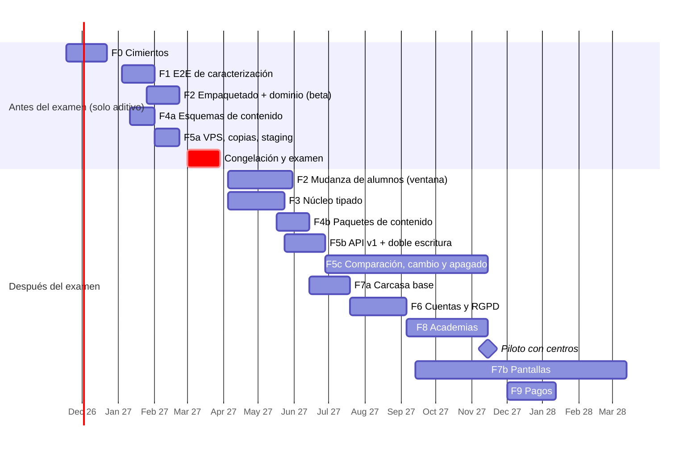

# Plan de migración a «Patrón» 2.0

Cómo se llega del prototipo actual a la arquitectura de [`ARQUITECTURA-V2.md`](ARQUITECTURA-V2.md), por fases y por
estrangulamiento. Sustituye el plan por fases de `docs/VERSION-2.md` §5–§7. Los ids `E-01`, `S-12`… son hallazgos de
la [auditoría](../auditoria/AUDITORIA.md).

_17 de noviembre de 2026._

## 1. Reglas del plan

1. **Hasta la convocatoria de marzo de 2027, la app actual no se interrumpe.** Sigue publicándose desde el repositorio
   actual, en la dirección actual, con el Worker actual. Antes de esa fecha solo se hace trabajo **aditivo**: cosas
   nuevas al lado, nada que cambie lo que ve o usa el alumno. Del 1 de marzo al examen, **congelación**: solo
   arreglos críticos.
2. **Estrangulamiento.** Cada pieza nueva convive con la vieja y la sustituye cuando la iguala en pruebas. Ninguna
   fase exige un «gran día de cambio».
3. **Cada fase se puede deshacer** y dice cómo.
4. **Nada toca la base de producción desde local ni desde pruebas** (ADR 0014). Vale también para D1 desde el día 1.
5. **Criterios de salida medibles.** Una fase no está hecha porque «parece que va»: lo dice un número o una prueba.
6. **El cuello de botella es la revisión del dueño, no la escritura.** Como mucho 2–3 líneas de trabajo de agentes
   abiertas a la vez; más PR de los que se pueden revisar es deuda, no velocidad.

**Qué es «una semana» aquí:** una semana de una persona dedicando unas 20 horas a dirigir y revisar agentes. Con menos
dedicación, el calendario se estira en proporción; las fases que pueden ir en paralelo lo acortan algo, no a la mitad.
La auditoría ya avisó de que las «6–8 semanas» del cliente en VERSION-2 eran optimistas: aquí la carcasa son 20–27.

**Modelos** (misma convención que `docs/ROADMAP.md`): **Fable u Opus** para diseñar mecanismos, contratos, seguridad y
todo lo que toque normas, cálculos o datos de alumnos; **Sonnet** para construir lo ya decidido, con pruebas;
**Haiku** solo para volumen que se comprueba solo (nunca contenido de examen).

## 2. Resumen de fases

| Fase | Qué | Esfuerzo (semanas) | Cuándo | ¿Toca al alumno? |
| --- | --- | ---: | --- | --- |
| **F0** | Cimientos: repositorio, CI, audio fuera, dominio comprado, `checkJs` | 4–5 | nov–dic 2026 | No |
| **F1** | Red de seguridad: E2E de caracterización | 3–4 | ene 2027 | No |
| **F2** | Empaquetado y mudanza al dominio propio | 3–4 (+ 8 semanas de ventana) | preparar ene–feb; activar abr 2027 | Sí, desde abril |
| **F3** | Núcleo como paquete tipado | 5–7 | abr–may 2027 | No (mismo comportamiento) |
| **F4** | Contenido con esquema y paquetes | 4–6 | esquema ene–feb; paquetes may–jun | Sí (carga más rápida) |
| **F5** | API en el VPS, doble escritura y apagado del Worker | 7–9 (+ 4 meses de observación) | infra ene–feb; API may–jul; apagado otoño | No (invisible) |
| **F6** | Cuentas, sesiones y RGPD | 5–7 | jul–ago 2027 | Sí (opcional para él) |
| **F7a** | Carcasa nueva: base (Preact, IndexedDB) | 4–5 | jun–jul 2027 | Sí (sin cambio visible) |
| **F7b** | Carcasa nueva: pantalla a pantalla | 16–22 | sep 2027 – mar 2028 | Sí |
| **F8** | Academias | 8–10 | sep–nov 2027; piloto nov–dic | Sí (centros piloto) |
| **F9** | Pagos | 4–6 | dic 2027 – ene 2028 | Sí |
| | **Total** | **63–85** | **≈ 16 meses** | |

**Hitos publicables** (se planifica por ellos, no por el total):

| Hito | Fecha objetivo | Qué cambia para el mundo |
| --- | --- | --- |
| H1 «Nada roto llega a producción» | Navidad de 2026 | CI obligatoria; copia semanal de D1 |
| H2 «Casa propia» | Abril–mayo de 2027 | Dominio propio, app empaquetada (de 403 peticiones a ~15) |
| H3 «Servidor propio» | Julio de 2027 | Sincronización en el VPS con copias probadas |
| H4 «Cuenta y privacidad» | Septiembre de 2027 | Cuenta opcional, exportar y borrar, política publicada |
| H5 «Primer centro» | Noviembre–diciembre de 2027 | Piloto con 1–3 centros |
| H6 «Se puede cobrar» | Enero–febrero de 2028 | Pases y canon |
| H7 «Adiós a la carcasa antigua» | Primavera de 2028 | `legado/` borrado |

## 3. Qué se puede adelantar sin riesgo antes de marzo de 2027

Todo esto ocurre en el repositorio nuevo, en el VPS o en la CDN, y **no cambia un byte de lo que sirve la dirección actual**:

| Trabajo | Fase | Por qué no hay riesgo |
| --- | --- | --- |
| Repositorio nuevo, CI completa, reglas de capas, lint, formato | F0 | Es otro repositorio |
| Un `ci.yml` mínimo **también en el repositorio actual** (pruebas + comprobación de la precarga en cada PR) | F0 | Solo observa; es lo que protege al dueño mientras sigue publicando hasta marzo |
| Exportación semanal de D1, de solo lectura | F0 | Lee; no escribe |
| Audio a R2 (copia) | F0 | El audio de la app actual sigue donde está |
| Comprar el dominio y montar Cloudflare | F0 | Nadie apunta aún allí |
| E2E de caracterización de todos los recorridos | F1 | Se ejecutan contra una copia local |
| Empaquetar la app tal cual con Vite y servirla en el dominio nuevo **como beta, sin anunciarla** | F2 | Es otro origen; el dueño puede probarla con su código. Requiere añadir el origen nuevo a `ORIGENES_EXTRA` del Worker: cambio de configuración, sin código, que se hace en una ventana tranquila de enero y se revierte quitándolo |
| Esquemas Zod del contenido y validación en CI | F4a | Solo valida lo que ya hay |
| VPS: Compose, Caddy, Postgres, copias con restauración probada, monitorización, *staging* | F5a | Sin alumnos |
| API `/v1/sync` portada y probada en *staging* | F5b (parte) | Ningún cliente la usa |
| Borradores de política de privacidad, registro de tratamientos y contrato de encargo | F6 (parte) | Documentos |
| Prueba de «Hoy» (Preact frente a Svelte), en una rama | F7a (parte) | No se fusiona |
| Arreglar los 13 `TS2554` y los 95 `TS236x` que sean fallos reales | F0 | Son arreglos normales, con su prueba, por el camino de siempre y antes de febrero |

**No se hace antes del examen:** pantalla de mudanza, cambio de servidor de sincronización, IndexedDB, renombrar el
núcleo a TypeScript, cuentas, cualquier pantalla nueva.

**Dos repositorios hasta la congelación.** Mientras el actual siga siendo producción, los cambios de producto se hacen
allí y se traen al nuevo con `herramientas/importar-legado.mjs` (repetible, comprobado en CI). En el nuevo no se edita
`src/` a mano: solo se añade alrededor. Tras el examen, **relevo**: última importación, el repositorio nuevo pasa a ser
la fuente y el antiguo solo recibe la pantalla de mudanza.

## 4. Fases

### F0 · Cimientos (incondicional)

**Objetivo.** Que nada roto pueda llegar a producción y que el proyecto tenga casa propia. Ataca los riesgos 1, 5, 6
y 10 de la auditoría. No depende de ninguna validación de negocio.

**Entregables.**

- Repositorio `patron` privado, con la estructura de monorepo vacía y el código actual importado por guion bajo
  `apps/web/` (tal cual) y `apps/worker-legado/`; `pnpm` 10, Node 24.
- `ci.yml`: Prettier, ESLint (109 errores → 0; avisos con trinquete), `tsc --checkJs` con trinquete (472 → objetivo 0),
  `node --test` con `c8 --all` y umbral por directorio, `dependency-cruiser` con las capas reales, `knip`, `gitleaks`,
  `pnpm audit`. Rama protegida, revisión obligatoria, borrado automático de ramas.
- `ci.yml` mínimo en el repositorio actual.
- Audio en R2; en el repositorio nuevo, solo índice y guiones. `gitleaks` sobre el árbol importado.
- Dominio comprado, DNS en Cloudflare, correo del dominio con SPF, DKIM y DMARC.
- Exportación semanal automática de D1 (solo lectura) a un almacén externo, cifrada; norma de «producción intocable»
  escrita y aplicada a `wrangler`.
- ADR en `docs/adr/`; guía de arquitectura corta que sustituye a `ARCHITECTURE.md`.
- Comprobado y anotado: quién tiene escritura en GitHub y en Cloudflare; **si se conserva el `PEPPER`** (ADR 0018).

**Criterio de salida.**

- Un PR con un test roto, un error de lint o un `import` que viole las capas **no se puede fusionar** (se demuestra con tres PR de prueba).
- `git clone` del repositorio nuevo < 40 MB; `pnpm i && pnpm test` pasa recién clonado (hoy falla 1 y se saltan 5, P-05).
- `checkJs`: 0 errores `TS2554` y `TS236x`; total ≤ 250.
- Existe al menos una exportación de D1 restaurada y verificada en local.

**Riesgos y vuelta atrás.** Riesgo: que el lint destape cientos de avisos y la fase se convierta en limpiar. Se evita
con trinquete: se fija la cifra de hoy y solo se exige no empeorar. Vuelta atrás: no hay nada que deshacer; producción
no se ha tocado. El `ci.yml` del repositorio actual se quita borrando un fichero.

**Esfuerzo.** 4–5 semanas.

**En paralelo y con qué modelo.**

| Línea | Modelo |
| --- | --- |
| Reglas de capas, umbrales, diseño de los flujos de CI y de la protección de ramas | Fable u Opus |
| Escribir flujos, configuración de ESLint/Prettier, guion de importación, subida del audio | Sonnet |
| Revisar uno a uno los `TS2554` y `TS236x` (son posibles fallos de cálculo) | Opus |
| Quitar las 107 variables sin usar y las 29 exportaciones muertas, anotar la versión del *vendor* | Haiku (lo verifican lint y pruebas) |
| Dominio, DNS, cuentas, comprobación de accesos y del `PEPPER` | El dueño |

### F1 · Red de seguridad: E2E de caracterización

**Objetivo.** Tener pruebas que digan si una pantalla nueva iguala a la vieja antes de tocar ninguna (P-01, P-02).

**Entregables.**

- `e2e/` con Playwright (Chromium y WebKit móvil; 360 y 990 px; claro y oscuro) y axe en cada recorrido:

  1. primera visita y bienvenida; 2. «Hoy» en cinco estados; 3. una clase completa; 4. una tanda de preguntas con
  corrección; 5. un examen completo con resultados; 6. carta paso a paso y modo guiado; 7. mesa de cartas (trazar una
  demora); 8. sincronizar dos aparatos (dos contextos contra un servidor local); 9. vincular por enlace;
  10. sin conexión: instalar, cortar la red, estudiar, volver; 11. actualización de versión con examen a medias;
  12. copia y recuperación; 13. pódcast con pausa; 14. Travesía y la semana antes; 15. Ajustes (letra, tema).
- Reloj y azar fijados; servidor de sincronización local con D1 en memoria (ya existe para los tests).
- Guion de arranque de la auditoría convertido en prueba, con las cifras de hoy como línea base.
- Capturas de referencia de las 37 vistas a 360 y 990 px, claro y oscuro.

**Criterio de salida.** Los 15 recorridos pasan 20 veces seguidas sin fallos intermitentes en CI en menos de 12
minutos; axe con 0 infracciones salvo la conocida de la mesa de cartas (anotada); una mutación deliberada en cada
recorrido (cambiar un cálculo, quitar un botón) hace fallar su prueba.

**Riesgos y vuelta atrás.** Riesgo: pruebas frágiles que acaban desactivadas; se combate con selectores por rol y
texto visible, no por clase CSS, y con la regla de las 20 pasadas. Riesgo: caracterizar un fallo como si fuera lo
correcto; el dueño revisa cada recorrido antes de darlo por bueno. Sin vuelta atrás necesaria (aditivo).

**Esfuerzo.** 3–4 semanas.

**En paralelo y con qué modelo.** Definir qué se caracteriza en cada recorrido y cuál es el resultado correcto: Fable
u Opus. Escribir los guiones, de tres en tres recorridos por agente: Sonnet. Capturas de referencia de las 37 vistas:
Haiku. Puede ir a la vez que F4a y F5a.

### F2 · Empaquetado y mudanza al dominio propio

**Objetivo.** Salir del origen compartido (S-01), poder poner cabeceras (S-02) y dejar de servir 403 ficheros sueltos
(R-01), **sin que nadie pierda progreso** (ADR 0013). Se hace antes de introducir cuentas.

**Entregables.**

- **Vite empaqueta la app actual tal cual** (misma `ui/`, sin framework): punto de entrada `index.html`, `data/` como
  estáticos, trozos por `import()` donde ya los hay. Service worker con Workbox y **precarga generada**: en el origen
  nuevo no hay service worker antiguo que migrar, así que el cambio de mecanismo sale gratis.
- Despliegue a Cloudflare desde CI con `_headers` (CSP en modo informe); audio desde `audio.<dominio>`.
- Página de privacidad provisional y aviso legal en el dominio nuevo.
- En la app antigua (repositorio actual): pantalla de mudanza con comprobación de «todo subido», copia del código y
  guía de instalación; y, en la nueva, «¿Vienes de la app anterior?» en la bienvenida.
- Guía de mudanza con capturas para iPhone, Android y ordenador.
- E2E de la mudanza (dos orígenes locales) y **prueba manual en teléfonos reales**.

**Calendario dentro de la fase.** Enero–febrero: construir y servir en el dominio como beta sin anunciar; el dueño la
usa si quiere. Marzo: nada. Abril: se publica en la dirección antigua el aviso descartable; a las 8 semanas, la
dirección antigua solo enseña la pantalla de mudanza. Sigue viva al menos 12 meses.

**Criterio de salida.**

- Los 15 recorridos de F1 pasan igual contra la app empaquetada que contra la original.
- Primera visita: ≤ 20 peticiones y JS de arranque ≤ 450 KB gzip (objetivo intermedio; el de 200 KB llega en F7).
- Mudanza probada en iPhone con app instalada, Android con app instalada y navegador de escritorio: el progreso
  plegado tras mudarse es idéntico (comparación de la exportación).
- A las 8 semanas del aviso, ≥ 80 % de los alumnos activos en los últimos 30 días sincronizan desde el origen nuevo
  (el servidor lo sabe por la cabecera `Origin`, sin datos personales).

**Riesgos y vuelta atrás.**

| Riesgo | Mitigación |
| --- | --- |
| Alumno con cosas sin subir que se muda | La pantalla no deja continuar hasta que el servidor confirma 0 pendientes; sin red, no se ofrece |
| iPhone: la app instalada no comparte datos con Safari | Código visible y copiable; la app nueva lo pide en la bienvenida |
| Se pierde lo que no viaja (carta escaneada, bloc, ajustes) | Se avisa antes con la lista exacta; la carta se vuelve a importar |
| El empaquetado cambia algún comportamiento | Para eso está F1; y la app antigua sigue intacta |
| Avisos diarios duplicados | Baja en el origen antiguo como paso de la mudanza |

Vuelta atrás: la dirección antigua nunca deja de funcionar durante la ventana; si la nueva da problemas, se retira el
aviso (un despliegue) y quien se haya mudado puede volver con su código, porque los dos orígenes hablan con el mismo servidor.

**Esfuerzo.** 3–4 semanas de trabajo, más la ventana de 8 semanas de convivencia (sin trabajo, solo vigilar).

**En paralelo y con qué modelo.** Diseño de la pantalla de mudanza, textos para gente mayor y análisis de qué no
viaja: Fable u Opus. Configuración de Vite y Workbox, despliegue, guía: Sonnet. Pruebas en teléfonos: el dueño.

### F3 · Núcleo como paquete tipado

**Objetivo.** Que los motores sean un paquete con frontera vigilada y tipos estrictos, sin cambiar un resultado (T-01, E-07, E-08).

**Entregables.**

- `@patron/contratos` con los tipos de dominio (`Pregunta`, `Banco`, `Operacion`, `Progreso`, `Titulacion`, `Leccion`).
- `@patron/nucleo` y `@patron/laminas`: código movido por guion, renombrado a `.ts` y en `strict`, directorio a
  directorio en este orden: `math`, `bancos`, `analysis`, `chart`, `graphics`, `bloc` → `theory` → `sincro` → `exams`
  → `course` → `laminas`.
- Rotos los 2 ciclos (E-09) y las dependencias mutuas de E-08 (`course ↔ illustrations`, `course ↔ theory`, `course ↔ exams`).
- `store` deja de importar hacia arriba; `motor.js` (que usa `window`) se queda en `web`.
- Lógica de negocio sacada de las vistas que más pesan (`resultados` de `theory.js`, corrección de examen) a funciones
  puras con pruebas (C-03): es condición para F7b.

**Criterio de salida.** `tsc -b` con `strict` y 0 errores en `contratos`, `nucleo` y `laminas`; las 2.581 pruebas
pasan sin haber cambiado ninguna aserción (el `diff` de `tests/` solo toca rutas de importación); cobertura ≥ 95 % en
`nucleo`; `dependency-cruiser` sin violaciones; los 15 E2E en verde; ni un `any` explícito fuera de una lista con motivo.

**Riesgos y vuelta atrás.** Riesgo: «arreglar» comportamiento al tipar; regla: un PR de tipado no cambia lógica, y si
el tipo revela un fallo, va en un PR aparte con su prueba. Riesgo: `plegar` y `operaciones` (complejidad 83 y 66); se
tipan sin reestructurar, con el test de equivalencia de 200 secuencias como red. Vuelta atrás: cada directorio es un
PR que se revierte solo; los tipos no llegan al navegador.

**Esfuerzo.** 5–7 semanas.

**En paralelo y con qué modelo.** Tipos de dominio y tipado de `sincro`: Fable u Opus. Conversión directorio a
directorio: Sonnet, hasta 3 agentes a la vez en directorios sin dependencia entre sí (`math`/`bancos`/`bloc`, luego
`exams`/`theory`, luego `course`). Anotar parámetros en `laminas` (184 errores, 95 ficheros): Haiku, verificado por
`tsc` y por las pruebas. Extraer lógica de las vistas: Opus.

### F4 · Contenido con esquema y paquetes

**Objetivo.** Que un error de dato falle en CI y que el alumno solo descargue lo que estudia (D-03, M-09, R-02, R-03, R-04).

**Entregables.**

- **F4a (antes de marzo, aditivo):** esquemas Zod de todo el contenido; validación en CI; marca de generado frente a
  fuente; JSON Schema para el editor; comprobación de ids estables.
- **F4b:** compilador a paquetes (índice, por tema, explicaciones, convocatorias reservadas aparte); cargador en el
  cliente con caché versionada; resoluciones y láminas como trozos por banco; versión semántica por banco; cuarentena
  comprobada también sobre `dist/`; tubería de bancos ejecutable en CI con huellas de las entradas (M-08).

**Criterio de salida.** 100 % de los ficheros de `fuentes/` validan; un campo mal escrito a propósito hace fallar la
CI; datos para pintar «Hoy» ≤ 150 KB gzip (hoy ≈ 1,2 MB); precarga inicial ≤ 3 MB gzip (hoy 7,5 MB); ningún paquete
que no sea `conv-*` contiene una reservada (prueba); las pruebas de reserva y cuarentena pasan sin cambios; el examen
final de un alumno con una foto de reserva antigua sale idéntico antes y después.

**Riesgos y vuelta atrás.** Riesgo mayor: **romper la reserva** (que una reservada se cuele en el estudio o que
cambie el examen final de alguien); se cubre con las pruebas existentes más una nueva de «foto antigua». Riesgo: un
alumno sin conexión sin su banco; el banco elegido se descarga entero antes de decir «listo». Vuelta atrás: el
cargador nuevo va tras un interruptor; el formato antiguo se sigue generando un trimestre.

**Esfuerzo.** 4–6 semanas (F4a 1,5–2; F4b 2,5–4).

**En paralelo y con qué modelo.** Esquemas y diseño del empaquetado de la reserva: Fable u Opus (toca una norma del
proyecto). Compilador y cargador: Sonnet. Nada para Haiku: es contenido de examen.

### F5 · API en el VPS, doble escritura y apagado del Worker

**Objetivo.** Llevar la sincronización a PostgreSQL en el VPS sin que ningún alumno lo note, con copias probadas
(D-04, D-05, M-07, S-21, S-22) y según el ADR 0018.

**Entregables.**

- **F5a (antes de marzo):** VPS endurecido (cortafuegos, SSH por VPN, actualizaciones); Compose con Caddy, Postgres 18
  y pgBackRest; copias al almacén externo y **restauración automática semanal**; Uptime Kuma, monitor externo y
  alertas; entorno de *staging*; despliegue por CI con aprobación; runbooks (restaurar, rotar secretos, emergencia).
- **F5b:** `apps/api` con `/v1/sync`, `/v1/avisos` y `/v1/salud` portados (mismo contrato, mismas pruebas); modelo de
  datos inicial (`alumnos`, `credenciales_codigo`, `operaciones`, `avisos_push`) con migraciones `dbmate`; roles de
  base de datos; límites en memoria; registros sin datos personales. En el cliente, segundo remoto «sombra».
- **F5c:** importación de D1; tarea diaria de comparación; cambio de principal; avisos diarios migrados; Worker en
  solo lectura y, después, eliminado.

**Criterio de salida.**

- Restauración completa ensayada por el dueño en < 2 horas siguiendo el runbook.
- 14 días seguidos con **0 diferencias** entre D1 y Postgres (recuento, último `seq` y huella de ids por alumno).
- 30 días con la API como principal: disponibilidad ≥ 99,5 %, p95 de `/v1/sync` < 150 ms, 0 alumnos con `recreados` > 0.
- Desde un portátil y desde CI **no se puede** abrir conexión a la base de producción (se intenta y falla).
- El Worker lleva 90 días en solo lectura sin escrituras rechazadas de clientes legítimos antes de borrarlo.

**Riesgos y vuelta atrás.**

| Riesgo | Mitigación |
| --- | --- |
| No se conserva el `PEPPER` | Se sabe desde F0. Sin él: no se importan credenciales, los alumnos entran por resubida desde sus aparatos y el Worker vive 6 meses más |
| El VPS cae | La app sigue en local; en los pasos 1–3 el otro servidor tiene todo |
| Diferencias entre D1 y Postgres | No se cambia de principal hasta 14 días a cero |
| Avisos enviados por los dos servidores | Interruptor `PUSH_ACTIVO` del Worker a 0 antes de encender los de la API |
| Carga del VPS (si aloja otras cosas) | Límites de memoria y CPU por contenedor; alerta de disco |

Vuelta atrás: en cada paso el cliente puede volver al Worker con un cambio de configuración remota; los datos están
en los dos sitios y en cada aparato. Solo el paso 4 (borrar el Worker) es irreversible, y por eso espera 90 días y
deja una exportación archivada.

**Esfuerzo.** 7–9 semanas (F5a 2–3; F5b 3–4; F5c ≈ 2 repartidas en 4 meses de calendario).

**En paralelo y con qué modelo.** Modelo de datos, roles y políticas, endurecimiento, runbooks y revisión de
seguridad: Fable u Opus. Compose, Caddyfile, portado del manejador y de sus 40 pruebas, tarea de comparación: Sonnet.
Nada para Haiku. F5a puede ir a la vez que F1 y F2; F5b a la vez que F3 (no comparten ficheros).

### F6 · Cuentas, sesiones y RGPD

**Objetivo.** Identidad revocable y derechos del alumno en el producto (S-10, S-12, S-13); es la puerta de academias y cobro.

**Entregables.**

- `/v2`: sesiones por aparato, vínculos de un solo uso, enlace mágico, passkeys, «Mis dispositivos» con cierre de
  sesiones, unión de cuenta y progreso existente.
- Contrato de operaciones v2 (se acaba el rodeo de `settings`, E-12) y `POST /v2/sync`.
- Exportar y borrar desde la app (con margen de 7 días y lápidas); tarea de retención.
- Política de privacidad, aviso legal y registro de tratamientos publicados; correcciones en `docs/SYNC.md`.
- Correo transaccional con dominio propio.
- Pantallas nuevas (Cuenta, Mis dispositivos, Privacidad) **ya en Preact** sobre la carcasa base de F7a.
- CSP obligatoria (deja el modo informe).

**Criterio de salida.** Un alumno con código antiguo pasa a sesión sin perder nada (E2E, comparando el progreso
plegado); revocar un aparato corta su sincronización en < 1 minuto; exportación completa descargable; un alumno
borrado no reaparece aunque un aparato antiguo intente resubir (E2E); 0 informes legítimos de CSP en 14 días;
revisión de seguridad externa o de un segundo modelo sin hallazgos altos abiertos; textos legales revisados por un profesional.

**Riesgos y vuelta atrás.** Riesgo: fricción para gente mayor; la cuenta nunca es obligatoria para estudiar y se
prueba con 3–5 personas reales antes de anunciarla. Riesgo: correo que no llega; alternativa de vínculo por código
siempre disponible. Riesgo: unir dos progresos; se reutiliza la fusión de bases probada. Vuelta atrás: `/v1` con
código sigue aceptado 12 meses; las cuentas son un interruptor que se puede ocultar.

**Esfuerzo.** 5–7 semanas.

**En paralelo y con qué modelo.** Modelo de amenazas, flujos de autenticación, función de borrado y borradores
legales: Fable u Opus. Rutas, pantallas y correo: Sonnet. Revisión de seguridad final: un modelo distinto del que lo
escribió, más el dueño.

### F7 · Carcasa nueva

**Objetivo.** Sustituir la interfaz de prototipo (E-01, E-02, E-05, C-03, C-04, C-07, D-01, D-02) pantalla a
pantalla, sin un solo día en que la app deje de funcionar.

#### F7a · Base

**Entregables.** Prueba de «Hoy» (Preact frente a Svelte) y decisión anotada; `apps/web` con Preact, enrutador y
`<VistaAntigua>` sirviendo **todas** las rutas con las vistas actuales; contenedor de estado; **IndexedDB** con
migración verificada desde `localStorage` y compactación; `@patron/diseno` con tokens generados y componentes base;
manejo global de errores y cola de errores; interruptor por ruta.

**Criterio de salida.** Los 15 E2E pasan con todas las rutas aún antiguas; migración a IndexedDB probada con 200
registros reales anonimizados o generados (progreso plegado idéntico); escribir una respuesta con 20.000 operaciones
< 5 ms p95; `localStorage` ya no crece.

**Esfuerzo.** 4–5 semanas.

#### F7b · Pantalla a pantalla, por orden de valor

Para cada pantalla, el mismo ciclo: (1) su E2E ya existe y pasa contra la antigua; (2) Opus saca la lógica a un
`modeloX` puro con pruebas; (3) Sonnet escribe los componentes; (4) el E2E pasa sin tocarlo, axe a 0, capturas
comparadas, pasada con lector de pantalla; (5) se activa para el dueño, luego para el 10 %, luego para todos;
(6) en el mismo PR que la activa para todos se borran la vista antigua, su CSS y sus pruebas de texto.

| Orden | Pantallas | Por qué en este puesto | Semanas |
| ---: | --- | --- | ---: |
| 1 | **Hoy** | La más vista; sale casi hecha de la prueba | 1 |
| 2 | **Tanda, examen y resultados** (`theory.js`, `exams.js`, `ensayo.js`) | Donde el alumno pasa más tiempo; el nudo de 1.336 líneas (E-02) | 3–4 |
| 3 | **Clase y tarjetas** (`curso.js`, `tarjetas.js`) | Segundo uso; 454 líneas en una función | 2–3 |
| 4 | Temario, plan, progreso, nivel, titulación, bienvenida | Navegación principal; sencillas | 2 |
| 5 | **Carta paso a paso y modo guiado** (`carta-pasos.js`, `guiado.js`) | El diferencial del producto; lógica ya en el núcleo | 3–4 |
| 6 | Fallos, estrategia, semana, víspera, día del examen, Travesía | Estacionales: antes de la convocatoria de otoño | 2–3 |
| 7 | Pódcast y radio | Estado global del reproductor | 1–2 |
| 8 | **Mesa de cartas** (`interactive-chart.js`, 788 líneas en una función) | La más difícil y la que mejor funciona hoy: la última, y como isla envuelta antes que reescrita | 2–3 |
| 9 | Biblioteca, fórmulas, chuleta, mapas, galería, calculadora, reglas, Más | Poco riesgo; buen trabajo para agentes en paralelo | 1–2 |

**Criterio de salida de F7.** `apps/web/src/legado/`, `app.css` y `laminas.css` borrados; JS de arranque ≤ 200 KB
gzip y «pantalla lista» ≤ 3,5 s en la condición de medida; cobertura de `web` ≥ 70 %; 0 infracciones de axe en todas
las rutas; 0 pruebas que lean CSS o código fuente como texto.

**Riesgos y vuelta atrás.** Riesgo: quedarse a medias con dos interfaces para siempre; se combate con el orden por
valor (lo que queda al final es lo menos usado) y con no empezar una pantalla sin borrar la anterior. Riesgo:
regresiones visuales que el E2E no ve; capturas comparadas y revisión del dueño («nada se publica sin visto bueno»
sigue vigente). Riesgo: que el dueño siga pidiendo funciones en pantallas a medio migrar; regla: una función nueva se
hace en la versión nueva o espera. Vuelta atrás: interruptor por ruta hasta que la pantalla lleva dos semanas para
todos; después, revertir el PR.

**Esfuerzo.** 16–22 semanas, que con dos pantallas en paralelo son 5–6 meses de calendario.

**En paralelo y con qué modelo.** Extraer el modelo de cada vista: Opus. Componentes: Sonnet, dos pantallas a la vez
como máximo (por la revisión). Capturas, comparación de imágenes y borrado de clases CSS muertas: Haiku. Pantallas del
grupo 9: tres agentes Sonnet en paralelo.

### F8 · Academias

**Objetivo.** Que un centro pueda dar de alta un grupo, repartir un código y seguir a sus alumnos con su
consentimiento, aislado de los demás centros (D-04, D-05, D-09).

**Requisitos previos.** F5 (API principal), F6 (cuentas, RGPD) y F7a. **No** necesita F7b: el panel del profesor es
interfaz nueva.

**Entregables.**

- Tablas de centros, miembros, grupos, códigos de centro, matrículas, consentimientos, `config_grupo`,
  `accesos_profesor`; **políticas RLS** y batería de aislamiento.
- Proyecciones (`proy_*`) calculadas con el pliegue del núcleo, y su reconstrucción.
- Alta de centro con aceptación del contrato de encargo; invitación de profesores por correo.
- Alumno: entrar con código de centro, pantalla de consentimiento, «Mi centro» con retirada y «quién ha visto mi progreso».
- Panel del profesor: lista del grupo con preparación, riesgo y última actividad; ficha del alumno; informe semanal
  por correo; configuración del grupo (sustituye al fichero del modo profesor); exportación CSV.
- Recuento de alumnos activos por centro (base del canon).
- Interruptor por centro para el piloto.

**Criterio de salida.** Batería de aislamiento: 0 lecturas o escrituras cruzadas entre dos centros en todas las
tablas y rutas; prueba del catálogo: ninguna tabla con `centro_id` sin política; retirar el consentimiento oculta al
alumno en la siguiente consulta (E2E); `proyección ≡ plegar(operaciones)` en 200 secuencias al azar; panel de un grupo
de 50 alumnos en < 500 ms; **piloto de un mes con 1–3 centros** sin incidentes de datos y con el contrato de encargo firmado.

**Riesgos y vuelta atrás.**

| Riesgo | Mitigación |
| --- | --- |
| Fuga de datos entre centros | RLS forzada + batería obligatoria en CI + revisión por un segundo modelo |
| Construir un panel que nadie pidió | Las 5–10 conversaciones con centros (R-27 de la hoja de ruta) se hacen **antes del verano de 2027**; el panel se diseña con 2–3 profesores reales |
| El alumno no entiende el consentimiento | Prueba con personas reales; texto llano; no compartir no penaliza |
| Coste de las políticas en consultas | Índices dedicados y presupuesto de tiempo en CI |
| No hay centros piloto en otoño | La fase se entrega igual, tras su interruptor; no bloquea F7b ni F9 |

Vuelta atrás: todo va tras el interruptor por centro; apagarlo deja a los alumnos como particulares con su progreso intacto.

**Esfuerzo.** 8–10 semanas.

**En paralelo y con qué modelo.** Políticas, consentimiento, proyecciones y diseño del panel: Fable u Opus. Rutas y
pantallas: Sonnet, en dos líneas (lado alumno y lado profesor). Revisión de aislamiento: un modelo distinto del autor.
Puede ir a la vez que el inicio de F7b.

### F9 · Pagos

**Objetivo.** Cobrar pases a particulares y el canon a los centros (ADR 0017).

**Requisitos previos (de negocio, no técnicos).** Derechos de preguntas y carta aclarados; política publicada;
decisión del dueño con su asesor sobre facturación e IVA.

**Entregables.** Catálogo de productos; Stripe Checkout de pago único; *webhooks* firmados e idempotentes; pases y
cálculo de derechos en el servidor, entregados firmados para funcionar sin conexión; nivel gratuito y bloqueo suave
en el cliente; cupón «¡Aprobé!» y garantía de ampliación; liquidación trimestral del canon con meses de pausa y
factura; panel de facturación del centro; pausa por impago con plazo de gracia; conciliación diaria con Stripe.

**Criterio de salida.** En el entorno de pruebas de Stripe: compra → pase en < 30 s; el mismo *webhook* enviado 5
veces concede un solo pase; un reembolso retira el acceso; sin *webhook* no hay pase aunque el cliente diga lo
contrario; liquidación de un trimestre de prueba con pausas cuadra con el recuento manual; 0 diferencias en la
conciliación durante 14 días; una compra real y un reembolso real hechos por el dueño.

**Riesgos y vuelta atrás.** Riesgo: bloquear a quien ha pagado; ante la duda el cliente concede (7 días de gracia sin
conexión) y hay un botón «ya he pagado» que reconsulta. Riesgo: obligaciones fiscales; se resuelven antes de empezar,
no después. Riesgo: que el muro de pago hunda el uso; se enciende por titulación y con el nivel gratuito generoso.
Vuelta atrás: interruptor global «todo gratis», que es el estado actual.

**Esfuerzo.** 4–6 semanas.

**En paralelo y con qué modelo.** Diseño de derechos, *webhooks* y liquidación: Fable u Opus. Integración y pantallas:
Sonnet. Nada para Haiku.

## 5. Después de F9

- **Aula virtual en tiempo real** (carta compartida, test en clase): fase aparte, con su propio prototipo y
  condicionada al permiso de la carta.
- **PNB, Capitán, más tribunales:** contenido sobre los ejes y paquetes ya existentes.
- **Editor de contenido para centros:** solo si se cumplen las condiciones de `ARQUITECTURA-V2.md` §4.5.

## 6. Riesgos del plan en conjunto

| # | Riesgo | Probabilidad | Qué se hace |
| ---: | --- | --- | --- |
| 1 | **Dedicación real menor que la supuesta** (el dueño además prepara su examen hasta marzo) | Alta | Planificar por hitos; H1–H3 no dependen de negocio. Si hay que recortar, se aplaza F7b, no F0–F6 |
| 2 | **Revisión insuficiente de lo que escriben los agentes** | Alta | CI estricta, límite de 2–3 líneas abiertas, revisión cruzada entre modelos en seguridad y datos |
| 3 | **Deriva entre los dos repositorios** hasta la congelación | Media | Importación por guion comprobada en CI; en el nuevo no se edita `src/` |
| 4 | **Mudanza de dominio en iPhone** | Media | Prueba en teléfonos reales, código visible, 12 meses de convivencia |
| 5 | **`PEPPER` no conservado** | Desconocida | Se comprueba en la primera semana de F0 |
| 6 | **Derechos del contenido y de la carta sin aclarar** | Media | Bloquea F9 (cobrar), no lo anterior. Es gestión del dueño y puede empezar ya |
| 7 | **Las academias no validan el producto** | Media | Conversaciones antes del verano; piloto tras interruptor; F8 reutiliza todo lo de F5–F6 |
| 8 | **Un solo VPS** | Baja–media | *Offline-first*, copias externas, restauración ensayada; 4 horas de recuperación asumidas |
| 9 | **Carcasa a medio migrar durante mucho tiempo** | Media | Orden por valor; borrar lo antiguo en el mismo PR; no abrir pantalla nueva sin cerrar la anterior |
| 10 | **Funciones nuevas que compiten con la migración** | Alta | Presupuesto explícito: hasta marzo manda el examen; después, como mucho un 20 % del tiempo a funciones |
| 11 | **Textos legales y fiscalidad** | Media | Borradores en F6, revisión profesional antes de H4 y H6 |
| 12 | **Versiones de herramientas que cambian en 16 meses** | Baja | Renovate semanal; ninguna decisión depende de una versión menor |

## 7. Qué cambia respecto a `docs/VERSION-2.md`

| VERSION-2 | Este plan |
| --- | --- |
| F0–F2 condicionadas a ~30 clientes o un centro | F0–F5 sin condición; la puerta de negocio queda para F8–F9 |
| API en Workers + Postgres gestionado + Durable Objects | API Node en el VPS junto a PostgreSQL |
| Cliente en 6–8 semanas | Carcasa en 20–27 semanas, precedida de E2E |
| «Los mismos tests sobre el paquete» | Cierto para el núcleo; las 36 pruebas de texto se sustituyen por E2E |
| Operación como fase final continua | Copias, alertas y restauración antes de tener datos de pago (F5a) |
| Sin dominio, audio, repositorio ni E2E | F0, F1 y F2 |
| Comerciante de registro | Stripe, a confirmar con el asesor |
| 8–12 meses | ≈ 16 meses hasta H6; H7 en la primavera de 2028 |
