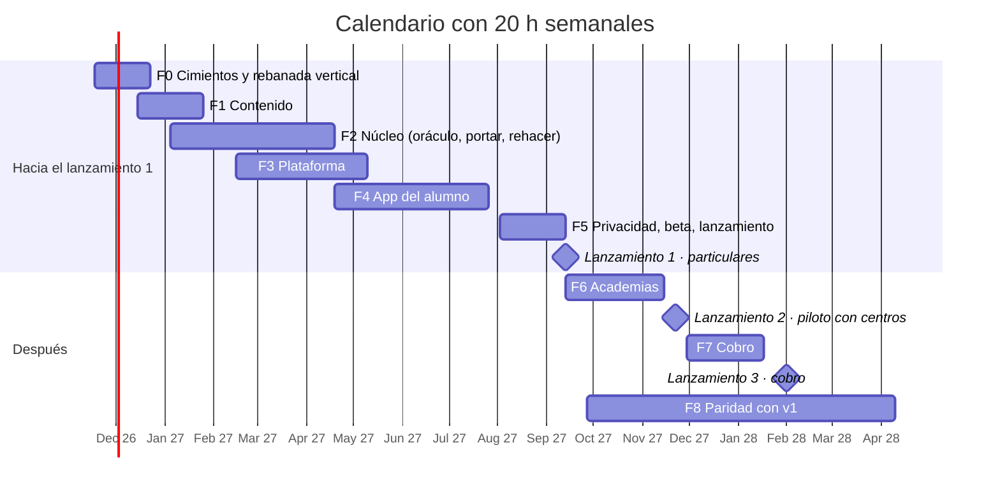

# Plan de construcción de «Patrón» 2.0

Cómo se construye el producto nuevo descrito en [`ARQUITECTURA-V2.md`](ARQUITECTURA-V2.md), desde el repositorio vacío
hasta poder cobrar. Sustituye al plan de migración anterior y al plan por fases de `docs/VERSION-2.md`.

_17 de noviembre de 2026 (segunda versión: desarrollo nuevo)._

## 1. Reglas del plan

1. **v1 no se toca.** La app actual sigue en su sitio, con su servidor, para el dueño y sus alumnos. El producto nuevo
   solo la **lee**: su contenido, su comportamiento (casos dorados) y, si un alumno lo pide, su progreso.
2. **No hay congelación ni fechas vetadas.** Como nada de esto afecta a v1, se puede empezar hoy y trabajar durante la
   preparación del examen de marzo de 2027. Lo único que marzo condiciona es el tiempo del dueño.
3. **Se construye por rebanadas que funcionan de punta a punta**, no por capas: desde la primera fase hay algo
   desplegado en *staging* que se puede abrir en un móvil.
4. **Tres lanzamientos, en orden:** particulares (gratis) → academias → cobro (ADR 0021).
5. **Criterios de salida medibles.** Una fase está hecha cuando lo dice un número o una prueba.
6. **Producción intocable desde fuera** desde el día en que exista (ADR 0014).
7. **El cuello de botella es la revisión del dueño, no la escritura.** Como mucho 2–3 líneas de agentes abiertas a la
   vez. Por eso las líneas en paralelo adelantan poco el calendario: reparten las mismas horas de revisión.

**Qué es «una semana».** Una semana del dueño dirigiendo y revisando agentes. El plan da el esfuerzo con **20 horas
semanales** y el calendario también con **10**. Con 10 horas el calendario no llega a doblarse en las fases donde los
agentes pueden trabajar largo rato sin revisión (portar contra casos dorados), y se dobla o más en las que exigen
criterio continuo (diseño de pantallas, seguridad).

**Modelos** (misma convención que `docs/ROADMAP.md` de v1): **Fable u Opus** para diseñar mecanismos, contratos,
seguridad y todo lo que toque normas, cálculos o datos de alumnos, y para arbitrar discrepancias con el oráculo;
**Sonnet** para construir lo ya decidido, con pruebas; **Haiku** solo para volumen que se comprueba solo, nunca para
contenido de examen.

## 2. Resumen

| Fase | Qué | Esfuerzo (semanas a 20 h) | Calendario a 20 h/sem | Calendario a 10 h/sem |
| --- | --- | ---: | --- | --- |
| **F0** | Cimientos y rebanada vertical | 4–5 | nov–dic 2026 | nov 2026 – ene 2027 |
| **F1** | Contenido: esquemas, importador, paquetes | 4–5 | dic 2026 – ene 2027 | ene–mar 2027 |
| **F2** | Núcleo: oráculo, portar, reescribir | 9–12 | ene–abr 2027 | feb–ago 2027 |
| **F3** | Plataforma: VPS, API, eventos, identidad | 7–9 | feb–may 2027 | jun–oct 2027 |
| **F4** | App del alumno | 10–13 | abr–jul 2027 | sep 2027 – mar 2028 |
| **F5** | Privacidad, beta y lanzamiento | 3–4 | ago–sep 2027 | mar–may 2028 |
| | **Lanzamiento 1 · particulares** | **37–48** | **septiembre de 2027** (ago–oct) | **mayo de 2028** (mar–jul) |
| **F6** | Academias | 7–9 | sep–nov 2027 | may–sep 2028 |
| | **Lanzamiento 2 · piloto con centros** | | **noviembre–diciembre de 2027** | **septiembre–octubre de 2028** |
| **F7** | Cobro | 4–5 | dic 2027 – ene 2028 | oct–dic 2028 |
| | **Lanzamiento 3 · se puede cobrar** | | **febrero de 2028** | **enero de 2029** |
| **F8** | Paridad con v1 (mesa de cartas, pódcast…) | 9–12 | intercalada, hasta primavera de 2028 | hasta mediados de 2029 |
| | **Total** | **57–74** | **≈ 16 meses** | **≈ 28–30 meses** |

**Con 10 horas semanales las academias no llegan en el primer año.** Si esa es la dedicación real, hay dos palancas:
recortar el primer lanzamiento (§5) o encargar parte de la revisión a otra persona.

## 3. Qué se puede empezar ya mismo

Todo. Nada depende de v1 más que de poder leerla. Estas líneas no se pisan entre sí y pueden arrancar la primera semana:

| Línea | Primeras tareas | Quién |
| --- | --- | --- |
| A · Repositorio y CI | Monorepo vacío con pnpm, TypeScript estricto, ESLint, Prettier, Vitest, reglas de capas, CI con rama protegida | Opus diseña, Sonnet escribe |
| B · Oráculo | Fijar el commit de v1; generador de casos dorados empezando por carta, ejercicios y náutica | Opus diseña los juegos, Sonnet escribe |
| C · Contenido | Esquemas Zod de pregunta, convocatoria, ficha de tribunal y lección; primer importador (un tribunal, una titulación) | Opus los esquemas, Sonnet el importador |
| D · Infraestructura | VPS endurecido, Compose con Caddy y Postgres, copias con restauración probada, *staging* | Opus diseña y revisa, Sonnet escribe |
| E · Lo que solo puede hacer el dueño | Comprar el dominio; cuentas de Cloudflare y GitHub; empezar la gestión de los derechos de preguntas y carta; hablar con academias | El dueño |

Lo único que conviene **no** adelantar: pantallas antes de tener núcleo y contenido (se rehacen), y pagos antes de aclarar derechos.

## 4. Fases

### F0 · Cimientos y rebanada vertical

**Objetivo.** Que el proyecto nazca con todas las puertas puestas y demostrar la arquitectura entera con una función
real, pequeña, desplegada.

**Entregables.**

- Repositorio `patron` privado: monorepo, CI completa (`rapido`, `tests`, `build`, `e2e`, `auditoria`), rama protegida,
  Renovate, `gitleaks`, Conventional Commits y `release-please`.
- Dominio comprado; Cloudflare (DNS, estáticos, R2, Access para *staging*); correo del dominio con SPF, DKIM y DMARC.
- VPS: cortafuegos, SSH por VPN, Compose con Caddy, Postgres 18 y pgBackRest hacia el almacén externo, **restauración
  automática**, monitor externo. Entorno `staging`; despliegue desde CI.
- `herramientas/oraculo` con el commit de v1 fijado y los dos primeros juegos de casos.
- **Rebanada vertical:** una tanda de 10 preguntas de un tema (un tribunal, PER), con contenido importado de verdad,
  corrección con el núcleo, eventos guardados en IndexedDB, sincronizados con la API y vistos en un segundo aparato,
  instalable y funcionando sin conexión, en `pre.<dominio>`.
- ADR en `docs/adr/`; guía de arquitectura corta; instrucciones para agentes en el repositorio.

**Criterio de salida.** Un PR con una prueba rota, un error de tipos o un `import` que viole las capas no se puede
fusionar (demostrado con tres PR de prueba); la rebanada funciona en un iPhone y un Android reales, con y sin red; dos
aparatos convergen; una restauración completa de la base de *staging* ensayada por el dueño; decisión de framework
confirmada o cambiada según el criterio del ADR 0004.

**Riesgos y vuelta atrás.** Riesgo: alargar los cimientos buscando perfección; la rebanada vertical es el tope: cuando
funciona, se pasa. Riesgo: que SvelteKit no convenza; se cambia aquí, con una semana perdida y no con meses. No hay
producción: nada que deshacer.

**Esfuerzo.** 4–5 semanas (a 10 h: 8–10).

**En paralelo y con qué modelo.** Las líneas A–E de §3 a la vez. Diseño de CI, capas, endurecimiento y contrato
mínimo de eventos: Fable u Opus. Escribir flujos, Compose y la rebanada: Sonnet. Haiku: nada.

### F1 · Contenido

**Objetivo.** Tener todo el contenido de v1 en los esquemas nuevos, validado y empaquetado, con la reserva y la
cuarentena intactas, y poder repetirlo cada vez que v1 cambie.

**Entregables.**

- Esquemas Zod de todo el contenido en `@patron/contratos/contenido`; JSON Schema para el editor.
- `herramientas/importar-v1`: bancos (partidos por convocatoria), explicaciones, práctica, conceptos, clases, rutas,
  mapas, normativa, carta, pódcast; resoluciones y láminas convertidas a `.ts`; audio subido a R2; informe de importación.
- Compilador a paquetes: índice, por tema, explicaciones, convocatorias reservadas aparte; versión por banco.
- Herramienta de cuarentena y pruebas de reserva portadas; comprobación de ids estables.
- Tubería de extracción de exámenes (`herramientas/bancos`) portada, escribiendo el esquema nuevo.
- `docs/paridad.md` empezada: inventario de pantallas y funciones de v1 con capturas de referencia.

**Criterio de salida.** Importación completa con **0 piezas rechazadas** y recuentos por tribunal y titulación iguales
a los de v1; reimportar el mismo commit no cambia nada; un campo mal escrito a propósito falla en CI; ningún paquete
que no sea de convocatoria contiene una reservada; cuarentena sin citas nuevas respecto a v1; datos para pintar «Hoy»
≤ 150 KB gzip; los 62 episodios accesibles en `audio.<dominio>`.

**Riesgos y vuelta atrás.** Riesgo mayor: **romper la reserva o la cuarentena** al cambiar de formato; se cubre con el
juego de dorados «Reserva» y con las pruebas portadas. Riesgo: contenido de v1 irregular que no encaja en un esquema
estricto; el importador lista cada caso y se decide uno a uno (arreglar en v1 o relajar el esquema), nunca en
silencio. Riesgo: que v1 siga cambiando; por eso el importador es repetible. Vuelta atrás: es un paquete nuevo sin usuarios.

**Esfuerzo.** 4–5 semanas (a 10 h: 8–10).

**En paralelo y con qué modelo.** Esquemas, tratamiento de la reserva y decisiones sobre casos irregulares: Fable u
Opus. Importador, compilador y subida de audio: Sonnet, un agente por familia (bancos, curso, pódcast). Capturas de
las 37 pantallas de v1 para la lista de paridad: Haiku. Conversión de resoluciones: Sonnet (es contenido de examen).

### F2 · Núcleo

**Objetivo.** Los motores del método en `@patron/nucleo` y `@patron/laminas`, tipados y con frontera vigilada, dando
lo mismo que v1 salvo donde se haya decidido lo contrario.

**Entregables, por orden.**

1. **Oráculo completo**: los nueve juegos de casos dorados de la arquitectura (§2.3).
2. **Portado tal cual:** `mates`, `nautica`, `carta`, `ejercicios`, `analisis`, `graficos`, kit de resoluciones,
   fórmulas de repaso y «estoy listo», reglas de examen por titulación, reserva y equivalentes; láminas.
3. **Reescrito:** contrato de eventos y pliegue conmutativo; estado del alumno; plan de «Hoy»; sesión de test,
   simulacros y corrección; examen final; ruta del curso. (Cuaderno de fallos, semana antes del examen y travesía
   quedan para F8.)
4. Conversor de operaciones de v1 a eventos.
5. `docs/divergencias-v1.md` con cada diferencia deliberada.

**Criterio de salida.** `tsc` estricto con 0 errores; **100 % de los casos dorados** de lo portado coinciden
exactamente; los de lo reescrito coinciden salvo las divergencias apuntadas; cada pregunta de carta de los tres
tribunales da la respuesta oficial; propiedad `aplicar(instantánea, cola) ≡ plegar(todo)` en 10.000 secuencias al
azar y en cualquier orden; cobertura ≥ 95 % (≥ 80 % en `graficos`); ninguna función con complejidad > 15 sin excepción
anotada; 0 violaciones de capas.

**Riesgos y vuelta atrás.**

| Riesgo | Mitigación |
| --- | --- |
| Reescribir peor lo que funcionaba | Solo se reescribe lo de la lista; todo contra dorados; divergencias a la vista |
| El oráculo hereda fallos de v1 | Cada discrepancia sospechosa la arbitra una persona u Opus con fuente; no se «arregla» para coincidir |
| Pliegue conmutativo mal diseñado | Es lo primero que se diseña (Fable u Opus), con pruebas de propiedad antes de escribir pantallas |
| La fase se alarga por perfeccionismo | Orden por dependencia del lanzamiento: lo que F4 no usa, a F8 |
| Funciones largas del kit chocan con el límite de complejidad | Se parten con los dorados como red, o excepción anotada |

Vuelta atrás: paquetes sin usuarios; cada módulo es un PR.

**Esfuerzo.** 9–12 semanas (a 10 h: 14–20; es la fase que menos se alarga, porque portar contra dorados necesita poca revisión).

**En paralelo y con qué modelo.** Diseño del oráculo, contrato de eventos, pliegue, estado del alumno y arbitraje de
discrepancias: Fable u Opus. Portar módulo a módulo: Sonnet, hasta tres agentes en módulos sin dependencia entre sí.
Reescribir plan, corrección y examen final: Opus (son el método y las normas). Tipado mecánico de las 95 láminas,
verificado bit a bit por los dorados de SVG: Haiku. Puede solaparse con F1 y F3.

### F3 · Plataforma

**Objetivo.** Un servidor propio, seguro y operable por una persona, que guarda eventos, conoce cuentas y aparatos, y
está listo para centros.

**Entregables.**

- `apps/api` con Fastify: `/v2/eventos`, instantáneas, aparatos y sesiones, vínculos de un solo uso, cuentas con
  enlace mágico, passkeys, errores del cliente, salud.
- Modelo de datos inicial con migraciones `dbmate`: alumnos, cuentas, aparatos, sesiones, eventos, instantáneas,
  proyecciones, solicitudes RGPD, auditoría; roles de base de datos y **RLS por alumno** desde el principio (la de
  centros llega en F6 sobre el mismo patrón).
- Tareas con `pg-boss`: proyecciones, instantáneas, retención.
- Producción: entorno `produccion` con aprobación, secretos con SOPS, copias con WAL continuo, restauración semanal
  automática, alertas, runbooks (restaurar, rotar secretos, emergencia).
- Límites de tasa, registros sin datos personales, CSP y cabeceras.
- Correo transaccional con el dominio propio.

**Criterio de salida.** Restauración completa en < 2 horas siguiendo el runbook; desde un portátil y desde CI **no se
puede** abrir conexión a la base de producción (se intenta y falla); el rol de la API no puede hacer `TRUNCATE` ni
borrar alumnos (se intenta y falla); `proyección ≡ plegar(eventos)` en 200 secuencias; p95 de `/v2/eventos` < 150 ms
con 500 alumnos simulados; revocar un aparato corta su sincronización en < 1 minuto; revisión de seguridad por un
modelo distinto del autor sin hallazgos altos abiertos.

**Riesgos y vuelta atrás.** Riesgo: autenticación propia con fallos; alcance pequeño, revisión cruzada y pruebas de
abuso (reutilizar enlaces, códigos caducados, fuerza bruta). Riesgo: operar Postgres sin experiencia; la restauración
se ensaya antes de tener un solo dato real. Riesgo: el VPS aloja otras cosas; límites por contenedor. Vuelta atrás:
despliegues por imagen con vuelta a la anterior; sin usuarios hasta F5.

**Esfuerzo.** 7–9 semanas (a 10 h: 14–18).

**En paralelo y con qué modelo.** Modelo de datos, políticas, flujos de identidad, modelo de amenazas, runbooks y
revisión de seguridad: Fable u Opus. Rutas, tareas, Compose y pruebas: Sonnet. Haiku: nada. La infraestructura (hecha
en F0) y la API pueden ir a la vez que F2.

### F4 · App del alumno

**Objetivo.** La aplicación con la que un particular prepara el examen de principio a fin (alcance del ADR 0021).

**Entregables.**

- `@patron/diseno`: tokens del estilo C (claro, oscuro, automático), tipografías, iconos, componentes base accesibles
  y su catálogo.
- Carcasa PWA: instalación, sin conexión, actualización que no interrumpe un examen, descarga del banco elegido.
- Pantallas, en este orden (cada una con su E2E, axe a cero y revisión con lector de pantalla):

| Orden | Pantallas | Semanas |
| ---: | --- | ---: |
| 1 | Bienvenida, elección de titulación y tribunal, **tanda de preguntas** con corrección y explicación (amplía la rebanada vertical) | 2 |
| 2 | **Hoy** con plan, progreso y «estoy listo» | 1,5–2 |
| 3 | **Exámenes**: convocatorias, simulacros, examen final con reserva, resultados por materia | 2–2,5 |
| 4 | **Clases y tarjetas**, temario, ruta | 2–2,5 |
| 5 | **Carta paso a paso** y ejercicios generados de carta; láminas | 2–3 |
| 6 | Ajustes (letra, tema), Mis dispositivos, cuenta, sincronización visible | 1–1,5 |

- Páginas públicas prerenderizadas: portada, qué es, privacidad (provisional).
- `e2e/`: los recorridos principales en Chromium y WebKit móvil, a 360 y 990 px, claro y oscuro; presupuesto de
  rendimiento en CI.

**Criterio de salida.** Un alumno nuevo completa en un móvil real, sin conexión tras instalar: elegir banco → tanda →
clase → simulacro → resultado → carta paso a paso; 0 infracciones de axe en todas las rutas; JS de arranque ≤ 200 KB
gzip y «pantalla lista» ≤ 3,5 s en la condición de medida; objetivos táctiles ≥ 44 px medidos; cobertura de `web`
≥ 70 %; lista de paridad al día (cada función de v1: igual, mejor, aplazada o descartada); **visto bueno del dueño
pantalla a pantalla** frente a las capturas de v1.

**Riesgos y vuelta atrás.** Riesgo: es la fase donde más pesa el gusto del dueño y donde los agentes más se desvían;
se combate con componentes base cerrados antes de las pantallas y con la referencia visual de v1. Riesgo: reabrir el
diseño («ya que es nuevo…»); el estilo C es el de partida y los cambios de diseño van después del lanzamiento. Riesgo:
lógica que se cuela en componentes; regla de lint y revisión. Riesgo: WebKit en iPhone (almacenamiento, instalación);
pruebas en teléfono real en cada pantalla. Vuelta atrás: sin usuarios hasta F5.

**Esfuerzo.** 10–13 semanas (a 10 h: 22–28; es la fase que más se alarga con menos horas, porque exige mirar cada pantalla).

**En paralelo y con qué modelo.** Sistema de diseño, estructura de la carcasa y modelo de cada pantalla (qué función
del núcleo la alimenta): Fable u Opus. Componentes y pantallas: Sonnet, dos pantallas a la vez como máximo. Capturas
comparadas y catálogo de componentes: Haiku.

### F5 · Privacidad, beta y lanzamiento para particulares

**Objetivo.** Abrir al público, gratis, con las obligaciones cumplidas.

**Entregables.**

- Exportar y borrar datos desde la app (con margen de 7 días); tarea de retención; registro de tratamientos; política
  de privacidad y aviso legal **revisados por un profesional**; CSP obligatoria.
- **Importación del progreso de v1** por código y por fichero (ADR 0013).
- Beta cerrada con 10–20 personas (entre ellas el dueño y alumnos de v1 que quieran), dos o tres semanas.
- **Relevo del contenido:** última importación desde v1; desde ese día el contenido se mantiene en el repositorio nuevo.
- Panel mínimo para el dueño: uso agregado, errores del cliente, estado de copias.
- Runbook de lanzamiento y de incidentes.

**Criterio de salida.** Un alumno de v1 importa su progreso y «estoy listo» coincide con el de v1 (salvo divergencias
apuntadas); un alumno borrado no reaparece; 0 informes legítimos de CSP en 14 días; durante la beta, 0 pérdidas de
progreso y ningún error de cliente que afecte a más de un aparato sin resolver; disponibilidad de la API ≥ 99,5 %;
textos legales publicados.

**Riesgos y vuelta atrás.** Riesgo: que la beta destape un fallo del pliegue con datos reales; para eso es la beta, y
los eventos en bruto permiten recalcular. Riesgo: el relevo del contenido deja a v1 sin actualizaciones; es lo
buscado, y se avisa en v1 con una línea (único cambio en v1 de todo el plan, y opcional). Vuelta atrás: el lanzamiento
es reversible (se cierra el registro y v1 sigue ahí); lo irreversible es el relevo, y por eso va al final.

**Esfuerzo.** 3–4 semanas (a 10 h: 6–8), más el tiempo de calendario de la beta.

**En paralelo y con qué modelo.** Función de borrado, retención, borradores legales y conversor de progreso: Fable u
Opus. Pantallas y panel: Sonnet. Atender a los probadores: el dueño.

### F6 · Academias

**Objetivo.** Que un centro dé de alta un grupo, reparta un código y siga a sus alumnos con su consentimiento, aislado
de los demás centros.

**Entregables.**

- Tablas de centros, miembros, grupos, códigos de centro, matrículas, consentimientos, configuración de grupo y
  auditoría de accesos; **políticas RLS** y batería de aislamiento.
- Alta de centro con aceptación del contrato de encargo; invitación de profesores.
- Alumno: entrar con código de centro, pantalla de consentimiento, «Mi centro» con retirada y «quién ha visto mi progreso».
- Panel del profesor (`/profesor`): lista del grupo con preparación, riesgo y última actividad; ficha del alumno;
  informe semanal por correo; configuración del grupo; exportación CSV.
- Recuento de alumnos activos por centro (base del canon); interruptor por centro para el piloto.
- Página pública para centros.

**Criterio de salida.** Batería de aislamiento: 0 lecturas o escrituras cruzadas entre dos centros en todas las tablas
y rutas; ninguna tabla con `centro_id` sin política (prueba del catálogo); retirar el consentimiento oculta al alumno
en la siguiente consulta; panel de un grupo de 50 alumnos en < 500 ms; **piloto de un mes con 1–3 centros** sin
incidentes de datos y con el contrato de encargo firmado.

**Riesgos y vuelta atrás.**

| Riesgo | Mitigación |
| --- | --- |
| Fuga de datos entre centros | RLS forzada, batería obligatoria en CI, revisión por un segundo modelo |
| Construir un panel que nadie pidió | Las 5–10 conversaciones con centros se hacen **durante F2–F4**; el panel se diseña con 2–3 profesores |
| El alumno no entiende el consentimiento | Prueba con personas reales; no compartir no penaliza |
| No hay centros piloto a tiempo | La fase se entrega tras su interruptor; no bloquea F7 ni F8 |

Vuelta atrás: apagar el interruptor de un centro deja a sus alumnos como particulares, con su progreso intacto.

**Esfuerzo.** 7–9 semanas (a 10 h: 14–18).

**En paralelo y con qué modelo.** Políticas, consentimiento, proyecciones y diseño del panel: Fable u Opus. Rutas y
pantallas: Sonnet, en dos líneas (alumno y profesor). Revisión de aislamiento: un modelo distinto del autor. Se
solapa con el inicio de F8.

### F7 · Cobro

**Objetivo.** Pases para particulares y canon para centros (ADR 0017).

**Requisitos previos, de negocio:** derechos de preguntas y carta aclarados; decisión del dueño con su asesor sobre
facturación e IVA.

**Entregables.** Catálogo de productos; Stripe Checkout de pago único; *webhooks* firmados e idempotentes; pases y
derechos calculados en el servidor y entregados firmados para funcionar sin conexión; nivel gratuito y bloqueo suave;
cupón «¡Aprobé!» y garantía de ampliación; liquidación trimestral del canon con meses de pausa y factura; facturación
del centro; pausa por impago con plazo de gracia; conciliación diaria; página de precios.

**Criterio de salida.** En el entorno de pruebas: compra → pase en < 30 s; el mismo *webhook* cinco veces concede un
solo pase; un reembolso retira el acceso; sin *webhook* no hay pase; la liquidación de un trimestre de prueba cuadra
con el recuento manual; 14 días sin diferencias en la conciliación; una compra y un reembolso reales hechos por el dueño.

**Riesgos y vuelta atrás.** Riesgo: bloquear a quien ha pagado; ante la duda se concede (7 días de gracia sin
conexión). Riesgo: obligaciones fiscales; se resuelven antes de empezar. Riesgo: que el muro de pago hunda el uso; se
enciende por titulación, con nivel gratuito generoso. Vuelta atrás: interruptor «todo gratis».

**Esfuerzo.** 4–5 semanas (a 10 h: 8–10).

**En paralelo y con qué modelo.** Derechos, *webhooks* y liquidación: Fable u Opus. Integración y pantallas: Sonnet.

### F8 · Paridad con v1

**Objetivo.** Que el producto nuevo haga todo lo que hacía la maqueta y merezca la pena, para poder dejar de depender de ella.

**Entregables, por orden de valor:** (1) mesa de cartas interactiva con regla, compás y transportador; (2) pódcast y
radio con pausas; (3) cuaderno de fallos y dosis; (4) la semana antes, víspera y día del examen; estrategia y
simulacro completo; (5) travesía e insignias; (6) recordatorio diario por push; (7) calculadora, biblioteca, fórmulas,
chuleta, mapas; (8) carta escaneada por el alumno.

**Criterio de salida.** `docs/paridad.md` sin ninguna función en «aplazada»; cada una con su E2E y axe a cero; el
dueño prepara una convocatoria entera solo con el producto nuevo.

**Riesgos y vuelta atrás.** Riesgo: no terminar nunca porque v1 «ya lo hace»; el orden por valor asegura que lo que
quede sea lo menos usado, y cada pieza descartada se apunta como tal. Riesgo: la mesa de cartas, la pieza más compleja
(788 líneas en una función en v1); se diseña de nuevo con el motor gráfico portado y se prueba primero en tableta.

**Esfuerzo.** 9–12 semanas (a 10 h: 18–24), intercaladas con F6 y F7.

**En paralelo y con qué modelo.** Diseño de la mesa de cartas y del cuaderno: Fable u Opus. El resto: Sonnet, con el
grupo 7 repartido entre tres agentes. Capturas comparadas: Haiku.

## 5. Si hay que recortar el primer lanzamiento

Por orden de lo que menos duele:

| Recorte | Ahorro (semanas a 20 h) | Qué se pierde |
| --- | ---: | --- |
| Passkeys después del lanzamiento (queda el enlace mágico) | 1 | Comodidad |
| Carta paso a paso a F8 | 2–3 | El diferencial; solo si v1 sigue cubriéndolo |
| Lanzar solo PER (PY a continuación) | 1–2 | Poco: el contenido se importa igual |
| Sin cuenta en el lanzamiento (solo sesión por aparato y unir aparatos) | 1–2 | Recuperar el progreso si se pierden todos los aparatos |
| Clases en versión sencilla (sin tarjetas animadas) | 1 | Acabado |

Lo que **no** se recorta: CI, copias con restauración probada, casos dorados, accesibilidad, exportar y borrar datos.

## 6. Riesgos del plan en conjunto

| # | Riesgo | Probabilidad | Qué se hace |
| ---: | --- | --- | --- |
| 1 | **Dedicación real menor que la supuesta** (y el dueño prepara su examen hasta marzo) | Alta | Calendario a 10 h a la vista; recortes de §5; F0–F2 necesitan poca decisión suya |
| 2 | **Un desarrollo nuevo no enseña nada hasta lanzar**: diez meses sin usuarios | Alta | Rebanada vertical desde F0; el dueño usa *staging* a diario desde F4; beta cuanto antes |
| 3 | **Revisión insuficiente de lo que escriben los agentes** | Alta | CI estricta, casos dorados, 2–3 líneas abiertas como mucho, revisión cruzada entre modelos en seguridad y datos |
| 4 | **Reabrir el método o el diseño** porque «ahora es nuevo» | Media | v1 es la especificación; las mejoras se apuntan como divergencias y las grandes esperan al lanzamiento |
| 5 | **El oráculo consagra fallos de v1** | Media | Arbitraje caso a caso con fuente; las pruebas de contenido (respuesta oficial) mandan sobre v1 |
| 6 | **Dos productos vivos**: contenido que cambia en v1, alumnos repartidos | Media | Importador repetible; relevo con fecha; decidir el futuro de v1 tras el lanzamiento |
| 7 | **Derechos de preguntas y carta sin aclarar** | Media | Bloquea cobrar (F7), no lo anterior. Gestión del dueño: empezar ya |
| 8 | **Las academias no validan el producto** | Media | Conversaciones durante F2–F4; piloto tras interruptor |
| 9 | **Un solo VPS** | Baja–media | *Offline-first*, copias externas, restauración ensayada |
| 10 | **Autenticación y aislamiento escritos por agentes** | Media | Alcance mínimo, pruebas de abuso, RLS como segunda barrera, revisión independiente |
| 11 | **Textos legales y fiscalidad** | Media | Borradores en F3, revisión profesional antes del lanzamiento 1 y del 3 |
| 12 | **v1 sigue abierta sin política de privacidad ni borrado** | Cierta | No lo arregla este plan; decisión del dueño (cerrarla o dejarla como demostración tras el lanzamiento) |

## 7. Qué cambia respecto al plan anterior (migración)

| Antes | Ahora |
| --- | --- |
| Estrangulamiento: vistas antiguas dentro de la app nueva, pantalla a pantalla | Producto nuevo aparte; v1 intacta |
| Congelación hasta el examen de marzo; antes, solo trabajo aditivo | Sin congelación: se empieza ya |
| Mudanza de dominio de los alumnos y doble escritura con el Worker durante meses | Importación opcional del progreso; el Worker no se toca |
| E2E de caracterización contra la app antigua antes de sustituir cada pantalla | Casos dorados generados con v1 para el núcleo; E2E de aceptación para la app nueva |
| Núcleo movido y tipado tal cual | Matemática y normas portadas; aprendizaje y eventos reescritos |
| Valor entregado poco a poco sobre la app existente | Tres lanzamientos; el primero hacia septiembre de 2027 |
| ≈ 16 meses hasta poder cobrar, con la carcasa antigua viva hasta 2028 | ≈ 15–16 meses hasta poder cobrar, sin deuda heredada; paridad completa en primavera de 2028 |

El plazo total apenas cambia: lo que cambia es el riesgo (ya no se opera sobre la app que usan los alumnos) y el
resultado (sin el modelo de datos ni la interfaz de la maqueta dentro). El precio es no tener nada publicado hasta el
primer lanzamiento.
